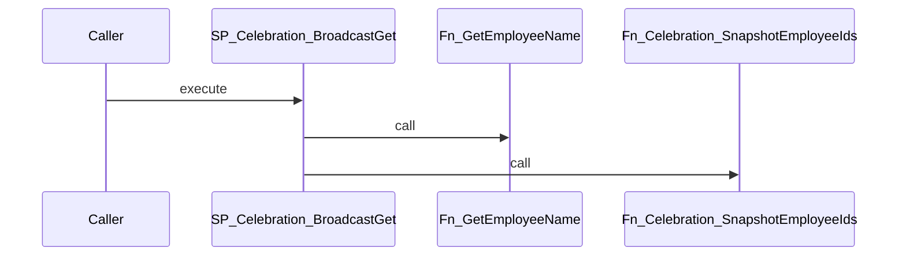
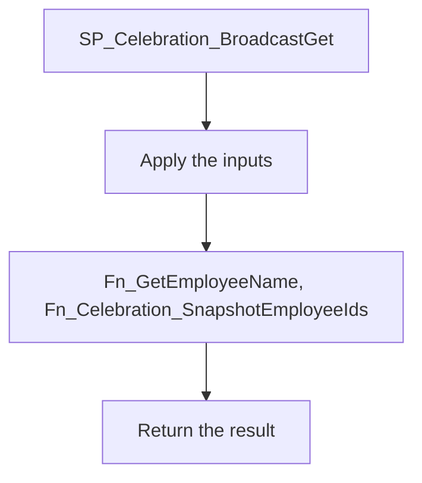

# SP_Celebration_BroadcastGet

## What it does

Returns one broadcast detail row for edit, view, or post-create/update reload.

## Parameters

| Name | Direction | What it is for |
|---|---|---|
| `@EmployerId` | in | Input (`INT`) |
| `@BroadcastId` | in | Input (`INT`) |
| `@ActorEmployeeId` | in | Input (`INT`) |

## Call sequence

## Callers

| Object | Kind | Page |
|---|---|---|
| `SP_Celebration_BroadcastCreate` | procedure | [SP_Celebration_BroadcastCreate](/docs/database/hrms/SP_Celebration_BroadcastCreate) |
| `SP_Celebration_BroadcastLimitedEdit` | procedure | [SP_Celebration_BroadcastLimitedEdit](/docs/database/hrms/SP_Celebration_BroadcastLimitedEdit) |
| `SP_Celebration_BroadcastReschedule` | procedure | No page yet |
| `SP_Celebration_BroadcastUpdate` | procedure | [SP_Celebration_BroadcastUpdate](/docs/database/hrms/SP_Celebration_BroadcastUpdate) |

## Nested

| Object | Kind | When | Page |
|---|---|---|---|
| `Fn_GetEmployeeName` | function | Called while this object runs | [Fn_GetEmployeeName](/docs/database/hrms/Fn_GetEmployeeName) |
| `Fn_Celebration_SnapshotEmployeeIds` | function | Called while this object runs | [Fn_Celebration_SnapshotEmployeeIds](/docs/database/hrms/Fn_Celebration_SnapshotEmployeeIds) |

## Steps

In `HRMS-DATABASE/HRMS/STOREPROCEDURE/161632/SP_Celebration_BroadcastGet.sql`:

1. Returns one broadcast detail row for edit, view, or post-create/update reload.
2. May return a validation `ResultCode` / `Message` result set instead of mutating when inputs fail checks.

## Tables

| Table | Read or write |
|---|---|
| `TCelebrationBroadcast` | read |
| `TCelebrationBroadcastAudience` | read |
| `TCelebrationSeen` | read |
| `TEmployee` | read |
| `TEmployeeInfo` | read |
| `TTitle` | read |
| `TOrgHierarchyDetails` | read |
| `TCelebrationSettings` | read |
| `TCelebrationBroadcastAudienceSnapshot` | read |

## Flow

