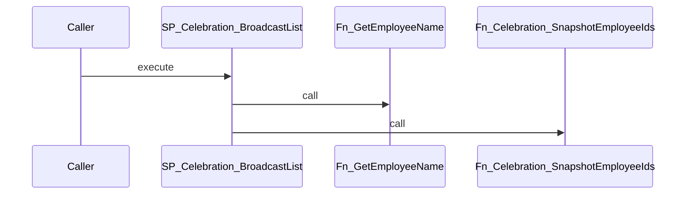
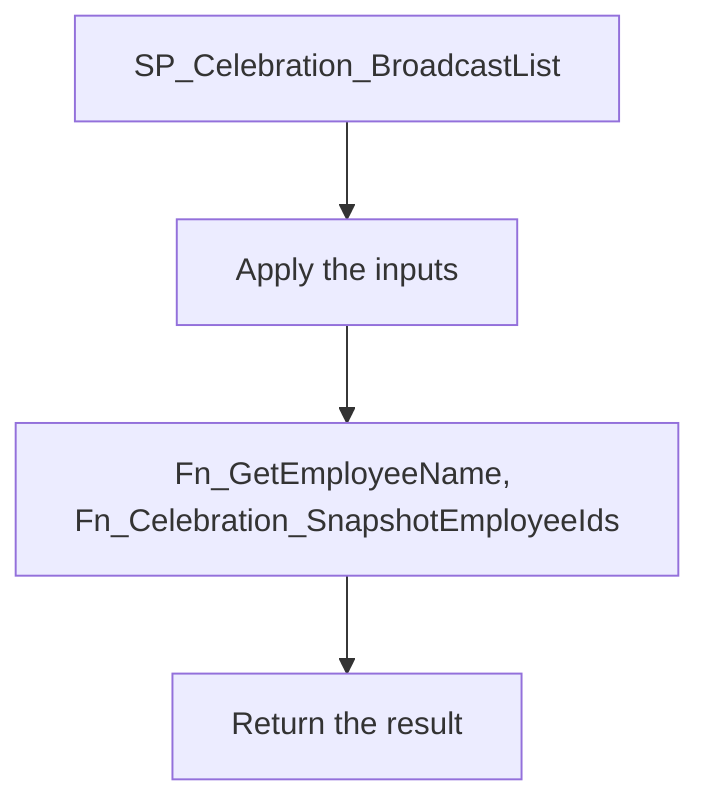

# SP_Celebration_BroadcastList

## What it does

Paged list of celebration broadcasts for the hub Broadcasts tab, with filters and creator visibility.

## Parameters

| Name | Direction | What it is for |
|---|---|---|
| `@EmployerId` | in | Input (`INT`) |
| `@ActorEmployeeId` | in | Input (`INT`) |
| `@CategoryCode` | in | Input (`VARCHAR(30)`) |
| `@Status` | in | Input (`VARCHAR(20)`) |
| `@CreatedBy` | in | Input (`INT`) |
| `@MineOnly` | in | Input (`BIT`) |
| `@Search` | in | Input (`NVARCHAR(100)`) |
| `@CategoryCodes` | in | Input (`NVARCHAR(500)`) |
| `@Statuses` | in | Input (`NVARCHAR(200)`) |
| `@CreatedByFilter` | in | Input (`NVARCHAR(500)`) |
| `@Page` | in | Input (`INT`) |
| `@PageSize` | in | Input (`INT`) |

## Call sequence

## Callers

No other procedure or function under STOREPROCEDURE or FUNCTIONS executes this object.

## Nested

| Object | Kind | When | Page |
|---|---|---|---|
| `Fn_GetEmployeeName` | function | Called while this object runs | [Fn_GetEmployeeName](/docs/database/hrms/Fn_GetEmployeeName) |
| `Fn_Celebration_SnapshotEmployeeIds` | function | Called while this object runs | [Fn_Celebration_SnapshotEmployeeIds](/docs/database/hrms/Fn_Celebration_SnapshotEmployeeIds) |

## Steps

In `HRMS-DATABASE/HRMS/STOREPROCEDURE/161632/SP_Celebration_BroadcastList.sql`:

1. Paged list of celebration broadcasts for the hub Broadcasts tab, with filters and creator visibility.

## Tables

| Table | Read or write |
|---|---|
| `TCelebrationCategory` | read |
| `TCelebrationComment` | read |
| `TCelebrationReaction` | read |
| `TCelebrationBroadcast` | read |
| `TEmployee` | read |
| `TEmployeeInfo` | read |
| `TCelebrationSeen` | read |
| `TCelebrationSettings` | read |
| `TCelebrationBroadcastAudienceSnapshot` | read |

## Flow

