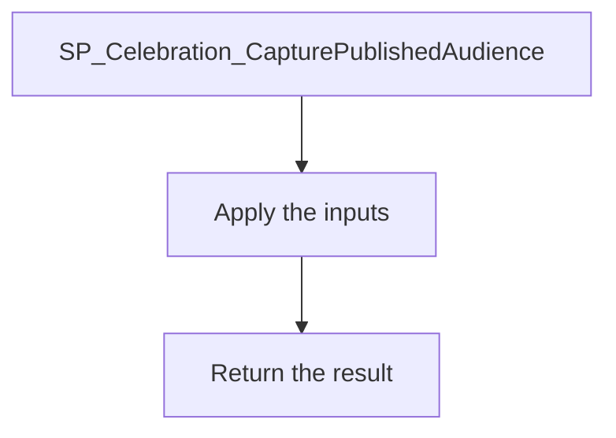

# SP_Celebration_CapturePublishedAudience

## What it does

Materializes the published audience snapshot for a broadcast that is going live.

## Parameters

| Name | Direction | What it is for |
|---|---|---|
| `@EmployerId` | in | Input (`INT`) |
| `@BroadcastId` | in | Input (`INT`) |

## Call sequence

Calls no other procedures or functions.

## Callers

| Object | Kind | Page |
|---|---|---|
| `SP_Celebration_BroadcastCreate` | procedure | [SP_Celebration_BroadcastCreate](/docs/database/hrms/SP_Celebration_BroadcastCreate) |
| `SP_Celebration_BroadcastUpdate` | procedure | [SP_Celebration_BroadcastUpdate](/docs/database/hrms/SP_Celebration_BroadcastUpdate) |
| `SP_Celebration_PublishOrCancel` | procedure | No page yet |

## Nested

Calls no other procedures or functions.

## Steps

In `HRMS-DATABASE/HRMS/STOREPROCEDURE/161632/SP_Celebration_CapturePublishedAudience.sql`:

1. Materializes the published audience snapshot for a broadcast that is going live.

## Tables

| Table | Read or write |
|---|---|
| `TCelebrationBroadcast` | read |
| `TCelebrationBroadcastAudienceSnapshot` | write |
| `TEmployee` | read |
| `TEmployeeInfo` | read |
| `TCelebrationBroadcastAudience` | read |

## Flow

