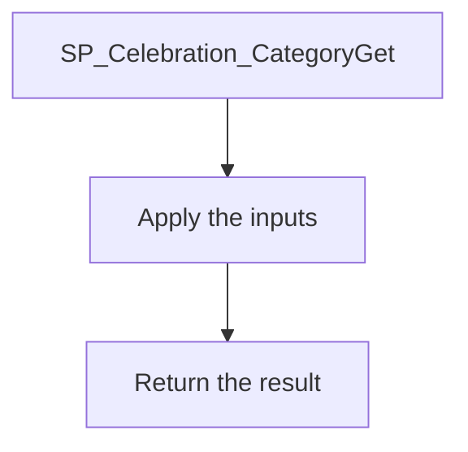

# SP_Celebration_CategoryGet

## What it does

Returns celebration category rows for an employer (enabled flags, labels, auto-posting).

## Parameters

| Name | Direction | What it is for |
|---|---|---|
| `@EmployerId` | in | Input (`INT`) |

## Call sequence

Calls no other procedures or functions.

## Callers

| Object | Kind | Page |
|---|---|---|
| `SP_Celebration_CategoryUpsertAutoPosting` | procedure | No page yet |
| `SP_Celebration_CategoryUpsertManual` | procedure | No page yet |
| `SP_Celebration_CategoryUpsertMilestone` | procedure | No page yet |

## Nested

Calls no other procedures or functions.

## Steps

In `HRMS-DATABASE/HRMS/STOREPROCEDURE/161632/SP_Celebration_CategoryGet.sql`:

1. Returns celebration category rows for an employer (enabled flags, labels, auto-posting).

## Tables

| Table | Read or write |
|---|---|
| `TCelebrationCategory` | read |
| `TCelebrationTemplate` | read |

## Flow

