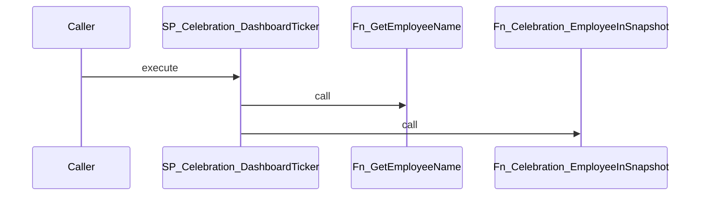
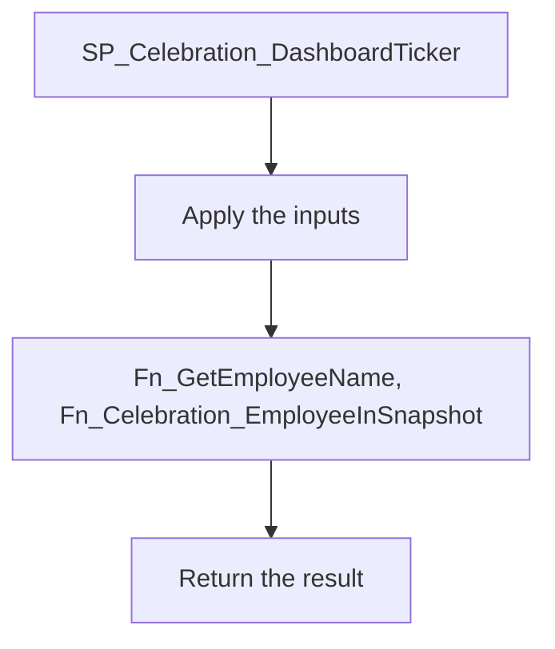

# SP_Celebration_DashboardTicker

## What it does

Returns today's celebration milestones for the header ticker: birthdays, anniversaries, and other broadcasts the employee is in the audience for.

## Parameters

| Name | Direction | What it is for |
|---|---|---|
| `@EmployerId` | in | Employer that owns the data (`INT`) |
| `@ActorEmployeeId` | in | Signed-in employee reading the feed or ticker (`INT`) |
| `@AsOfDate` | in | Organisation-local date the ticker is evaluated for (`DATE`) |

## Call sequence

## Callers

No other procedure or function under STOREPROCEDURE or FUNCTIONS executes this object.

## Nested

| Object | Kind | When | Page |
|---|---|---|---|
| `Fn_GetEmployeeName` | function | Called while this object runs | [Fn_GetEmployeeName](/docs/database/hrms/Fn_GetEmployeeName) |
| `Fn_Celebration_EmployeeInSnapshot` | function | Called while this object runs | [Fn_Celebration_EmployeeInSnapshot](/docs/database/hrms/Fn_Celebration_EmployeeInSnapshot) |

## Steps

In `HRMS-DATABASE/HRMS/STOREPROCEDURE/179082/SP_Celebration_DashboardTicker.sql`:

1. Returns today's celebration milestones for the header ticker: birthdays, anniversaries, and other broadcasts the employee is in the audience for.

## Tables

| Table | Read or write |
|---|---|
| `TEmployee` | read |
| `TEmployeeInfo` | read |
| `TCelebrationBroadcast` | read |
| `TOrgHierarchyDetails` | read |
| `TLocation` | read |
| `TCelebrationCategory` | read |
| `TCelebrationBroadcastAudienceSnapshot` | read |
| `TCelebrationBroadcastAudience` | read |

## Flow

