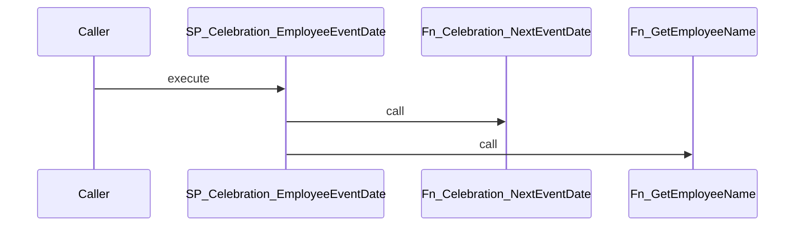
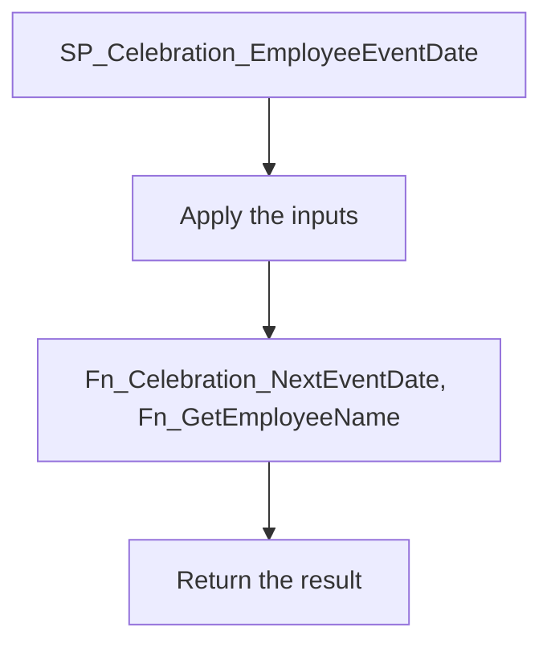

# SP_Celebration_EmployeeEventDate

## What it does

Resolves the next event date and display name for a milestone employee and category.

## Parameters

| Name | Direction | What it is for |
|---|---|---|
| `@EmployerId` | in | Input (`INT`) |
| `@EmployeeId` | in | Input (`INT`) |
| `@CategoryCode` | in | Input (`VARCHAR(30)`) |
| `@AsOfDate` | in | Input (`DATE`) |

## Call sequence

## Callers

No other procedure or function under STOREPROCEDURE or FUNCTIONS executes this object.

## Nested

| Object | Kind | When | Page |
|---|---|---|---|
| `Fn_Celebration_NextEventDate` | function | Called while this object runs | [Fn_Celebration_NextEventDate](/docs/database/hrms/Fn_Celebration_NextEventDate) |
| `Fn_GetEmployeeName` | function | Called while this object runs | [Fn_GetEmployeeName](/docs/database/hrms/Fn_GetEmployeeName) |

## Steps

In `HRMS-DATABASE/HRMS/STOREPROCEDURE/161632/SP_Celebration_EmployeeEventDate.sql`:

1. Resolves the next event date and display name for a milestone employee and category.
2. May return a validation `ResultCode` / `Message` result set instead of mutating when inputs fail checks.

## Tables

| Table | Read or write |
|---|---|
| `TEmployee` | read |
| `TEmployeeInfo` | read |
| `TTitle` | read |
| `TOrgHierarchyDetails` | read |
| `TLocation` | read |

## Flow

