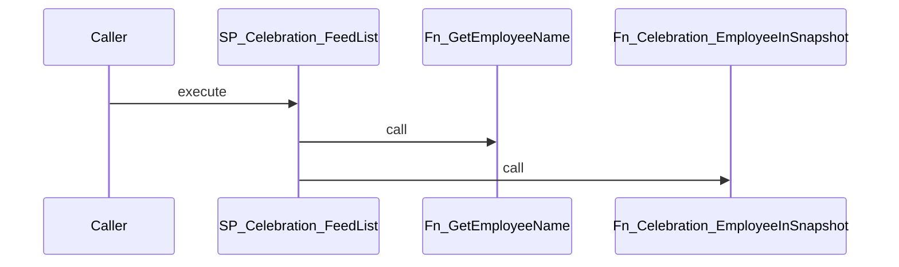
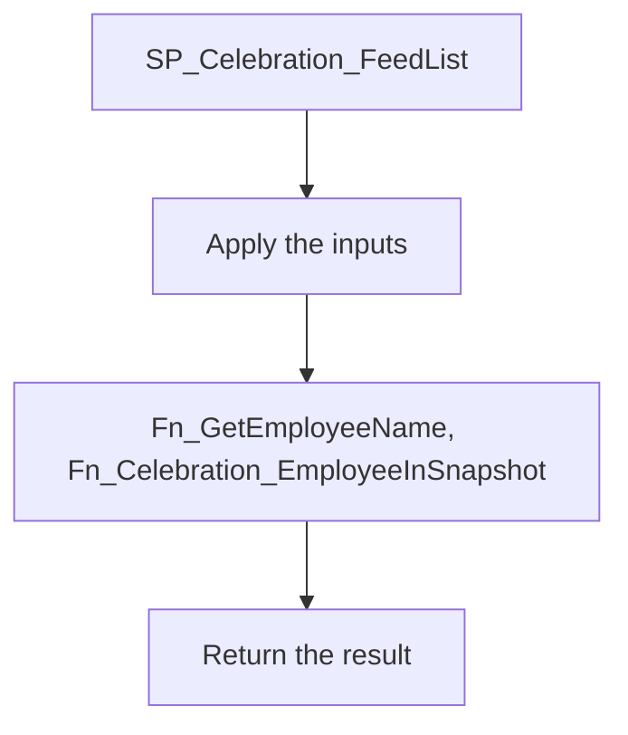

# SP_Celebration_FeedList

## What it does

Returns one page of the Celebrations feed on Home, filtered by category, sort, search, and the about-me flag, for broadcasts the employee may see.

## Parameters

| Name | Direction | What it is for |
|---|---|---|
| `@EmployerId` | in | Employer that owns the data (`INT`) |
| `@ActorEmployeeId` | in | Signed-in employee reading the feed or ticker (`INT`) |
| `@CategoryCode` | in | Optional celebration category filter (`VARCHAR(30)`) |
| `@Sort` | in | Feed sort (`VARCHAR(20)`) |
| `@Search` | in | Optional feed search text (`NVARCHAR(100)`) |
| `@AboutMe` | in | 1 when the feed is limited to the signed-in employee (`BIT`) |
| `@Page` | in | Feed page (`INT`) |
| `@PageSize` | in | Page size for the list. Empty uses the procedure default (`INT`) |

## Call sequence

## Callers

No other procedure or function under STOREPROCEDURE or FUNCTIONS executes this object.

## Nested

| Object | Kind | When | Page |
|---|---|---|---|
| `Fn_GetEmployeeName` | function | Called while this object runs | [Fn_GetEmployeeName](/docs/database/hrms/Fn_GetEmployeeName) |
| `Fn_Celebration_EmployeeInSnapshot` | function | Called while this object runs | [Fn_Celebration_EmployeeInSnapshot](/docs/database/hrms/Fn_Celebration_EmployeeInSnapshot) |

## Steps

In `HRMS-DATABASE/HRMS/STOREPROCEDURE/161632/SP_Celebration_FeedList.sql`:

1. Returns one page of the Celebrations feed on Home, filtered by category, sort, search, and the about-me flag, for broadcasts the employee may see.

## Tables

| Table | Read or write |
|---|---|
| `TEmployee` | read |
| `TEmployeeInfo` | read |
| `TCelebrationComment` | read |
| `TCelebrationReaction` | read |
| `TCelebrationAttachment` | read |
| `TCelebrationBroadcast` | read |
| `TCelebrationSeen` | read |
| `TCelebrationWish` | read |
| `TTitle` | read |
| `TOrgHierarchyDetails` | read |
| `TCelebrationBroadcastAudienceSnapshot` | read |
| `TCelebrationBroadcastAudience` | read |

## Flow

