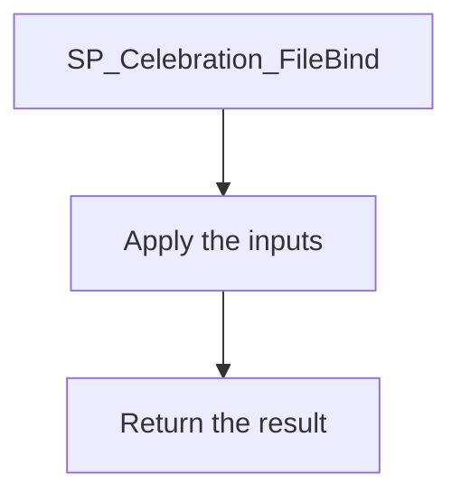

# SP_Celebration_FileBind

## What it does

Binds uploaded file ids to a broadcast, wish, or template owner.

## Parameters

| Name | Direction | What it is for |
|---|---|---|
| `@EmployerId` | in | Input (`INT`) |
| `@ActorEmployeeId` | in | Input (`INT`) |
| `@FileId` | in | Input (`INT`) |
| `@OwnerType` | in | Input (`VARCHAR(20)`) |
| `@OwnerId` | in | Input (`INT`) |

## Call sequence

Calls no other procedures or functions.

## Callers

No other procedure or function under STOREPROCEDURE or FUNCTIONS executes this object.

## Nested

Calls no other procedures or functions.

## Steps

In `HRMS-DATABASE/HRMS/STOREPROCEDURE/161632/SP_Celebration_FileBind.sql`:

1. Binds uploaded file ids to a broadcast, wish, or template owner.
2. May return a validation `ResultCode` / `Message` result set instead of mutating when inputs fail checks.

## Tables

| Table | Read or write |
|---|---|
| `TCelebrationAttachment` | write |

## Flow

