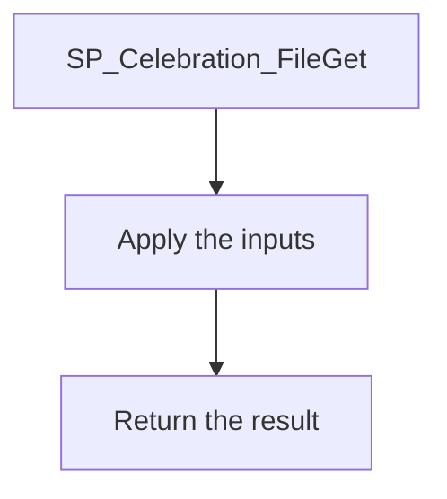

# SP_Celebration_FileGet

## What it does

Returns one celebration file row by id for download or preview.

## Parameters

| Name | Direction | What it is for |
|---|---|---|
| `@EmployerId` | in | Input (`INT`) |
| `@FileId` | in | Input (`INT`) |

## Call sequence

Calls no other procedures or functions.

## Callers

No other procedure or function under STOREPROCEDURE or FUNCTIONS executes this object.

## Nested

Calls no other procedures or functions.

## Steps

In `HRMS-DATABASE/HRMS/STOREPROCEDURE/161632/SP_Celebration_FileGet.sql`:

1. Returns one celebration file row by id for download or preview.

## Tables

| Table | Read or write |
|---|---|
| `TCelebrationAttachment` | read |

## Flow

