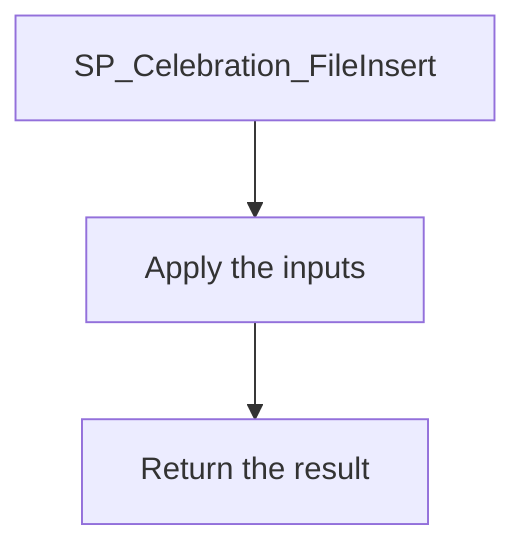

# SP_Celebration_FileInsert

## What it does

Inserts a celebration file metadata row (attachment, avatar, or background) before disk storage is bound by the API.

## Parameters

| Name | Direction | What it is for |
|---|---|---|
| `@EmployerId` | in | Input (`INT`) |
| `@ActorEmployeeId` | in | Input (`INT`) |
| `@OwnerType` | in | Input (`VARCHAR(20)`) |
| `@OwnerId` | in | Input (`INT`) |
| `@Kind` | in | Input (`VARCHAR(20)`) |
| `@OriginalName` | in | Input (`NVARCHAR(260)`) |
| `@StoredFileName` | in | Input (`NVARCHAR(260)`) |
| `@FilePath` | in | Input (`NVARCHAR(500)`) |
| `@ContentType` | in | Input (`VARCHAR(100)`) |
| `@SizeBytes` | in | Input (`BIGINT`) |

## Call sequence

Calls no other procedures or functions.

## Callers

No other procedure or function under STOREPROCEDURE or FUNCTIONS executes this object.

## Nested

Calls no other procedures or functions.

## Steps

In `HRMS-DATABASE/HRMS/STOREPROCEDURE/161632/SP_Celebration_FileInsert.sql`:

1. Inserts a celebration file metadata row (attachment, avatar, or background) before disk storage is bound by the API.

## Tables

| Table | Read or write |
|---|---|
| `TCelebrationAttachment` | write |

## Flow

