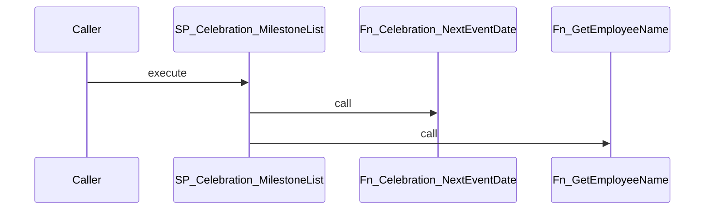
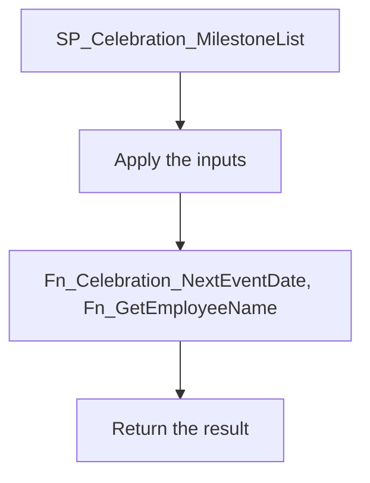

# SP_Celebration_MilestoneList

## What it does

Upcoming milestone cards (birthday / work anniversary) for the Upcoming tab.

## Parameters

| Name | Direction | What it is for |
|---|---|---|
| `@EmployerId` | in | Input (`INT`) |
| `@AsOfDate` | in | Input (`DATE`) |
| `@CategoryCode` | in | Input (`VARCHAR(30)`) |
| `@Search` | in | Input (`NVARCHAR(100)`) |
| `@ActorEmployeeId` | in | Input (`INT`) |

## Call sequence

## Callers

| Object | Kind | Page |
|---|---|---|
| `SP_Celebration_MilestoneQuickReference` | procedure | [SP_Celebration_MilestoneQuickReference](/docs/database/hrms/SP_Celebration_MilestoneQuickReference) |

## Nested

| Object | Kind | When | Page |
|---|---|---|---|
| `Fn_Celebration_NextEventDate` | function | Called while this object runs | [Fn_Celebration_NextEventDate](/docs/database/hrms/Fn_Celebration_NextEventDate) |
| `Fn_GetEmployeeName` | function | Called while this object runs | [Fn_GetEmployeeName](/docs/database/hrms/Fn_GetEmployeeName) |

## Steps

In `HRMS-DATABASE/HRMS/STOREPROCEDURE/161632/SP_Celebration_MilestoneList.sql`:

1. Upcoming milestone cards (birthday / work anniversary) for the Upcoming tab.

## Tables

| Table | Read or write |
|---|---|
| `TCelebrationCategory` | read |
| `TEmployee` | read |
| `TEmployeeInfo` | read |
| `TTitle` | read |
| `TOrgHierarchyDetails` | read |
| `TLocation` | read |
| `TCelebrationBroadcast` | read |
| `TCelebrationWish` | read |

## Flow

