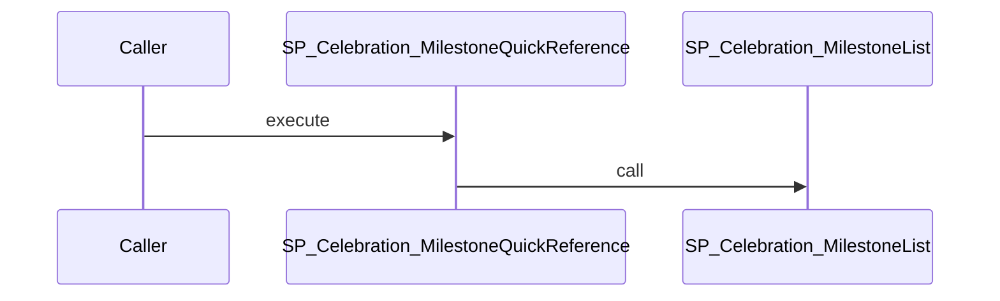
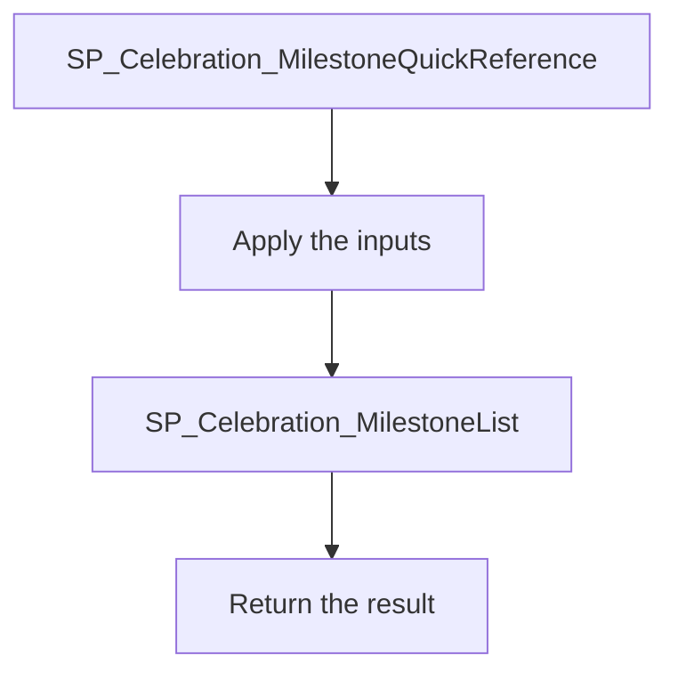

# SP_Celebration_MilestoneQuickReference

## What it does

Thin wrapper that returns the quick-reference milestone list via MilestoneList.

## Parameters

| Name | Direction | What it is for |
|---|---|---|
| `@EmployerId` | in | Input (`INT`) |
| `@AsOfDate` | in | Input (`DATE`) |
| `@ActorEmployeeId` | in | Input (`INT`) |

## Call sequence

## Callers

No other procedure or function under STOREPROCEDURE or FUNCTIONS executes this object.

## Nested

| Object | Kind | When | Page |
|---|---|---|---|
| `SP_Celebration_MilestoneList` | procedure | Called while this object runs | [SP_Celebration_MilestoneList](/docs/database/hrms/SP_Celebration_MilestoneList) |

## Steps

In `HRMS-DATABASE/HRMS/STOREPROCEDURE/161632/SP_Celebration_MilestoneQuickReference.sql`:

1. Thin wrapper that returns the quick-reference milestone list via MilestoneList.

## Tables

No base tables referenced (expression-only or pass-through).

## Flow

