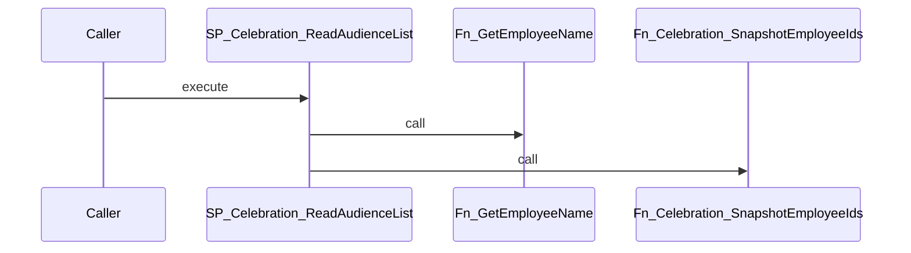
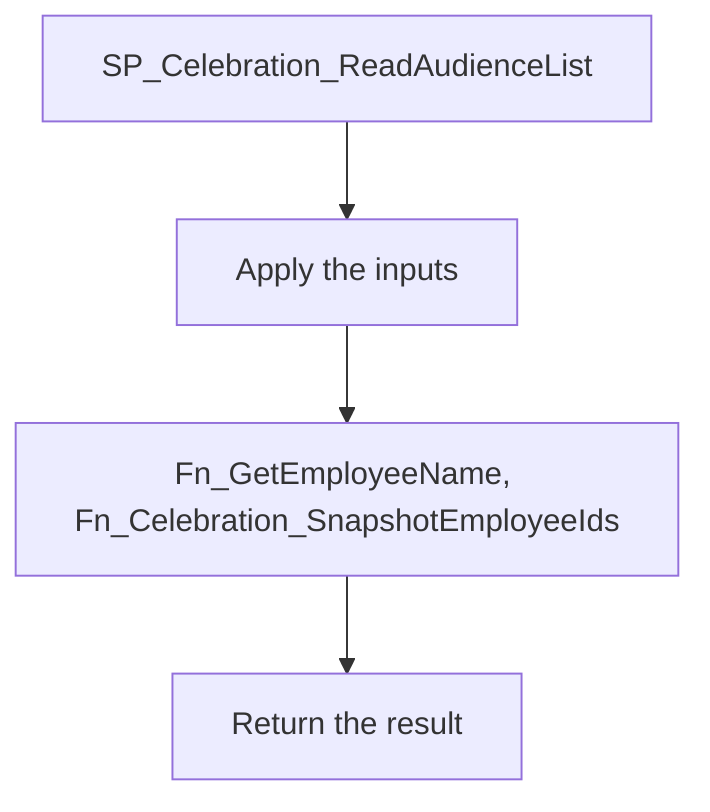

# SP_Celebration_ReadAudienceList

## What it does

Lists Acknowledged or Pending employees for a mandatory-read published broadcast.

## Parameters

| Name | Direction | What it is for |
|---|---|---|
| `@EmployerId` | in | Input (`INT`) |
| `@BroadcastId` | in | Input (`INT`) |
| `@Bucket` | in | Input (`NVARCHAR(20)`) |
| `@Search` | in | Input (`NVARCHAR(100)`) |

## Call sequence

## Callers

No other procedure or function under STOREPROCEDURE or FUNCTIONS executes this object.

## Nested

| Object | Kind | When | Page |
|---|---|---|---|
| `Fn_GetEmployeeName` | function | Called while this object runs | [Fn_GetEmployeeName](/docs/database/hrms/Fn_GetEmployeeName) |
| `Fn_Celebration_SnapshotEmployeeIds` | function | Called while this object runs | [Fn_Celebration_SnapshotEmployeeIds](/docs/database/hrms/Fn_Celebration_SnapshotEmployeeIds) |

## Steps

In `HRMS-DATABASE/HRMS/STOREPROCEDURE/161632/SP_Celebration_ReadAudienceList.sql`:

1. Lists Acknowledged or Pending employees for a mandatory-read published broadcast.
2. May return a validation `ResultCode` / `Message` result set instead of mutating when inputs fail checks.

## Tables

| Table | Read or write |
|---|---|
| `TCelebrationBroadcastAudienceSnapshot` | read |
| `TEmployeeInfo` | read |
| `TCelebrationSeen` | read |

## Flow

