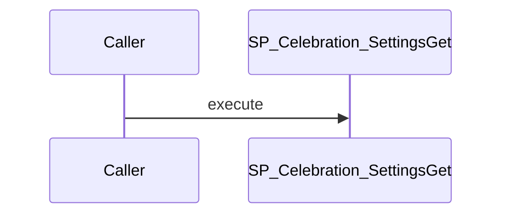
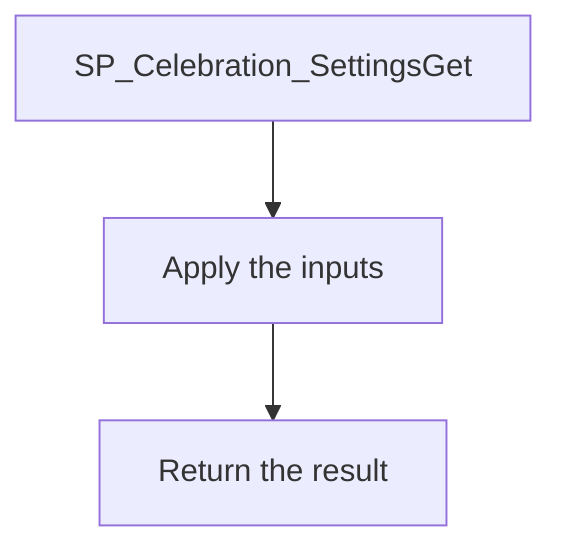

# SP_Celebration_SettingsGet

## What it does

Returns the employer's Celebrations Hub settings row. The feed and the ticker both load this before they apply timezone and feature flags. No row means an empty result; this procedure does not insert a default.

## Parameters

| Name | Direction | What it is for |
|---|---|---|
| `@EmployerId` | in | Employer that owns the data (`INT`) |

## Call sequence

## Callers

| Object | Kind | Page |
|---|---|---|
| `SP_Celebration_SettingsUpsertAutoPosting` | procedure | No page yet |
| `SP_Celebration_SettingsUpsertBehaviour` | procedure | No page yet |
| `SP_Celebration_SettingsWebDomainUpsert` | procedure | No page yet |

## Nested

This object does not execute another procedure or user-defined function.

## Steps

In `HRMS-DATABASE/HRMS/STOREPROCEDURE/161632/SP_Celebration_SettingsGet.sql`:

1. Returns the employer's Celebrations Hub settings row.
2. The feed and the ticker both load this before they apply timezone and feature flags.
3. No row means an empty result; this procedure does not insert a default.

## Tables

| Table | Read or write |
|---|---|
| `TCelebrationSettings` | read |

## Flow

