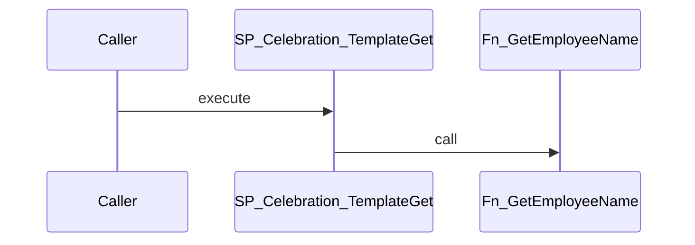
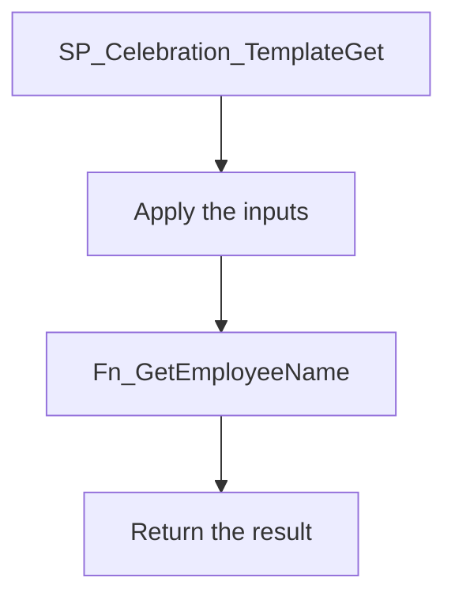

# SP_Celebration_TemplateGet

## What it does

Returns one template with snapshot fields for the wizard preview.

## Parameters

| Name | Direction | What it is for |
|---|---|---|
| `@EmployerId` | in | Input (`INT`) |
| `@TemplateId` | in | Input (`INT`) |

## Call sequence

## Callers

No other procedure or function under STOREPROCEDURE or FUNCTIONS executes this object.

## Nested

| Object | Kind | When | Page |
|---|---|---|---|
| `Fn_GetEmployeeName` | function | Called while this object runs | [Fn_GetEmployeeName](/docs/database/hrms/Fn_GetEmployeeName) |

## Steps

In `HRMS-DATABASE/HRMS/STOREPROCEDURE/161632/SP_Celebration_TemplateGet.sql`:

1. Returns one template with snapshot fields for the wizard preview.

## Tables

| Table | Read or write |
|---|---|
| `TCelebrationTemplateAudience` | read |
| `TCelebrationTemplate` | read |
| `TEmployeeInfo` | read |

## Flow

