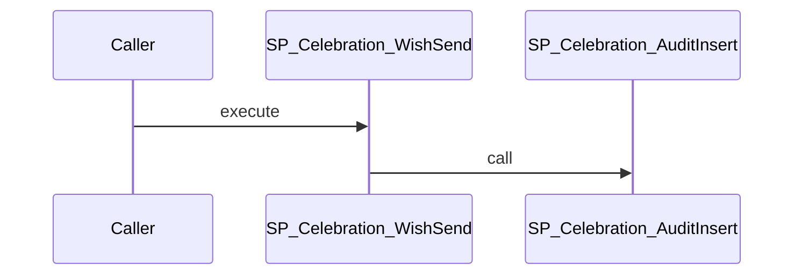
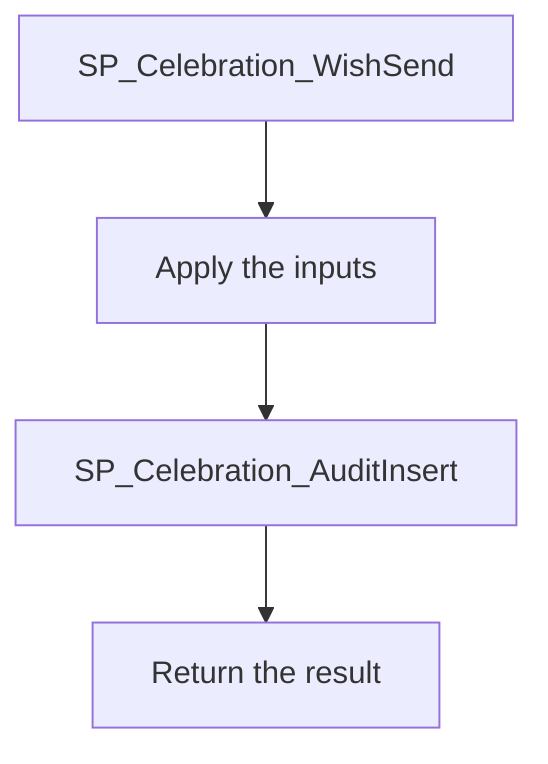

# SP_Celebration_WishSend

## What it does

Inserts a personal wish for a milestone recipient, audits, and reports whether it was already sent.

## Parameters

| Name | Direction | What it is for |
|---|---|---|
| `@EmployerId` | in | Input (`INT`) |
| `@SenderEmployeeId` | in | Input (`INT`) |
| `@RecipientEmployeeId` | in | Input (`INT`) |
| `@BroadcastId` | in | Input (`INT`) |
| `@CategoryCode` | in | Input (`VARCHAR(30)`) |
| `@EventDate` | in | Input (`DATE`) |
| `@Subject` | in | Input (`NVARCHAR(300)`) |
| `@BodyText` | in | Input (`NVARCHAR(MAX)`) |

## Call sequence

## Callers

No other procedure or function under STOREPROCEDURE or FUNCTIONS executes this object.

## Nested

| Object | Kind | When | Page |
|---|---|---|---|
| `SP_Celebration_AuditInsert` | procedure | Called while this object runs | [SP_Celebration_AuditInsert](/docs/database/hrms/SP_Celebration_AuditInsert) |

## Steps

In `HRMS-DATABASE/HRMS/STOREPROCEDURE/161632/SP_Celebration_WishSend.sql`:

1. Inserts a personal wish for a milestone recipient, audits, and reports whether it was already sent.
3. Calls `SP_Celebration_AuditInsert` after a successful mutation.

## Tables

| Table | Read or write |
|---|---|
| `TCelebrationBroadcast` | read |
| `TCelebrationWish` | write |

## Flow

