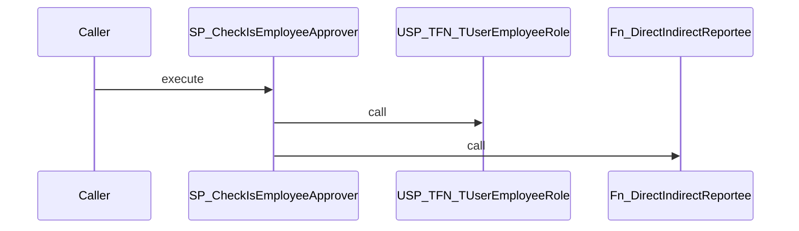
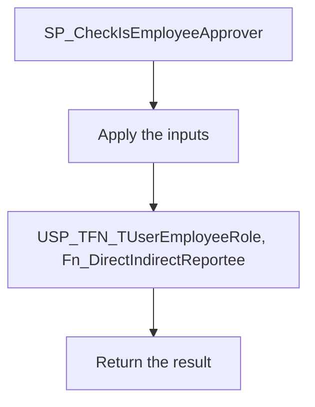

# SP_CheckIsEmployeeApprover

## What it does

Tells the Home dashboard whether the signed-in employee should see team widgets. It reads the employee's role and whether anyone else reports to them, then returns IsApprover as 1 or 0.

## Parameters

| Name | Direction | What it is for |
|---|---|---|
| `@EmployerID` | in | Declared on the procedure and passed by the API. The procedure body does not read it (`INT`) |
| `@EmployeeID` | in | Employee the Home screen is loading or acting for (`INT`) |

## Call sequence

## Callers

No other procedure or function under STOREPROCEDURE or FUNCTIONS executes this object.

## Nested

| Object | Kind | When | Page |
|---|---|---|---|
| `USP_TFN_TUserEmployeeRole` | function | Called while this object runs | [USP_TFN_TUserEmployeeRole](/docs/database/hrms/USP_TFN_TUserEmployeeRole) |
| `Fn_DirectIndirectReportee` | function | Called while this object runs | [Fn_DirectIndirectReportee](/docs/database/hrms/Fn_DirectIndirectReportee) |

## Steps

In `HRMS-DATABASE/HRMS/STOREPROCEDURE/SP_CheckIsEmployeeApprover.sql`:

1. Tells the Home dashboard whether the signed-in employee should see team widgets.
2. It reads the employee's role and whether anyone else reports to them, then returns IsApprover as 1 or 0.

## Tables

No permanent table is read or written. The result comes from parameters, functions, or table variables.

## Flow

