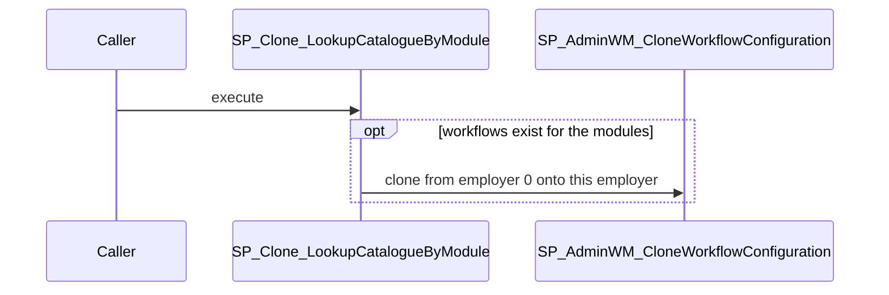
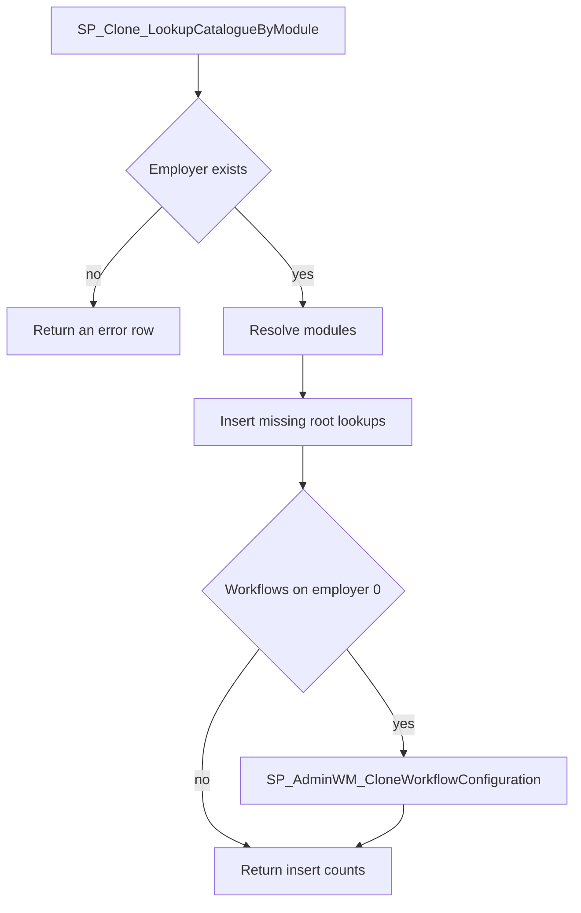

# SP_Clone_LookupCatalogueByModule

## What it does

Seeds root lookup values for one employer, limited to the modules named in @ModuleIds or, when that list is blank, the modules on TEmployerModule. Child lookup values are not copied. Existing employer and lookup-id pairs are left in place. When employer 0 has workflows for those modules, it clones them with SP_AdminWM_CloneWorkflowConfiguration. Training, travel, timeport, and conference-room lookups are written through synonyms.

## Parameters

| Name | Direction | What it is for |
|---|---|---|
| `@EmployerId` | in | Employer that receives the catalogue |
| `@ModuleIds` | in | Module id csv. Null uses TEmployerModule for this employer |

## Call sequence

## Callers

Procedures and functions that call this object.

| Object | Kind | Page |
|---|---|---|
| `USP_OTD_ApplyDefaultsForEmployer` | procedure | [USP_OTD_ApplyDefaultsForEmployer](/docs/database/hrms/USP_OTD_ApplyDefaultsForEmployer) |

## Nested

| Object | Kind | When | Page |
|---|---|---|
| `SP_AdminWM_CloneWorkflowConfiguration` | procedure | employer 0 has workflows for the selected modules | No page yet |

## Steps

1. Return an ErrorMessage result when the employer id is missing or the employer does not exist.

2. Fill the module list from the csv, or from TEmployerModule when the csv is blank.

3. Insert missing root lookup rows into TLOOKUP, TQuestion_LOOKUP, TLookup_TRAINING, TLookup_TRAVELNEXPENSE, TLookup_TIMEPORT, and TLookup_CRBOOKING for the mapped lookup ids. Each insert is guarded by NOT EXISTS.

4. Collect workflow ids on employer 0 for those modules and, when any exist, execute SP_AdminWM_CloneWorkflowConfiguration from employer 0 onto this employer with email templates cloned.

5. Return Target and RowsInserted for each catalogue that was written.

## Tables

| Table | Read or write |
|---|---|
| `TemployerDetails` | read |
| `TEmployerModule` | read |
| `TLOOKUP` | read and write |
| `TQuestion_LOOKUP` | read and write |
| `TLookup_TRAINING` | write |
| `TLookup_TRAVELNEXPENSE` | write |
| `TLookup_TIMEPORT` | write |
| `TLookup_CRBOOKING` | write |
| `TWorkflowManagement` | read |

## Flow

