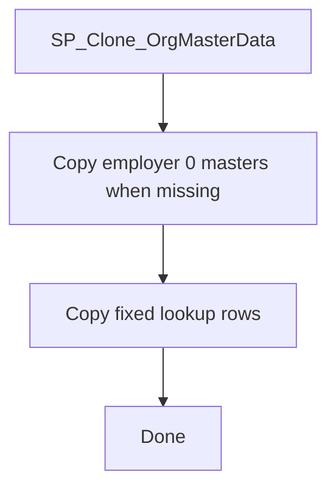

# SP_Clone_OrgMasterData

## What it does

Copies starter master data onto a new employer from employer 0 and from a few fixed lookup ids. Inserts are guarded so a matching row that already exists for the new employer is left in place. The procedure does not execute another procedure.

## Parameters

| Name | Direction | What it is for |
|---|---|---|
| `@EmployerId` | in | Employer that receives the copied rows |

## Call sequence

Calls no other procedures or functions.

## Callers

Procedures and functions that call this object.

| Object | Kind | Page |
|---|---|---|
| `SP_AdminORG_AddEmployerDet` | procedure | [SP_AdminORG_AddEmployerDet](/docs/database/hrms/SP_AdminORG_AddEmployerDet) |

## Nested

Calls no other procedures or functions.

## Steps

1. Insert attendance modes, employment types, relationships, recruitment reasons and sources, interview levels, separation reasons, notice-period types, employer modules, and resignation date types from employer 0 when the new employer does not already have the matching row.

2. Insert lookup rows into TLOOKUP, TQuestion_LOOKUP, TLookup_TRAVELNEXPENSE, and TLookup_TRAINING, including survey category 103 and emoji rating 2008 and their module mappings.

3. Insert onboarding template categories, expertise, rating masters, homepage preferences, email templates, chart preferences, birthday and anniversary quotes, welcome mail, languages, religions, grid-column config, and reason-comment config.

## Tables

| Table | Read or write |
|---|---|
| `tAttendanceCaptureMode` | read and write |
| `TMEmploymentTypes` | read and write |
| `TEmergencyRelationship` | read and write |
| `THiringReason` | read and write |
| `TBillingType` | read and write |
| `TCandidateSource` | read and write |
| `TInterviewLevel` | read and write |
| `TCancelledReason` | read and write |
| `TInterviewCancelledReason` | read and write |
| `TResignation` | read and write |
| `TSeparationType` | read and write |
| `TLOOKUP` | read and write |
| `tNoticePeriodTypes` | read and write |
| `TEmployerModule` | read and write |
| `TResignationDateTypeMaster` | read and write |
| `POBTemplateCategory` | read and write |
| `TExpertise` | read and write |
| `TQuestion_LOOKUP` | read and write |
| `TLookup_TRAVELNEXPENSE` | read and write |
| `TLookup_TRAINING` | read and write |
| `TRRSRatingMaster` | read and write |
| `TRRSRatingScaleDetails` | read and write |
| `tEmailTemplates` | read and write |
| `TChartPreferences` | read and write |
| `TEmpBirthdayQuote` | read and write |
| `TEmpWorkAnniversaryQuote` | read and write |
| `TEmpWelcomeMail` | read and write |
| `TGridColumnEmployerConfig` | read and write |
| `TReasonCommentsConfig` | read and write |
| `TReasonCommentsConfigModule` | read and write |

## Flow

