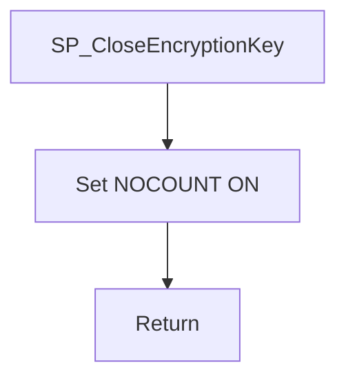

# SP_CloseEncryptionKey

## What it does

The procedure is the close-key step that callers run after work that used the encryption key. In `HRMS-DATABASE/HRMS/STOREPROCEDURE/SP_CloseEncryptionKey.sql` the symmetric-key close is commented out, so a call returns without closing a key and without a result set.

## Parameters

| Name | Direction | What it is for |
|---|---|---|
| — | — | The procedure takes no parameters |

## Call sequence

Calls no other procedures or functions.

## Callers

| Object | Kind | Page |
|---|---|---|
| `Alter_SP_RPT_EmpCheckInCheckOut` | procedure | No page yet |
| `dbo.usp_GetDataForEmailNotIfication.StoredProcedure` | procedure | No page yet |
| `HRMS_SP_GetEmployeeActualOfficeTimeInDateRangeHorizantal` | procedure | No page yet |
| `OV_Rule_LeaveAttendance_LateMark_Card` | procedure | No page yet |
| `ShowHierarchy` | procedure | No page yet |
| `SP_AddCompOffRequest` | procedure | No page yet |
| `SP_AddCompOffRequest_Mobile` | procedure | No page yet |
| `SP_AddEmployeePassportDetails` | procedure | No page yet |
| `SP_Admin_GetAllEmployeeDetails` | procedure | No page yet |
| `SP_Admin_GetAllEmployeeListByOrg` | procedure | No page yet |
| `SP_Admin_GetEmployeeByRoleId` | procedure | No page yet |
| `SP_AdminAM_GetAttendanceCategory` | procedure | No page yet |
| `Sp_AdminAM_GetTempCardDet` | procedure | No page yet |
| `Sp_AdminAM_InsTempCardDet` | procedure | No page yet |
| `Sp_AdminCMS_GetConfirmationReviewLevel` | procedure | No page yet |
| `SP_AdminCMS_SrchEmpForConfReAssign` | procedure | No page yet |
| `Sp_AdminEMP_CopyEmployee` | procedure | No page yet |
| `SP_AdminEMP_EmployeeSearch` | procedure | No page yet |
| `SP_AdminEMP_GetEmpListByOrg` | procedure | No page yet |
| `SP_AdminESS_GetVoucherAppEmpList` | procedure | No page yet |
| `SP_AdminESS_GetVouchers` | procedure | No page yet |
| `SP_AdminESS_GetVoucherTypes` | procedure | No page yet |
| `SP_AdminLM_GetLeaveBal` | procedure | No page yet |
| `SP_AdminLM_GetLeaveTypeRule` | procedure | No page yet |
| `SP_AdminLM_ValidateCompOffLeaveReq` | procedure | No page yet |
| `SP_AdminMS_GetJobSchedulerDet` | procedure | No page yet |
| `SP_AdminMstr_GetActivities` | procedure | No page yet |
| `SP_AdminMstr_GetNewsAndEvents` | procedure | No page yet |
| `Sp_AdminORG_GetEmpByUnit` | procedure | No page yet |
| `SP_AdminPMS_EmployeeAutoClosure` | procedure | No page yet |
| `SP_AdminPMS_EmployeeGoalSettingSearch` | procedure | No page yet |
| `SP_AdminPMS_EmployeeSearch` | procedure | No page yet |
| `SP_AdminPMS_GetEmpByAppraisalCycle` | procedure | No page yet |
| `SP_AdminPMS_GetEmpByAppraisalCyclePermission` | procedure | No page yet |
| `Sp_ADMINPMS_GetEmployeeDetailsByGoalID` | procedure | No page yet |
| `SP_ADMINPMS_GetEmployeeGoalFormDataForMe` | procedure | No page yet |
| `SP_ADMINPMS_GetEmployeeGoalSettingForMe` | procedure | No page yet |
| `Sp_AdminPMS_GetEmployeeReviewlevelData` | procedure | No page yet |
| `SP_AdminPMS_GetExistingAppraisalCycleTypes` | procedure | No page yet |
| `SP_AdminPMS_GetExistingAppraisalCycleTypesForFormStatus` | procedure | No page yet |
| `Sp_AdminPMS_GetGoalSettingReviewFrequency` | procedure | No page yet |
| `Sp_AdminPMS_GetGoalSettingReviewLevel` | procedure | No page yet |
| `Sp_AdminPMS_GetPendingAppList` | procedure | No page yet |
| `Sp_AdminPMS_GetPendingDesignationsForGoalSetting` | procedure | No page yet |
| `Sp_AdminPMS_GetPendingEmployeesForGoalSetting` | procedure | No page yet |
| `Sp_AdminPMS_GetPMSConfigureAutoClosureData` | procedure | No page yet |
| `SP_AdminPMS_GetSelfAppDetForExtract` | procedure | No page yet |
| `Sp_AdminPMS_GetWhatsAppAssessmentMappingData` | procedure | No page yet |
| `SP_AdminPMS_InsEmpAppraisalCycleMapping` | procedure | No page yet |
| `SP_AdminPMS_SrchEmpByAppraisalCycle` | procedure | No page yet |
| `SP_AdminPMS_SrchEmpByGoalPeriod` | procedure | No page yet |
| `SP_AdminRM_GetEmployeeListByOrg` | procedure | No page yet |
| `Sp_AdminRM_GetInterviewTemplate` | procedure | No page yet |
| `Sp_AdminRM_GetRecruiter` | procedure | No page yet |
| `Sp_AdminRM_GetRecruiterMstr` | procedure | No page yet |
| `Sp_AdminRM_GetRecruitmentAdminMaster` | procedure | No page yet |
| `SP_AdminRoleM_ChangeuserRole` | procedure | No page yet |
| `SP_AdminRoleM_GetEmpSumPermissionByRoleID` | procedure | No page yet |
| `SP_AdminRoleM_GetEmpSumPermissionHistByID` | procedure | No page yet |
| `SP_AdminRoleM_GetEmpSumPermissionMapHist` | procedure | No page yet |
| `Sp_AdminRoleM_GetRolePageMapHistByTransid` | procedure | No page yet |
| `Sp_AdminRoleM_GetUserAccMenuItemsHist` | procedure | No page yet |
| `Sp_AdminRoleM_GetUserPageMapHistByid` | procedure | No page yet |
| `SP_AdminRoleM_InsUserPageMap` | procedure | No page yet |
| `SP_AdminSCCT_GetChangesForApprByMe` | procedure | No page yet |
| `SP_AdminSCCT_GetChangesForApproval` | procedure | No page yet |
| `SP_AdminUM_CreateUser` | procedure | No page yet |
| `SP_AdminUM_GetActiveUserList` | procedure | No page yet |
| `SP_AdminUM_GETUserDetails` | procedure | No page yet |
| `Sp_ApproveRejectMyDetailsReview` | procedure | [Sp_ApproveRejectMyDetailsReview](/docs/database/hrms/Sp_ApproveRejectMyDetailsReview) |
| `sp_AR_RPT_ByCount` | procedure | No page yet |
| `SP_AverageActualWorkHoursDetailed` | procedure | No page yet |
| `SP_AverageActualWorkHoursSummary` | procedure | No page yet |
| `SP_BGV_GetAllActiveEmployee` | procedure | No page yet |
| `SP_BGV_GetEmployeeBGVDetails` | procedure | No page yet |
| `SP_BGV_GetHomePageVerificationDet` | procedure | No page yet |
| `SP_BGV_GetVerificationDet` | procedure | No page yet |
| `SP_BGV_GetVerificationViewDet` | procedure | No page yet |
| `Sp_BGV_InsertVerification` | procedure | No page yet |
| `Sp_BGV_UpdateVerification` | procedure | No page yet |
| `SP_Bulk_AddNewEmployee` | procedure | No page yet |
| `SP_Bulk_Create_Activate_Employee` | procedure | No page yet |
| `SP_BulkCreationProfile_Process_Template` | procedure | No page yet |
| `SP_BulkProfile_ErrorValidation` | procedure | No page yet |
| `SP_BulkProfile_UpdateEmployeeOfficialInformation` | procedure | No page yet |
| `SP_BulkProfileUpdate_DesignationByLogin_Org_Country` | procedure | No page yet |
| `SP_BulkProfileUpdate_EmployeeListByFilters` | procedure | No page yet |
| `SP_BulkProfileUpdate_InsertFieldConfigForNewEmployer` | procedure | No page yet |
| `SP_BulkProfileUpdate_LocationByLogin_Org_Country` | procedure | No page yet |
| `SP_BulkUpdateProfile_GetEmployeeDetailsForGivenFields` | procedure | No page yet |
| `SP_BulkUpdateProfile_Process_Template` | procedure | No page yet |
| `SP_ChangeuserRole` | procedure | No page yet |
| `SP_CheckIfEmployeeExists` | procedure | No page yet |
| `Sp_CM_DirectIndirectReports` | procedure | No page yet |
| `SP_CM_GetAllEmployeeDetails` | procedure | No page yet |
| `SP_CM_GetAllEmployeeListByOrg` | procedure | No page yet |
| `SP_CM_GetAllEmployeeListByOrg_Clone` | procedure | No page yet |
| `SP_CM_GetEmployeeFullInformation` | procedure | No page yet |
| `SP_CM_GetEmployeeListByOrganization` | procedure | No page yet |
| `SP_CM_GetEmployeeSummaryData` | procedure | No page yet |
| `SP_CM_GetHolidayCalendar` | procedure | No page yet |
| `SP_CM_GetHRContactDetails` | procedure | No page yet |
| `Sp_CM_Mydetails_DirectIndirectReports` | procedure | No page yet |
| `SP_CM_RequestReRoute` | procedure | No page yet |
| `SP_CM_RequestReRouteBKP03052025` | procedure | No page yet |
| `Sp_CM_Revamp_SearchEmployee` | procedure | No page yet |
| `Sp_CMS_GetConfirmationDueList` | procedure | No page yet |
| `Sp_CMS_GetConfirmationEmp` | procedure | No page yet |
| `Sp_CMS_GetConfirmationEmpRole` | procedure | No page yet |
| `Sp_CMS_GetConfirmationStatusForApprover` | procedure | No page yet |
| `Sp_CMS_GetConfStatusEmployeeListForExtract` | procedure | No page yet |
| `Sp_CMS_GetEmployeeAllUpdates` | procedure | No page yet |
| `Sp_CMS_GetEmployeeListForExtract` | procedure | No page yet |
| `Sp_CMS_GetNotificationListForConfirmationDueList` | procedure | No page yet |
| `SP_CMS_GetWorkflowRoutingLevels` | procedure | No page yet |
| `SP_CMS_GetWorkflowRoutingLevels_New` | procedure | No page yet |
| `SP_CMSSearchEmployeeForConfirmationReAssign` | procedure | No page yet |
| `sp_CopyEmployee` | procedure | No page yet |
| `SP_CreateUser` | procedure | No page yet |
| `SP_Creation_Admin_GetAllEmployeeDetails` | procedure | No page yet |
| `Sp_DailyAttendanceReport_New` | procedure | No page yet |
| `SP_DB_GetCalenderHolidayList` | procedure | No page yet |
| `SP_DB_GetEmployeeProfile` | procedure | No page yet |
| `SP_DB_GetNewsAndEvents` | procedure | No page yet |
| `SP_DeActivateEmployee` | procedure | No page yet |
| `Sp_DirectIndirectReports` | procedure | No page yet |
| `Sp_DSH_GetRRSAllocated` | procedure | No page yet |
| `SP_EC_AddNewEmployee` | procedure | No page yet |
| `SP_EC_AddNewEmployeeImport` | procedure | No page yet |
| `SP_EC_CheckIfCompanyCEOExists` | procedure | No page yet |
| `SP_EC_CheckIfEmployeeExists` | procedure | No page yet |
| `SP_EC_DeleteEmployee` | procedure | No page yet |
| `SP_EC_GetPendingPOBImportList` | procedure | No page yet |
| `SP_EC_ImportPOBEmployeeData` | procedure | No page yet |
| `SP_EC_UpdateEmployeeOfficialInformation` | procedure | No page yet |
| `SP_EC_UpdateEmployeeOfficialInformation_240624` | procedure | No page yet |
| `SP_EC_UpdateEmployeePersonalInformation` | procedure | No page yet |
| `SP_Employeedashboard_OrgChartFunctionalReport` | procedure | No page yet |
| `SP_Employeedashboard_OrgChartReportingReport` | procedure | No page yet |
| `SP_EmployeeFilterSearch` | procedure | No page yet |
| `SP_EmployeeInformation_AgeRangeofEmployees` | procedure | No page yet |
| `SP_EmployeeInformation_AgeRangeofEmployees_GlobalFilter` | procedure | No page yet |
| `Sp_employeeListByEmployerAndEmployee` | procedure | No page yet |
| `Sp_employeeListByEmployerId` | procedure | No page yet |
| `SP_EmployeeSearch` | procedure | No page yet |
| `Sp_EmployeeWorkAnniversaryReport` | procedure | No page yet |
| `Sp_EmployeeWorkAnniversaryReportSummary` | procedure | No page yet |
| `SP_EmployeeWorkflowFilterSearch` | procedure | No page yet |
| `SP_Employer_POBCandidate` | procedure | No page yet |
| `SP_EMPMD_AddEmpNominationInfo` | procedure | No page yet |
| `SP_EMPMD_AddEmpPassportDet` | procedure | No page yet |
| `SP_EMPMD_AddEmpVisaInfo` | procedure | No page yet |
| `SP_EMPMD_AddPastEmploymentDet` | procedure | No page yet |
| `SP_EMPMD_CheckIfEmployeeExists` | procedure | No page yet |
| `SP_EMPMD_GetEmergencyRelDet` | procedure | No page yet |
| `SP_EMPMD_GetEmpEmergencyContHistData` | procedure | No page yet |
| `Sp_EMPMD_GetEmpHistory` | procedure | No page yet |
| `Sp_EMPMD_GetEmployeeFutureInfo` | procedure | No page yet |
| `SP_EMPMD_GetEmployeeWelcomeEmailDet` | procedure | No page yet |
| `SP_EMPMD_GetEmpOFficialHistoryData` | procedure | No page yet |
| `SP_EMPMD_GetEmpPassportHistData` | procedure | No page yet |
| `SP_EMPMD_GetEmpPersonalInfoHistData` | procedure | No page yet |
| `SP_EMPMD_GetEmpSummaryData` | procedure | No page yet |
| `SP_EMPMD_GetEmpVISAHistoryData` | procedure | No page yet |
| `SP_EMPMD_GetPassportDet` | procedure | No page yet |
| `SP_EMPMD_UpdEducationDet` | procedure | No page yet |
| `SP_EMPMD_UpdPastEmploymentDet` | procedure | No page yet |
| `SP_ESS_GetBusinessCardDetails` | procedure | No page yet |
| `SP_ESS_GetBusinessCardRequestsForApproval` | procedure | No page yet |
| `Sp_ESS_GetHelpdeskCategoryList` | procedure | No page yet |
| `SP_ForceClosedAppraisalStatus` | procedure | No page yet |
| `Sp_Geo_GetAllEmployeesLastKnownLocation` | procedure | No page yet |
| `Sp_Geo_GetReporteesLastKnownLocation` | procedure | No page yet |
| `SP_Geo_GetReporteesList` | procedure | No page yet |
| `SP_GeoTagging_GetEmployeesByBusinessUnit` | procedure | No page yet |
| `SP_GET_AllApprovedRRSCandidateList` | procedure | No page yet |
| `SP_Get_EmployeesList` | procedure | No page yet |
| `SP_GET_GetAllPOBCandidateList` | procedure | No page yet |
| `SP_GET_GetNewJoineeListAndCount` | procedure | No page yet |
| `SP_GET_GetNewJoinneeEmpDetails` | procedure | No page yet |
| `SP_GET_TEmpSalary` | procedure | No page yet |
| `Sp_GET_TRRSCandidateSourcing` | procedure | No page yet |
| `Sp_GET_TRRSCandidateSourcing_dp_v2` | procedure | No page yet |
| `SP_Get_TrrsCtcComments` | procedure | No page yet |
| `SP_GET_ValidatePOBCandidateDetails` | procedure | No page yet |
| `sp_GetActiveResignationDetailed` | procedure | No page yet |
| `sp_GetActiveResignationSummary` | procedure | No page yet |
| `SP_GetActiveUserList` | procedure | No page yet |
| `SP_GetActivities` | procedure | No page yet |
| `SP_GetActivityDetailsByActivityId` | procedure | No page yet |
| `SP_GetActivityNameListByActivityType` | procedure | No page yet |
| `SP_GetActualOfficeWorkingTimeForAllEmployee` | procedure | No page yet |
| `SP_GetActualOfficeWorkingTimeForAllEmployeeInDateRange` | procedure | No page yet |
| `SP_GetAdminChangesForApproval` | procedure | No page yet |
| `SP_GetAdminChangesForApproval_ByMe` | procedure | No page yet |
| `SP_GetAdminChangesForApprovalDetails` | procedure | No page yet |
| `SP_GetAdminUsersEmails` | procedure | No page yet |
| `SP_GetAllActiveInActiveEmployeeList` | procedure | No page yet |
| `SP_GetAllCompensatoryLeaveExpired` | procedure | No page yet |
| `SP_GetAllEmployeeDetails` | procedure | No page yet |
| `SP_GetAllEmployeeDetailsForReports` | procedure | No page yet |
| `SP_GetAllEmployeeListByOrganization` | procedure | No page yet |
| `SP_GetAllEmpResignationDetails` | procedure | No page yet |
| `SP_GetAllInactiveEmployees` | procedure | No page yet |
| `SP_GetAllPOBTemplateForms` | procedure | No page yet |
| `SP_GetAllResignationByTemplateId` | procedure | No page yet |
| `SP_GetAllResignationDetails` | procedure | No page yet |
| `SP_GetAllTemplates` | procedure | No page yet |
| `SP_GetApplyLeaveTO` | procedure | No page yet |
| `Sp_GetAppraisalPermissions` | procedure | No page yet |
| `Sp_GetAppraisalPermissions_ByID` | procedure | No page yet |
| `SP_GetARforCancellation` | procedure | No page yet |
| `SP_GetAssetCat_EmployeeList` | procedure | No page yet |
| `SP_GetAttendanceNotificationForEmail` | procedure | No page yet |
| `sp_GetAttendanceRegularizationDetailed` | procedure | No page yet |
| `sp_GetAttendanceRegularizationDetailedDayBased` | procedure | No page yet |
| `sp_GetAttendanceRegularizationSummary` | procedure | No page yet |
| `sp_GetAttendanceRegularizationSummaryDayBased` | procedure | No page yet |
| `sp_GetAttendanceRegularizationTimeDetailed` | procedure | No page yet |
| `sp_GetAttendanceRegularizationTimeSummary` | procedure | No page yet |
| `Sp_GetAuthenticationOptionList` | procedure | No page yet |
| `SP_GetBusinessCardDetails` | procedure | No page yet |
| `SP_GetBusinessCardRequestsForApproval` | procedure | No page yet |
| `sp_GetBUWiseResignationDetailed` | procedure | No page yet |
| `sp_GetBUWiseResignationSummary` | procedure | No page yet |
| `SP_GetCandidateApplicationHistory` | procedure | No page yet |
| `SP_GetCandidateDetailsSSRS` | procedure | No page yet |
| `SP_GetCandidateJoiningDetailsSSRS` | procedure | No page yet |
| `SP_GetChangeRequestDetails` | procedure | No page yet |
| `SP_GetCheckinCheckoutTimeForAllEmployee` | procedure | No page yet |
| `SP_GetClearanceActivities` | procedure | No page yet |
| `SP_GetCMSConfirmationDetailsforExtract` | procedure | No page yet |
| `Sp_GetCMSConfirmationDueList` | procedure | No page yet |
| `SP_GetCMSConfirmationForApproval` | procedure | No page yet |
| `SP_GetCMSConfirmationForApprovalAll` | procedure | No page yet |
| `Sp_GetCMSEmployeeListForExtract` | procedure | No page yet |
| `SP_GetCompOffRequestDetails` | procedure | No page yet |
| `Sp_GetConfirmationemployee_EmployeeRole` | procedure | No page yet |
| `Sp_GetConfirmationemployee_Employees` | procedure | No page yet |
| `SP_GetDataForEmailNotIfication` | procedure | No page yet |
| `SP_GetDataForEmailNotIfication_Backup_2Sept25` | procedure | No page yet |
| `SP_GetDataForEmailNotIfication_newbkp` | procedure | No page yet |
| `Sp_GetDataForPendingApprovalsNotification` | procedure | No page yet |
| `SP_GetDeptAndEmpWiseLeaveAndWFH` | procedure | No page yet |
| `SP_GetDeptAndEmpWiseLeaveAndWFHDetailed` | procedure | No page yet |
| `SP_GetDeptList` | procedure | No page yet |
| `SP_GetDeptWiseLeaveAnalysisDetailed` | procedure | No page yet |
| `SP_GetDeptWiseLeaveAnalysisSummary` | procedure | No page yet |
| `SP_GetDirectAddedCandidates` | procedure | No page yet |
| `SP_GetDuplicatePANInfo` | procedure | No page yet |
| `sp_GetDynamicUserAccessMenuItemsHistory` | procedure | No page yet |
| `SP_GetEmailIdOfAdminUsers` | procedure | No page yet |
| `Sp_GetEmpActualWorkingHrs` | procedure | No page yet |
| `SP_GetEmpAndDeptWiseLeaveDetailed` | procedure | No page yet |
| `SP_GetEmpAndDeptWiseLeaveSummary` | procedure | No page yet |
| `Sp_GetEmpAttendanceDetails_DashBoard` | procedure | No page yet |
| `Sp_GetEmpAttendanceDetails_DashBoardCnt` | procedure | No page yet |
| `Sp_GetEmpAttendanceDetailsScheduler` | procedure | No page yet |
| `Sp_GetEmpBirthDayAnniversaryDetails` | procedure | No page yet |
| `Sp_GetEmpBirthDayAnniversaryDetails_DP` | procedure | No page yet |
| `Sp_GetEmpBirthDayAnniversaryDetails_Mobile` | procedure | No page yet |
| `SP_GetEmpDetFields_Employees` | procedure | No page yet |
| `SP_GetEmpDocGeneratedDetails` | procedure | No page yet |
| `SP_GetEmpDocGeneratedPathByID` | procedure | No page yet |
| `SP_GetEmpListBy_Org_AllowedBU_EmployeeId` | procedure | No page yet |
| `SP_GetEmployeeActivitiesForApproval` | procedure | No page yet |
| `SP_GetEmployeeActivityDetailsByActivityDetailId` | procedure | No page yet |
| `SP_GetEmployeeActivityDetailsByEmployeeId` | procedure | No page yet |
| `SP_GetEmployeeActualOfficeTimeInDateRangeHorizantal` | procedure | No page yet |
| `SP_GetEmployeeAssetList` | procedure | No page yet |
| `SP_GetEmployeeAssets` | procedure | No page yet |
| `sp_GetEmployeeByUnit` | procedure | No page yet |
| `SP_GetEmployeeDetails` | procedure | No page yet |
| `SP_GetEmployeeEmergencyContactHistoryData` | procedure | No page yet |
| `SP_GetEmployeeFullInformation` | procedure | No page yet |
| `Sp_GetEmployeeFutureInfo` | procedure | No page yet |
| `SP_GetEmployeeHelpdeskHistory` | procedure | No page yet |
| `Sp_GetEmployeeHistory` | procedure | No page yet |
| `SP_GetEmployeeInformation` | procedure | No page yet |
| `SP_GetEmployeeList` | procedure | No page yet |
| `SP_GetEmployeeListByOrg` | procedure | No page yet |
| `SP_GetEmployeeListByOrgAndBU` | procedure | No page yet |
| `SP_GetEmployeeListByOrganization` | procedure | No page yet |
| `SP_GetEmployeeListForMobileAccess` | procedure | No page yet |
| `SP_GetEmployeeListWithNoLeaveAssigned` | procedure | No page yet |
| `SP_GetEmployeeOFficialHistoryData` | procedure | No page yet |
| `SP_GetEmployeePassportHistoryData` | procedure | No page yet |
| `SP_GetEmployeePersonalInfoHistoryData` | procedure | No page yet |
| `SP_GetEmployeePersonalInformation` | procedure | No page yet |
| `sp_GetEmployeeResignationDetailed` | procedure | No page yet |
| `SP_GetEmployeeResignationDetailsForClearence` | procedure | No page yet |
| `sp_GetEmployeeResignationSummary` | procedure | No page yet |
| `sp_GetEmployeeRoles` | procedure | No page yet |
| `Sp_getemployeeskillcertification` | procedure | No page yet |
| `Sp_getemployeeskillcertificationDetails` | procedure | No page yet |
| `SP_GetEmployeeSummaryData` | procedure | No page yet |
| `SP_GetEmployeeTrainingInfo` | procedure | No page yet |
| `SP_GetEmployeeVISAHistoryData` | procedure | No page yet |
| `SP_GetEmployeeWiseLeaveSummary` | procedure | No page yet |
| `SP_GetEmployeeWiseLeaveSummaryDetails` | procedure | No page yet |
| `SP_GetEmployeeWiseWFHSummary` | procedure | No page yet |
| `SP_GetEmployeeWiseWFHSummaryDetails` | procedure | No page yet |
| `SP_GetEmpSummaryPermissionMappingHistory` | procedure | No page yet |
| `Sp_GetEmpSummaryRpt` | procedure | No page yet |
| `Sp_GetExitEmployeesdetailed` | procedure | No page yet |
| `Sp_GetExitEmployeesdetails` | procedure | No page yet |
| `SP_GetExitInterviewAnsByEmp` | procedure | No page yet |
| `sp_getExitInterviewDetails` | procedure | No page yet |
| `SP_GetGeoAttendanceRequestDetails` | procedure | No page yet |
| `SP_GetGeoAttendanceRequestList` | procedure | No page yet |
| `SP_GetHelpdeskRequestDetails` | procedure | No page yet |
| `SP_GetHiringInitiatedDetails` | procedure | No page yet |
| `SP_GetHiringOnHoldDetails` | procedure | No page yet |
| `SP_GetHomePageDetails` | procedure | No page yet |
| `SP_GetHomePageDetails1` | procedure | No page yet |
| `SP_GetHomepageEmpAttendanceDetails` | procedure | No page yet |
| `SP_GetHomePageEmpDirectory` | procedure | No page yet |
| `SP_GetHomePageEmpDirectoryNew` | procedure | No page yet |
| `SP_GetHomePageEmpSearch` | procedure | No page yet |
| `SP_GetHomePagePEndingDetailsByMe` | procedure | No page yet |
| `SP_GetHRClearedDetails` | procedure | No page yet |
| `SP_GetHRHelpDeskNotification` | procedure | No page yet |
| `SP_GetHRHelpDeskRequestStatus` | procedure | No page yet |
| `SP_GetHRScheduledDetails` | procedure | No page yet |
| `SP_GetJobSchedulerDetails` | procedure | No page yet |
| `SP_GetL1ScheduledDetails` | procedure | No page yet |
| `SP_GetL1ToBeScheduledDetails` | procedure | No page yet |
| `SP_GetL2ScheduledDetails` | procedure | No page yet |
| `SP_GetL2ToBeScheduledDetails` | procedure | No page yet |
| `SP_GetLeaveAnalysisDetails` | procedure | No page yet |
| `SP_GetLeaveAnalysisSummary` | procedure | No page yet |
| `SP_GETLEAVEBALANCE` | procedure | No page yet |
| `SP_GetLeaveCancellationRequests` | procedure | No page yet |
| `SP_GetLeaveDatesAndColorCodes` | procedure | No page yet |
| `SP_GetLeaveDetailed` | procedure | No page yet |
| `SP_GetLeavePlan` | procedure | No page yet |
| `SP_GetLeavePullbackForApproval` | procedure | No page yet |
| `SP_GetLeaveRequestDetails` | procedure | No page yet |
| `SP_GetLeaveSummary` | procedure | No page yet |
| `SP_GetLocationWiseARDetails` | procedure | No page yet |
| `SP_GetLocationWiseARSummary` | procedure | No page yet |
| `SP_GETMYRESIGNATIONCURRENTSTATUS` | procedure | No page yet |
| `SP_GETMYRESIGNATIONDETAILS` | procedure | No page yet |
| `SP_GETMYRESIGNATIONDETAILSBKP03052025` | procedure | No page yet |
| `SP_GetNewsANDEventDetails` | procedure | No page yet |
| `SP_GetNewsAndEvents` | procedure | No page yet |
| `SP_GetNotificationDetails` | procedure | No page yet |
| `SP_GetNotificationDetailsBKP03052025` | procedure | No page yet |
| `SP_GetOverDueTATHelpDeskNotification` | procedure | No page yet |
| `SP_GetPassportDetails` | procedure | No page yet |
| `Sp_GetPendingActivitiesForAdminChanges` | procedure | No page yet |
| `SP_GetPendingGeneratedDocumentApprovalList` | procedure | No page yet |
| `SP_GetPendingLeaveApplications` | procedure | No page yet |
| `SP_GetPendingmyDetailsReview` | procedure | No page yet |
| `SP_GetPendingOfferRolledOut` | procedure | No page yet |
| `SP_GetPendingOptionalHoliday` | procedure | No page yet |
| `sp_GetPerformanceAssessmentTabAccess` | procedure | No page yet |
| `Sp_GetPMSAppraisalEmployees_AppraisalCycleID` | procedure | No page yet |
| `SP_GetPMSAppraisalForApproval` | procedure | No page yet |
| `SP_GetPMSAppraisalForApprovalAll` | procedure | No page yet |
| `SP_GetPMSCompetenciesforSelfAppraisal` | procedure | No page yet |
| `Sp_GetPMSConfirmationDueList` | procedure | No page yet |
| `SP_GetPMSEmployeeAppraisalReport` | procedure | No page yet |
| `SP_GetPMSEmployeeByAppraisalCycle` | procedure | No page yet |
| `sp_GETPMSPendingAppraisalList` | procedure | No page yet |
| `SP_GetPMSSelfAppraisalDetailsForExtract` | procedure | No page yet |
| `SP_GetPOBCandidateDetailsByID` | procedure | No page yet |
| `SP_GetPOBCandidateHistory` | procedure | No page yet |
| `SP_GetPOBCandidateInfo` | procedure | No page yet |
| `SP_GetPOBReviewCandidateList` | procedure | No page yet |
| `SP_GetPOBTemplateFormById` | procedure | No page yet |
| `SP_GETPoisePayrollHrEmployeeFullInfo` | procedure | No page yet |
| `SP_GetProcessStatus` | procedure | No page yet |
| `Sp_GetReasonWiseExitSummary` | procedure | No page yet |
| `Sp_GetRecruiter` | procedure | No page yet |
| `Sp_GetRecruiterMstr` | procedure | No page yet |
| `SP_GetResignationPullbackRequests` | procedure | No page yet |
| `sp_GetResignationReasonDetailed` | procedure | No page yet |
| `sp_GetResignationReasonSummary` | procedure | No page yet |
| `sp_GetResignationStatusDetailed` | procedure | No page yet |
| `sp_GetResignationStatusSummary` | procedure | No page yet |
| `sp_GetResignationTrendDetailed` | procedure | No page yet |
| `sp_GetResignationTrendSummary` | procedure | No page yet |
| `SP_GetResignedEmployees` | procedure | No page yet |
| `sp_getRoleHomePageNotifyMapHistoryByTransid` | procedure | No page yet |
| `SP_GetRoleManagementList` | procedure | No page yet |
| `sp_getRolePageMappingHistoryByTransid` | procedure | No page yet |
| `Sp_GetRRSApprovedByList` | procedure | No page yet |
| `Sp_GetRrsCandidate` | procedure | No page yet |
| `Sp_GetRRSCandidateActivity` | procedure | No page yet |
| `Sp_GetRRSCandidateAssessmentDet` | procedure | No page yet |
| `Sp_GetRrsCandidateDashboard` | procedure | No page yet |
| `Sp_GetRRSCandidateInterview` | procedure | No page yet |
| `Sp_GetRRSCandidateNotes` | procedure | No page yet |
| `Sp_GetRrsCreator_Approver_List` | procedure | No page yet |
| `Sp_GetRrsDashboard` | procedure | No page yet |
| `Sp_GetRrsDetails` | procedure | No page yet |
| `SP_GetRRSDetailsSSRS` | procedure | No page yet |
| `Sp_GetRrsHrCandidateDetails` | procedure | No page yet |
| `Sp_GetRrsInitiateHiringDetails` | procedure | No page yet |
| `SP_GetRRSInitiateHiringForApproval` | procedure | No page yet |
| `Sp_GetRrsinterviewDetails` | procedure | No page yet |
| `Sp_GetRrsInterviewTemplate` | procedure | No page yet |
| `Sp_GetRrsJobRefDashboard` | procedure | No page yet |
| `Sp_GetRrsMgrCandidateDashboard` | procedure | No page yet |
| `Sp_GetRRSMyApprovedDetails` | procedure | No page yet |
| `SP_GetRRSRecruiterNames` | procedure | No page yet |
| `Sp_GetRrstoApprove` | procedure | No page yet |
| `Sp_GetRrsTransactinDetails` | procedure | No page yet |
| `Sp_GetRrstransdetails` | procedure | No page yet |
| `SP_GetSealSignatureImage` | procedure | No page yet |
| `SP_GetSealSignatureImagebySignId` | procedure | No page yet |
| `SP_GetShortlistingDetailsForEmail` | procedure | No page yet |
| `Sp_GetSpecificFutureEmployeeinfo` | procedure | No page yet |
| `Sp_GetSupportcontactdetailsbyid` | procedure | No page yet |
| `SP_GetTeamAttendanceDetails` | procedure | No page yet |
| `SP_GetTeamAttendanceDetailsNew` | procedure | No page yet |
| `SP_GetTeamMonthlyLeavePlan` | procedure | No page yet |
| `SP_GETTEAMRESIGNATIONDETAILS` | procedure | No page yet |
| `SP_GETTEAMRESIGNATIONDETAILSBKP03052025` | procedure | No page yet |
| `Sp_GetTeamResignationStatusDetails` | procedure | No page yet |
| `Sp_GetTemplateFieldValues` | procedure | No page yet |
| `SP_GetTempLocationLog` | procedure | No page yet |
| `SP_GetTEmployeeSessionMapping` | procedure | No page yet |
| `Sp_GetTemporaryCard_Details` | procedure | No page yet |
| `SP_GetUnLockEmployeeList` | procedure | No page yet |
| `SP_GETUserDetails` | procedure | No page yet |
| `sp_GetUserPageMappingHistoryByUserid` | procedure | No page yet |
| `SP_GetUserPassword` | procedure | No page yet |
| `SP_GetVoucherAppliedEmpList` | procedure | No page yet |
| `SP_GetVouchers` | procedure | No page yet |
| `SP_GetVoucherTypes` | procedure | No page yet |
| `SP_GetWFHforCancellation` | procedure | No page yet |
| `SP_GetZenx_PayrollHrEmployeeFullInfo` | procedure | No page yet |
| `SP_Import_Employee_data` | procedure | No page yet |
| `SP_Import_Employee_data_Fiji` | procedure | No page yet |
| `SP_Insert_TDailyRegisterNew` | procedure | No page yet |
| `Sp_InsertEventDetails` | procedure | No page yet |
| `Sp_InsertMyDetailsUpdateRequests` | procedure | No page yet |
| `Sp_InsertRrscandidate` | procedure | No page yet |
| `SP_InsertUpdatePOBCandidateInfo` | procedure | No page yet |
| `SP_InsertUserPageMapping` | procedure | No page yet |
| `SP_InsLockUnlockemployeeAccount` | procedure | No page yet |
| `sp_InsTemporaryCard_Details` | procedure | No page yet |
| `Sp_IT_GetIncomeTaxCategoryTypeDet` | procedure | No page yet |
| `Sp_IT_GetIncomeTaxSecCategoryDet` | procedure | No page yet |
| `Sp_IT_GetIncomeTaxSectionDet` | procedure | No page yet |
| `Sp_IT_GetIncTaxSecCategoryDrpDown` | procedure | No page yet |
| `Sp_IT_GetIncTaxSectionDropDown` | procedure | No page yet |
| `SP_LA_GetAllNotificationToReassign` | procedure | No page yet |
| `SP_LA_GetARCancellationForApproval` | procedure | No page yet |
| `SP_LA_GetAttendanceForApproval` | procedure | No page yet |
| `SP_LA_GetAttendanceForApproval_DP` | procedure | No page yet |
| `SP_LA_GetAttendanceForRejection` | procedure | No page yet |
| `SP_LA_GetCompOffRequestDetails` | procedure | No page yet |
| `SP_LA_GetFreezeAttendanceDetails` | procedure | No page yet |
| `SP_LA_GetLeaveCancellationForApproval` | procedure | No page yet |
| `SP_LA_GetLeaveDetails` | procedure | No page yet |
| `SP_LA_GetLeaveforCancellation` | procedure | No page yet |
| `SP_LA_GetLeaveRequestDetails` | procedure | No page yet |
| `SP_LA_GetLeaveRequestDetails_DP` | procedure | No page yet |
| `SP_LA_GetLeaveRequestDetailsCount` | procedure | No page yet |
| `SP_LA_GetODCancellationForApproval` | procedure | No page yet |
| `SP_LA_GetOnDutyRequests` | procedure | No page yet |
| `SP_LA_GetOptionalHolidayCancellationForApproval` | procedure | No page yet |
| `SP_LA_GetOptionalHolidayCancellationForApproval_DP` | procedure | No page yet |
| `Sp_LA_GetPendingActivitiesForApproval` | procedure | No page yet |
| `Sp_LA_GetPendingApprovalsNotification` | procedure | No page yet |
| `Sp_LA_GetPendingApprovalsNotification_DP` | procedure | No page yet |
| `SP_LA_GetPendingLeaveDetails` | procedure | No page yet |
| `SP_LA_GetPendingOptionalHoliday` | procedure | No page yet |
| `SP_LA_GetStatusHistory` | procedure | No page yet |
| `SP_LA_GetWorkFromHomeRequests` | procedure | No page yet |
| `SP_Leave_ARChartData` | procedure | No page yet |
| `SP_LOG_CheckUser` | procedure | No page yet |
| `SP_LOG_UserEmployee` | procedure | No page yet |
| `SP_Mob_AddTempLocationDetails` | procedure | No page yet |
| `SP_Mob_GetTempLocationDetails` | procedure | No page yet |
| `Sp_MQB_GetEvaluationTemplateList` | procedure | No page yet |
| `Sp_MQB_GetQuestionList` | procedure | No page yet |
| `Sp_MQB_GetTemplateChangeHistory` | procedure | No page yet |
| `SP_Mydetails_Enhanced_AddCertificationDet` | procedure | No page yet |
| `SP_Mydetails_Enhanced_AddEducationDetails` | procedure | No page yet |
| `SP_Mydetails_Enhanced_AddEmpBankDet` | procedure | No page yet |
| `SP_Mydetails_Enhanced_AddEmpEmergencyContactDet` | procedure | No page yet |
| `SP_Mydetails_Enhanced_AddEmpFamilyDet` | procedure | [SP_Mydetails_Enhanced_AddEmpFamilyDet](/docs/database/hrms/SP_Mydetails_Enhanced_AddEmpFamilyDet) |
| `SP_Mydetails_Enhanced_AddEmpNominationInfo` | procedure | No page yet |
| `SP_Mydetails_Enhanced_AddEmpNomineeDet` | procedure | No page yet |
| `SP_Mydetails_Enhanced_AddEmpPassportDet` | procedure | No page yet |
| `SP_Mydetails_Enhanced_AddEmpVisaInfo` | procedure | No page yet |
| `SP_Mydetails_Enhanced_AddPastEmploymentDet` | procedure | No page yet |
| `SP_Mydetails_Enhanced_ErrorValidation` | procedure | No page yet |
| `SP_Mydetails_Enhanced_InsertEmpContactDet` | procedure | No page yet |
| `SP_Mydetails_Enhanced_UpdateEmployeeOfficialInformation` | procedure | No page yet |
| `SP_Mydetails_Enhanced_UpdateEmployeePersonalInformation` | procedure | [SP_Mydetails_Enhanced_UpdateEmployeePersonalInformation](/docs/database/hrms/SP_Mydetails_Enhanced_UpdateEmployeePersonalInformation) |
| `SP_Mydetails_Enhanced_UpdCertificationDet` | procedure | No page yet |
| `SP_Mydetails_Enhanced_UpdEducationDet` | procedure | No page yet |
| `SP_Mydetails_Enhanced_UpdEmpBankDet` | procedure | No page yet |
| `SP_Mydetails_Enhanced_UpdEmpContactDet` | procedure | No page yet |
| `SP_MyDetails_Enhanced_UpdEmpCustomFields` | procedure | [SP_MyDetails_Enhanced_UpdEmpCustomFields](/docs/database/hrms/SP_MyDetails_Enhanced_UpdEmpCustomFields) |
| `SP_Mydetails_Enhanced_UpdEmpEmergencyContactDet` | procedure | No page yet |
| `SP_Mydetails_Enhanced_UpdEmpFamilyDet` | procedure | [SP_Mydetails_Enhanced_UpdEmpFamilyDet](/docs/database/hrms/SP_Mydetails_Enhanced_UpdEmpFamilyDet) |
| `SP_Mydetails_Enhanced_UpdEmpNominationDet` | procedure | No page yet |
| `SP_Mydetails_Enhanced_UpdEmpNomineeDet` | procedure | No page yet |
| `SP_Mydetails_Enhanced_UpdEmpVisaInfo` | procedure | No page yet |
| `SP_Mydetails_Enhanced_UpdPastEmploymentDet` | procedure | No page yet |
| `SP_MyDetails_GetEmployeeDetailsForGivenFields` | procedure | [SP_MyDetails_GetEmployeeDetailsForGivenFields](/docs/database/hrms/SP_MyDetails_GetEmployeeDetailsForGivenFields) |
| `Sp_NewJoineereportdetails` | procedure | No page yet |
| `Sp_NewJoineereportsummary` | procedure | No page yet |
| `SP_OD_GetOnDutyForApproval` | procedure | No page yet |
| `SP_OLD_GetEmployeeReports` | procedure | No page yet |
| `SP_OrgChartByID` | procedure | No page yet |
| `SP_OrgChartTest` | procedure | No page yet |
| `SP_OverDueTATRequestDetails` | procedure | No page yet |
| `SP_PendingDocumentBuilderESS` | procedure | No page yet |
| `SP_PendingDocumentBuilderRecruitment` | procedure | No page yet |
| `SP_PMS_GET_Feedback360OrgManagers` | procedure | No page yet |
| `SP_PMS_GET_Feedback360ReviewerGrid` | procedure | No page yet |
| `SP_PMS_GetAppraisalAssessment` | procedure | No page yet |
| `SP_PMS_GetAppraisalCycleDueList` | procedure | No page yet |
| `Sp_PMS_GetAppraisalCycleForEmployeeBellCurve` | procedure | No page yet |
| `Sp_PMS_GetAppraisalEmpByCycleID` | procedure | No page yet |
| `Sp_PMS_GetAppraisalEmpByCycleID_Old` | procedure | No page yet |
| `SP_PMS_GetAppraisalForApproval` | procedure | No page yet |
| `SP_PMS_GetAppraisalForApprovalAll` | procedure | No page yet |
| `SP_PMS_GetAssessmentTabAccess` | procedure | No page yet |
| `Sp_PMS_GetAuditSalaryRevisionForAssessment` | procedure | No page yet |
| `SP_PMS_GetAutoEmployeeConfirmationDueList` | procedure | No page yet |
| `SP_PMS_GetCompetencyforSelfAppraisal` | procedure | No page yet |
| `SP_PMS_GetConfirmationAsessment` | procedure | No page yet |
| `SP_PMS_GetConfirmationDueList` | procedure | No page yet |
| `SP_PMS_GetConfirmationDueListForUI` | procedure | No page yet |
| `Sp_PMS_GetEmpAssessmentBUWiseFormStatusGraph` | procedure | No page yet |
| `Sp_PMS_GetEmpAssessmentCycleStatusGraph` | procedure | No page yet |
| `Sp_PMS_GetEmpAssessmentFormStatusGraph` | procedure | No page yet |
| `Sp_PMS_GetEmpAssessmentGrowthChart` | procedure | No page yet |
| `Sp_PMS_GetEmpGoalAssessmentBUWiseFormStatus` | procedure | No page yet |
| `Sp_PMS_GetEmpGoalFormStatusGraph` | procedure | No page yet |
| `Sp_PMS_GetEmployeeAllUpdates` | procedure | No page yet |
| `SP_PMS_GetEmployeeAppraisalReport` | procedure | No page yet |
| `Sp_PMS_GetEmployeeGoalFormAllUpdates` | procedure | No page yet |
| `SP_PMS_GetEmployeeGoalFormIsEnabledForEdit` | procedure | No page yet |
| `SP_PMS_GetEmployeeGoalSettingForApproval` | procedure | No page yet |
| `Sp_PMS_GetEmployeeReviewDetails` | procedure | No page yet |
| `Sp_PMS_GetEmployeeSalaryRevisionForAssessment` | procedure | No page yet |
| `Sp_PMS_GetEmployeeSalaryRevisionForMoreinfo` | procedure | No page yet |
| `Sp_PMS_GetGoalFormSettingDetailsData` | procedure | No page yet |
| `SP_PMS_GetNineBoxAssessmentList` | procedure | No page yet |
| `SP_PMS_GetNineBoxAssessmentMatrix` | procedure | No page yet |
| `SP_PMS_GetPastTeamAppraisalAssessment` | procedure | No page yet |
| `SP_PMS_GetPastTeamGoalAssessment` | procedure | No page yet |
| `SP_PMS_GetPendingAckEmployeeGoalSettingForMe` | procedure | No page yet |
| `SP_PMS_GetPendingAckforAppraisalAssessment` | procedure | No page yet |
| `SP_PMS_GetPendingRecommendationsForMoreInformation` | procedure | No page yet |
| `SP_PMS_GetPendingSalaryRecommendationsForAssessment` | procedure | No page yet |
| `SP_PMS_GETPREVIOUSAPPRAISALRATINGS` | procedure | No page yet |
| `SP_PMS_GetPreviousAppraisalRecurings` | procedure | No page yet |
| `Sp_PMS_GetRevokeEmployeeSalaryRevisionForAssessment` | procedure | No page yet |
| `SP_PMS_GetSubmittedAssessment` | procedure | No page yet |
| `SP_PMS_GetSubmittedGoalSettings` | procedure | No page yet |
| `SP_PMS_GetSubmittedTeamAssessment` | procedure | No page yet |
| `Sp_PMS_GetTrainingDetHistoryEmpList` | procedure | No page yet |
| `SP_PMS_ParkPMSEmployeeAppraisalReportData` | procedure | No page yet |
| `SP_PMSEmployeeSearch` | procedure | No page yet |
| `SP_PMSInsertEmployeeAppraisalCycleMapping` | procedure | No page yet |
| `SP_PMSSearchEmployeeByAppraisalCycle` | procedure | No page yet |
| `SP_PopulateHomePagePendingCntByMe` | procedure | No page yet |
| `Sp_PopulateTHomePageNotificationCnts` | procedure | No page yet |
| `sp_RPT_AR_ByCount_Details` | procedure | No page yet |
| `SP_RPT_AttendanceReport_ByDate` | procedure | No page yet |
| `SP_RPT_EmpCheckInCheckOut` | procedure | No page yet |
| `SP_RPT_EmpCheckInCheckOut_Alter` | procedure | No page yet |
| `SP_RPT_EmpCompetency` | procedure | No page yet |
| `SP_RPT_EmployeeITDetails` | procedure | No page yet |
| `SP_RPT_EmpSkillSummary` | procedure | No page yet |
| `SP_RPT_FPF_GetDisciplineRecords` | procedure | No page yet |
| `SP_RPT_GetActOffWorkingTimeForAllEmp` | procedure | No page yet |
| `SP_RPT_GetAllCandidateDetails` | procedure | No page yet |
| `SP_RPT_GetAllEmployeeDetails` | procedure | No page yet |
| `SP_RPT_GetCandidateCompensation` | procedure | No page yet |
| `SP_RPT_GetEmpActOffTimeInDateRangeHorizantal` | procedure | No page yet |
| `SP_RPT_GetEmpActualOffTime` | procedure | No page yet |
| `SP_RPT_GetEmployeeCompensation` | procedure | No page yet |
| `SP_RPT_GetRoles` | procedure | No page yet |
| `SP_RPT_GetRRSCreators` | procedure | No page yet |
| `SP_RPT_GetRRSInterviewPanelName` | procedure | No page yet |
| `SP_RPT_Leave_ByDate` | procedure | No page yet |
| `Sp_RRS_DetailsSearch` | procedure | No page yet |
| `Sp_RRS_DropCandidate` | procedure | No page yet |
| `Sp_RRS_GetApprovedByList` | procedure | No page yet |
| `Sp_RRS_GetCandidate` | procedure | No page yet |
| `Sp_RRS_GetCandidateActivity` | procedure | No page yet |
| `Sp_RRS_GetCandidateAssessmentDet` | procedure | No page yet |
| `Sp_RRS_GetCandidateComment` | procedure | No page yet |
| `Sp_RRS_GetCandidateDashboard` | procedure | No page yet |
| `SP_RRS_GetCandidateDashboardNEW` | procedure | No page yet |
| `Sp_RRS_GetCandidateImage` | procedure | No page yet |
| `Sp_RRS_GetCandidateInitiateHiringComments` | procedure | No page yet |
| `Sp_RRS_GetCandidateInterview` | procedure | No page yet |
| `Sp_RRS_GetCandidateInterview_051523` | procedure | No page yet |
| `Sp_RRS_GetCandidateListRecruitmentDashboard` | procedure | No page yet |
| `Sp_RRS_GetCandidateNotes` | procedure | No page yet |
| `Sp_RRS_GetCandidateProcessStatus` | procedure | No page yet |
| `Sp_RRS_GetCandidateShortlistingDashboard` | procedure | No page yet |
| `Sp_RRS_GetCandidatesScheduled` | procedure | No page yet |
| `Sp_RRS_GetCandidateWithoutMappingId` | procedure | No page yet |
| `Sp_RRS_GetComment` | procedure | No page yet |
| `Sp_RRS_GetCreator_Approver_List` | procedure | No page yet |
| `Sp_RRS_GetDashboard` | procedure | No page yet |
| `SP_RRS_GetDuplicateCandidates` | procedure | No page yet |
| `Sp_RRS_GetHiringApproveSummaryForEmail` | procedure | No page yet |
| `Sp_RRS_GetHrCandidateDetails` | procedure | No page yet |
| `Sp_RRS_GetInitiateHiringDetails` | procedure | No page yet |
| `SP_RRS_GetInitiateHiringForApproval` | procedure | No page yet |
| `SP_RRS_GetInititateHiringCandidateStatus` | procedure | No page yet |
| `SP_RRS_GetInititateHiringCommentDetails` | procedure | No page yet |
| `Sp_RRS_GetInterviewDataForEmail` | procedure | No page yet |
| `Sp_RRS_GetinterviewDetails` | procedure | No page yet |
| `Sp_RRS_GetinterviewDetails_HT` | procedure | No page yet |
| `Sp_RRS_GetInterviewDetailsSSP` | procedure | No page yet |
| `Sp_RRS_GetInterviewDetailsSSP_HT` | procedure | No page yet |
| `Sp_RRS_GetInterviewFeedbackSummaryForEmail` | procedure | No page yet |
| `Sp_RRS_GetInterviewTemplate` | procedure | No page yet |
| `Sp_RRS_GetJobPosting` | procedure | No page yet |
| `Sp_RRS_GetJobPostingExternal` | procedure | No page yet |
| `Sp_RRS_GetJobRefDashboard` | procedure | No page yet |
| `Sp_RRS_Getjobreferral` | procedure | No page yet |
| `Sp_RRS_GetMgrCandidateDashboard` | procedure | No page yet |
| `Sp_RRS_GetMgrListForRRS` | procedure | No page yet |
| `Sp_RRS_GetMyApprovedDetails` | procedure | No page yet |
| `SP_RRS_GetPendingForReviewForApproval` | procedure | No page yet |
| `Sp_RRS_GetRecruiterInterviewDashboard_test` | procedure | No page yet |
| `Sp_RRS_GetRecruiterInterviewDashboardPagination` | procedure | No page yet |
| `Sp_RRS_GetReminderDataForCandidateShortlisting` | procedure | No page yet |
| `Sp_RRS_GetResumeBankData` | procedure | No page yet |
| `Sp_RRS_GetResumeBankData_Chart` | procedure | No page yet |
| `Sp_RRS_GetRRSCandidateMapping` | procedure | No page yet |
| `Sp_RRS_GetRRSNotes` | procedure | No page yet |
| `Sp_RRS_GetselectCandidateDetails` | procedure | No page yet |
| `SP_RRS_GetTempDocForEmailNotification` | procedure | No page yet |
| `Sp_RRS_GetTransactionDetails` | procedure | No page yet |
| `Sp_RRS_Gettransdetails` | procedure | No page yet |
| `Sp_RRS_GetUpdatedHiringComments` | procedure | No page yet |
| `Sp_RRS_InsertCandidate` | procedure | No page yet |
| `Sp_RRS_InsertShortListCandidateHistory` | procedure | No page yet |
| `Sp_RRS_RRSStatus` | procedure | No page yet |
| `Sp_RRS_UpdateChildDetails` | procedure | No page yet |
| `Sp_RRS_UpdateDetails` | procedure | No page yet |
| `Sp_RrsDetailsSearch` | procedure | No page yet |
| `SP_SARALAPI_GetAttendanceDetails` | procedure | No page yet |
| `SP_SARALAPI_UpdateNonSyncDetails` | procedure | No page yet |
| `SP_SendGlobalAccessNotification` | procedure | No page yet |
| `SP_SEP_ClearanceRequestReRoute` | procedure | No page yet |
| `SP_SEP_DeActivateEmployee` | procedure | No page yet |
| `SP_SEP_DeActivateEmployee_BY_ID` | procedure | No page yet |
| `SP_SEP_DeActivateEmployeeBKP03052025` | procedure | No page yet |
| `SP_SEP_DeActivateEmployeeWithAssets` | procedure | No page yet |
| `SP_SEP_GetActivityDetailsByActivityId` | procedure | No page yet |
| `SP_SEP_GetActivityDetByActId` | procedure | No page yet |
| `SP_SEP_GetActivityDetByActIdForEmployee` | procedure | No page yet |
| `SP_SEP_GetActivityNameByActType` | procedure | No page yet |
| `SP_SEP_GetAllEmpResignationDetails` | procedure | No page yet |
| `SP_SEP_GetAllPendingClearances` | procedure | No page yet |
| `SP_SEP_GetAllResignationByTemplateId` | procedure | No page yet |
| `SP_SEP_GETALLRESIGNATIONDETAILSFILTER` | procedure | No page yet |
| `SP_SEP_GETALLRESIGNATIONDETAILSFILTERBKP03052025` | procedure | No page yet |
| `SP_SEP_GetAllSubmittedResignations` | procedure | No page yet |
| `Sp_SEP_GetAutoExitInterviewMappedEmployees` | procedure | No page yet |
| `SP_SEP_GetClearanceActivitiesActivityType` | procedure | No page yet |
| `SP_SEP_GetClearanceActivity_History` | procedure | No page yet |
| `SP_SEP_GetClearancesGroupedByClearanceCategory` | procedure | No page yet |
| `SP_SEP_GetEmpActDetByDetId` | procedure | No page yet |
| `SP_SEP_GetEmpActForApproval` | procedure | No page yet |
| `SP_SEP_GetEmployeeActivityDetailsByActivityDetailId` | procedure | No page yet |
| `SP_SEP_GetEmployeeActivityDetailsByEmpAct` | procedure | No page yet |
| `SP_SEP_GetEmployeeActivityDetailsByEmployeeId` | procedure | No page yet |
| `SP_SEP_GetEmployeeActivityDetailsByEmployeeIdActivityType` | procedure | No page yet |
| `SP_SEP_GetEmployeeCategoryDetailsByEmployeeId` | procedure | No page yet |
| `SP_SEP_GetEmployeeResignationDetails` | procedure | No page yet |
| `SP_SEP_GetEmpResDetForClearence` | procedure | No page yet |
| `SP_SEP_GetExitInterviewDetails` | procedure | No page yet |
| `SP_SEP_GETEXITINTERVIEWNOTIFICATIONDATA` | procedure | No page yet |
| `SP_SEP_GetMyResignationFieldDetails` | procedure | No page yet |
| `SP_SEP_GetMyResignationFieldDetailsBKP03052025` | procedure | No page yet |
| `SP_SEP_GetReInitiatedEmpActForApproval` | procedure | No page yet |
| `SP_SEP_GETRESIGNATION_PULLBACKDETAILS` | procedure | No page yet |
| `SP_SEP_GetResignationDateTypeMaster` | procedure | No page yet |
| `SP_SEP_GetResignationPullbackRequests` | procedure | No page yet |
| `SP_SEP_GetTerminationDetails` | procedure | No page yet |
| `SP_ShiftAttendanceConfig_HistoryGet` | procedure | No page yet |
| `SP_TESTGETLEAVEBALANCE` | procedure | No page yet |
| `Sp_TnE_GetAllExpenseRequests` | procedure | No page yet |
| `Sp_TnE_GetExpenseRequestStatusDetails` | procedure | No page yet |
| `Sp_TnE_ViewTravelAccmd` | procedure | No page yet |
| `Sp_TnE_ViewTravelSchedule` | procedure | No page yet |
| `Sp_TS_GetEmpTimeSheetReportByWeeklyMonthly` | procedure | No page yet |
| `SP_UnreadMessagesCount` | procedure | No page yet |
| `SP_UpdateDailyRegisterNew_HT` | procedure | No page yet |
| `SP_UpdateEmpDocGeneratedDetails` | procedure | No page yet |
| `Sp_UserAccessRights_Rpt` | procedure | No page yet |
| `SP_UserEmployee` | procedure | No page yet |
| `SP_Validate_TimeportResourceMappingData` | procedure | No page yet |
| `SP_Validate_TLeaveBalance` | procedure | No page yet |
| `SP_ValidateCompensatoryOffLeaveRequest` | procedure | No page yet |
| `SP_vw_EmplEstablishmentDetailsyeeFullInfoReports_TDG_PROD_BY_DP` | procedure | No page yet |
| `SP_vw_EmployeeFullInfoReports` | procedure | No page yet |
| `SP_vw_EmployeeFullInfoReports_dev` | procedure | No page yet |
| `SP_vw_WorkFromHomeSummaryReports` | procedure | No page yet |
| `USP_ASSET_GetEmployeeAssetSummary` | procedure | No page yet |
| `USP_AssetDisplaySettings_ListEmployees` | procedure | No page yet |
| `USP_ClaimEventLeave_Notification_Pullback_Approved_List` | procedure | No page yet |
| `USP_ClaimEventLeave_Notification_Pullback_ApprovedAll_List` | procedure | No page yet |
| `USP_ClaimEventLeave_Notification_Pullback_Pending_List` | procedure | No page yet |
| `USP_ClaimEventLeave_Notification_Request_Approved_List` | procedure | No page yet |
| `USP_ClaimEventLeave_Notification_Request_ApprovedAll_List` | procedure | No page yet |
| `USP_ClaimEventLeave_Notification_Request_Pending_List` | procedure | No page yet |
| `USP_ClaimLocum_Notification_Cancellation_Details` | procedure | No page yet |
| `USP_ClaimLocum_Notification_Request_Details` | procedure | No page yet |
| `USP_ClaimLocum_Notification_RequestDetails` | procedure | No page yet |
| `USP_ClaimPH_Notification_Cancellation_Details` | procedure | No page yet |
| `USP_ClaimPH_Notification_RequestDetails` | procedure | No page yet |
| `USP_CM_GetEmployeeInformation` | procedure | No page yet |
| `USP_CompOff_SaveRequest` | procedure | No page yet |
| `Usp_CRB_GetAllConfBookings` | procedure | No page yet |
| `Usp_CRB_GetEmpConfBookings` | procedure | No page yet |
| `USP_EmailNotificationMonitor_Select` | procedure | No page yet |
| `USP_EmployeeFullInfoReports` | procedure | No page yet |
| `USP_EmployeeListByEmployers` | procedure | No page yet |
| `USP_EmployeeListBySiblingEmployers` | procedure | No page yet |
| `USP_EmployeeOrgScope_ListEmployees` | procedure | No page yet |
| `usp_Forgotcheckoutdetailed` | procedure | No page yet |
| `usp_Forgotcheckoutdetails` | procedure | No page yet |
| `USP_GET_AllConversationDetailsByUser` | procedure | No page yet |
| `USP_Get_AttendanceReportForIASYS` | procedure | No page yet |
| `USP_GET_ConversationDetailsByUserID` | procedure | No page yet |
| `USP_Get_EmployeeList` | procedure | No page yet |
| `USP_GET_RPI_AttendenceNotificationCount_1182024` | procedure | No page yet |
| `USP_Get_ShiftGroupingDetails` | procedure | No page yet |
| `Usp_GetAnnexureSalaryStructure` | procedure | No page yet |
| `USP_GetCandidateProcessStatus_MileStone` | procedure | No page yet |
| `USP_GetCurrentYearJoinedEmployee` | procedure | No page yet |
| `USP_GetEmpListByOrgBU` | procedure | No page yet |
| `USP_GetEmployeeDocuments` | procedure | No page yet |
| `Usp_GetEmployeeFirstName` | procedure | No page yet |
| `USp_GetEmployeeFullInfoReports` | procedure | No page yet |
| `USP_GetEmployeePreviousEmploymentDetail` | procedure | No page yet |
| `USP_GetFPFEmailNotification` | procedure | No page yet |
| `USP_GetManagerList` | procedure | No page yet |
| `USP_GetPOCandidateInitiateInfo` | procedure | No page yet |
| `USP_GetPOCandidateInitiateReviewList` | procedure | No page yet |
| `USP_GetProcessStatusNew` | procedure | No page yet |
| `Usp_InsertAnnexureSalaryStructure` | procedure | No page yet |
| `USP_InsertUpdatePOCandidateInitiateInfo` | procedure | No page yet |
| `USP_LA_Approved_All_AR_Cancellation` | procedure | No page yet |
| `USP_LA_Approved_All_AR_Request` | procedure | No page yet |
| `USP_LA_Approved_All_ClaimLocum_Cancellation` | procedure | No page yet |
| `USP_LA_Approved_All_ClaimLocum_Request` | procedure | No page yet |
| `USP_LA_Approved_All_ClaimPH_Cancellation` | procedure | No page yet |
| `USP_LA_Approved_All_ClaimPH_Request` | procedure | No page yet |
| `USP_LA_Approved_All_CompOff_Request_ByEmployee` | procedure | No page yet |
| `USP_LA_Approved_All_CompOffCreditRequest` | procedure | No page yet |
| `USP_LA_Approved_All_Leave_Cancellation` | procedure | No page yet |
| `USP_LA_Approved_All_Leave_Encashment` | procedure | No page yet |
| `USP_LA_Approved_All_Leave_Request` | procedure | No page yet |
| `USP_LA_Approved_All_OptionalHoliday_Cancellation` | procedure | No page yet |
| `USP_LA_Approved_All_OptionalHoliday_Request` | procedure | No page yet |
| `USP_LA_Approved_All_WFH_Cancellation` | procedure | No page yet |
| `USP_LA_Approved_All_WFH_Request` | procedure | No page yet |
| `USP_LA_Approved_AR_Cancellation` | procedure | No page yet |
| `USP_LA_Approved_ClaimLocum_Cancellation` | procedure | No page yet |
| `USP_LA_Approved_ClaimLocum_Request` | procedure | No page yet |
| `USP_LA_Approved_ClaimPH_Cancellation` | procedure | No page yet |
| `USP_LA_Approved_ClaimPH_Request` | procedure | No page yet |
| `USP_LA_Approved_CompOffCreditRequest` | procedure | No page yet |
| `USP_LA_Approved_Leave_Cancellation` | procedure | No page yet |
| `USP_LA_Approved_Leave_Encashment` | procedure | No page yet |
| `USP_LA_Approved_Leave_Request` | procedure | No page yet |
| `USP_LA_Approved_OptionalHoliday_Cancellation` | procedure | No page yet |
| `USP_LA_Approved_WFH_Cancellation` | procedure | No page yet |
| `USP_LA_Notification_Request_Pending_ByMe_Count` | procedure | No page yet |
| `USP_LA_Notification_Request_Pending_ByMe_List` | procedure | No page yet |
| `USP_LE_Encashment_Notification_List` | procedure | No page yet |
| `USP_LE_Encashment_Save` | procedure | No page yet |
| `USP_LM_LBA_ValidateCompOffRequest` | procedure | No page yet |
| `Usp_Mydetails_Enhanced_Process_Template` | procedure | [Usp_Mydetails_Enhanced_Process_Template](/docs/database/hrms/Usp_Mydetails_Enhanced_Process_Template) |
| `Usp_Mydetails_Enhanced_UpdateProfilePicture` | procedure | No page yet |
| `Usp_Mydetails_EnhancedcentralizedInformation` | procedure | No page yet |
| `USP_NonEmployeesByEmployers` | procedure | No page yet |
| `USP_OH_RequestList` | procedure | No page yet |
| `USP_Report_Leave_LeaveReport` | procedure | No page yet |
| `USP_Report_TimeAttendance_WorkFromHomeSummary` | procedure | No page yet |
| `USP_RevokeMobileAccess` | procedure | No page yet |
| `USP_RI_NonEmployeesByEmployers` | procedure | No page yet |
| `USP_RPT_Attendance` | procedure | No page yet |
| `USP_RPT_GetDraftPayrollOrganization` | procedure | No page yet |
| `Usp_Sch_SendTimeSheetDetailsEmail` | procedure | No page yet |
| `USP_SearchEmployee` | procedure | No page yet |
| `USP_SSRS_RPT_AR_ByCount_Details` | procedure | No page yet |
| `USP_SSRS_RPT_AR_RPT_ByCount` | procedure | No page yet |
| `USP_SSRS_RPT_AverageActualWorkHoursDetailed` | procedure | No page yet |
| `USP_SSRS_RPT_AverageActualWorkHoursSummary` | procedure | No page yet |
| `USP_SSRS_RPT_EmployeeWorkAnniversaryReport` | procedure | No page yet |
| `USP_SSRS_RPT_EmployeeWorkAnniversaryReportSummary` | procedure | No page yet |
| `USP_SSRS_RPT_Forgotcheckoutdetailed` | procedure | No page yet |
| `USP_SSRS_RPT_Forgotcheckoutdetails` | procedure | No page yet |
| `USP_SSRS_RPT_GetActiveResignationDetailed` | procedure | No page yet |
| `USP_SSRS_RPT_GetActiveResignationSummary` | procedure | No page yet |
| `USP_SSRS_RPT_GetAttendanceRegularizationDetailed` | procedure | No page yet |
| `USP_SSRS_RPT_GetAttendanceRegularizationDetailed_Consolidated` | procedure | No page yet |
| `USP_SSRS_RPT_GetAttendanceRegularizationDetailedDayBased` | procedure | No page yet |
| `USP_SSRS_RPT_GetAttendanceRegularizationSummary` | procedure | No page yet |
| `USP_SSRS_RPT_GetAttendanceRegularizationSummary_Consolidated` | procedure | No page yet |
| `USP_SSRS_RPT_GetAttendanceRegularizationSummaryDayBased` | procedure | No page yet |
| `USP_SSRS_RPT_GetAttendanceRegularizationTimeDetailed` | procedure | No page yet |
| `USP_SSRS_RPT_GetAttendanceRegularizationTimeSummary` | procedure | No page yet |
| `USP_SSRS_RPT_GetBUWiseResignationDetailed` | procedure | No page yet |
| `USP_SSRS_RPT_GetBUWiseResignationSummary` | procedure | No page yet |
| `USP_SSRS_RPT_GetDeptAndEmpWiseLeaveAndWFH` | procedure | No page yet |
| `USP_SSRS_RPT_GetDeptAndEmpWiseLeaveAndWFHDetailed` | procedure | No page yet |
| `USP_SSRS_RPT_GetDeptWiseLeaveAnalysisDetailed` | procedure | No page yet |
| `USP_SSRS_RPT_GetDeptWiseLeaveAnalysisSummary` | procedure | No page yet |
| `USP_SSRS_RPT_GetEmpAndDeptWiseLeaveDetailed` | procedure | No page yet |
| `USP_SSRS_RPT_GetEmpAndDeptWiseLeaveSummary` | procedure | No page yet |
| `USP_SSRS_RPT_GetEmployeeResignationDetailed` | procedure | No page yet |
| `USP_SSRS_RPT_GetEmployeeResignationSummary` | procedure | No page yet |
| `USP_SSRS_RPT_getemployeeskillcertificationDetails` | procedure | No page yet |
| `USP_SSRS_RPT_GetEmployeeWiseLeaveSummary` | procedure | No page yet |
| `USP_SSRS_RPT_GetEmployeeWiseLeaveSummaryDetails` | procedure | No page yet |
| `USP_SSRS_RPT_GetEmployeeWiseWFHSummary` | procedure | No page yet |
| `USP_SSRS_RPT_GetEmployeeWiseWFHSummaryDetails` | procedure | No page yet |
| `USP_SSRS_RPT_GetExitEmployeesdetailed` | procedure | No page yet |
| `USP_SSRS_RPT_GetExitEmployeesdetails` | procedure | No page yet |
| `USP_SSRS_RPT_GetLeaveAnalysisDetails` | procedure | No page yet |
| `USP_SSRS_RPT_GetLeaveAnalysisSummary` | procedure | No page yet |
| `USP_SSRS_RPT_GetLeaveDetailed` | procedure | No page yet |
| `USP_SSRS_RPT_GetLeaveSummary` | procedure | No page yet |
| `USP_SSRS_RPT_GetLocationWiseARDetails` | procedure | No page yet |
| `USP_SSRS_RPT_GetLocationWiseARSummary` | procedure | No page yet |
| `USP_SSRS_RPT_GetReasonWiseExitDetailed` | procedure | No page yet |
| `USP_SSRS_RPT_GetReasonWiseExitSummary` | procedure | No page yet |
| `USP_SSRS_RPT_GetResignationReasonDetailed` | procedure | No page yet |
| `USP_SSRS_RPT_GetResignationReasonSummary` | procedure | No page yet |
| `USP_SSRS_RPT_GetResignationStatusDetailed` | procedure | No page yet |
| `USP_SSRS_RPT_GetResignationStatusSummary` | procedure | No page yet |
| `USP_SSRS_RPT_GetResignationTrendDetailed` | procedure | No page yet |
| `USP_SSRS_RPT_GetResignationTrendSummary` | procedure | No page yet |
| `USP_SSRS_RPT_GetResignedEmployees` | procedure | No page yet |
| `USP_SSRS_RPT_NewJoineereportdetails` | procedure | No page yet |
| `USP_SSRS_RPT_NewJoineereportsummary` | procedure | No page yet |
| `USP_TEmailNotification_Select` | procedure | No page yet |
| `USP_Termination_GetEmployeeActivityDetailsByEmployeeId` | procedure | No page yet |
| `Usp_UpdateAnnexureSalaryStructure` | procedure | No page yet |
| `Usp_UpdateRecreateOfferLetter` | procedure | No page yet |
| `USP_WFH_RequestList` | procedure | No page yet |
| `uspGetChartDashboards` | procedure | No page yet |
| `uspProcessTEmployeeInfo_New` | procedure | No page yet |

## Nested

Calls no other procedures or functions.

## Steps

1. Set `NOCOUNT ON`.
2. Skip the commented `CLOSE SYMMETRIC KEY Encryption_Symmetric_Key` block. Nothing else runs.

## Tables

| Table | Read or write |
|---|---|
| — | The procedure does not read or write a table |

## Flow

