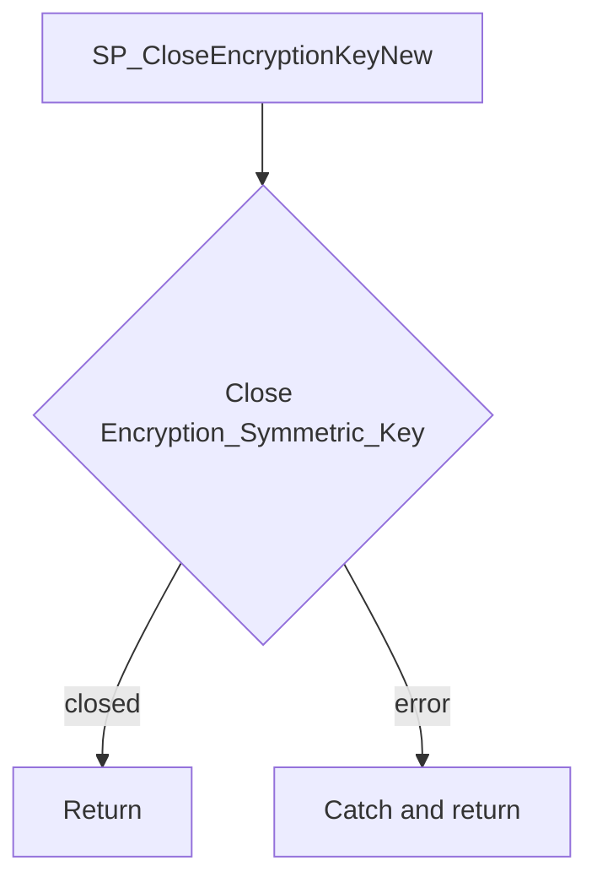

# SP_CloseEncryptionKeyNew

## What it does

Closes symmetric key `Encryption_Symmetric_Key` for the current session. A failure is caught and ignored. The procedure takes no parameters and returns no result set.

## Parameters

| Name | Direction | What it is for |
|---|---|---|
| — | — | The procedure takes no parameters |

## Call sequence

Calls no other procedures or functions.

## Callers

| Object | Kind | Page |
|---|---|---|
| `OV_Rule_DetailSP` | procedure | No page yet |
| `OV_Rule_Employee_Confirmation_SelfAssessment_Card` | procedure | No page yet |
| `OV_Rule_Employee_EmployeeMissingData_Card` | procedure | No page yet |
| `OV_Rule_LeaveAttendance_Absenteeism_Card` | procedure | No page yet |
| `OV_Rule_LeaveAttendance_PaidLeaves_Card` | procedure | No page yet |
| `OV_Rule_MasterSP` | procedure | No page yet |
| `OV_Rule_PMS_SelfAssessment_Card` | procedure | No page yet |
| `OV_Rule_Separation_Separation_Card` | procedure | No page yet |
| `Sp_AdminEMP_CopyEmployee` | procedure | No page yet |
| `SP_AdminEMP_EmployeeSearch` | procedure | No page yet |
| `SP_BulkCreationProfile_Process_Template` | procedure | No page yet |
| `SP_BulkProfileUpdate_DesignationByLogin_Org_Country` | procedure | No page yet |
| `SP_BulkProfileUpdate_EmployeeListByFilters` | procedure | No page yet |
| `SP_BulkProfileUpdate_InsertFieldConfigForNewEmployer` | procedure | No page yet |
| `SP_BulkProfileUpdate_LocationByLogin_Org_Country` | procedure | No page yet |
| `SP_BulkUpdateProfile_GetEmployeeDetailsForGivenFields` | procedure | No page yet |
| `SP_BulkUpdateProfile_Process_Template` | procedure | No page yet |
| `SP_CM_GetEmployeeFullInformation` | procedure | No page yet |
| `SP_EC_UpdateEmployeePersonalInformation` | procedure | No page yet |
| `SP_EMPMD_AddEmpBankDet` | procedure | No page yet |
| `SP_EMPMD_AddEmpContactDet` | procedure | No page yet |
| `SP_EMPMD_UpdEmpBankDet` | procedure | No page yet |
| `SP_EMPMD_UpdEmpContactDet` | procedure | No page yet |
| `SP_GeoTagging_GetEmployeesByBusinessUnit` | procedure | No page yet |
| `SP_GetEmpDetFields_Employees` | procedure | No page yet |
| `SP_GETPoisePayrollHrEmployeeFullInfo` | procedure | No page yet |
| `SP_LA_GetEmployeeLeaveBalanceDetails` | procedure | No page yet |
| `SP_Mydetails_Enhanced_AddEmpBankDet` | procedure | No page yet |
| `SP_Mydetails_Enhanced_InsertEmpContactDet` | procedure | No page yet |
| `SP_Mydetails_Enhanced_UpdateEmployeePersonalInformation` | procedure | [SP_Mydetails_Enhanced_UpdateEmployeePersonalInformation](/docs/database/hrms/SP_Mydetails_Enhanced_UpdateEmployeePersonalInformation) |
| `SP_Mydetails_Enhanced_UpdEmpBankDet` | procedure | No page yet |
| `SP_Mydetails_Enhanced_UpdEmpContactDet` | procedure | No page yet |
| `SP_MyDetails_GetEmployeeDetailsForGivenFields` | procedure | [SP_MyDetails_GetEmployeeDetailsForGivenFields](/docs/database/hrms/SP_MyDetails_GetEmployeeDetailsForGivenFields) |
| `SP_PMS_GET_Feedback360OrgManagers` | procedure | No page yet |
| `SP_PMS_GET_Feedback360ReviewerGrid` | procedure | No page yet |
| `SP_vw_EmployeeFullInfoReports` | procedure | No page yet |
| `USP_EmployeeFullInfoReports` | procedure | No page yet |
| `USP_GetLogo` | procedure | No page yet |
| `USP_GetLogo_InCloud` | procedure | No page yet |
| `USP_LE_EmployeeLeaveBalanceList` | procedure | No page yet |
| `USP_LE_List` | procedure | No page yet |
| `Usp_Mydetails_Enhanced_Process_Template` | procedure | [Usp_Mydetails_Enhanced_Process_Template](/docs/database/hrms/Usp_Mydetails_Enhanced_Process_Template) |
| `Usp_Mydetails_Enhanced_UpdateProfilePicture` | procedure | No page yet |
| `Usp_Mydetails_EnhancedcentralizedInformation` | procedure | No page yet |
| `uspProcessTEmployeeInfo_New` | procedure | No page yet |

## Nested

Calls no other procedures or functions.

## Steps

In `HRMS-DATABASE/HRMS/STOREPROCEDURE/SP_CloseEncryptionKeyNew.sql`:

1. Set `NOCOUNT ON`.
2. In a `TRY` block, run `CLOSE SYMMETRIC KEY Encryption_Symmetric_Key`.
3. In the `CATCH` block, do nothing.

## Tables

| Table | Read or write |
|---|---|
| — | The procedure does not read or write a table |

## Flow

