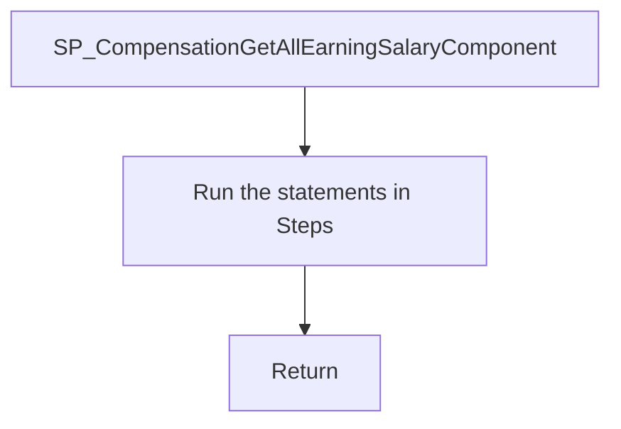

# SP_CompensationGetAllEarningSalaryComponent

## What it does

Returns earning salary components for a structure or annexure with human-readable calculation descriptions and optional exclusion of Fixed/Variable/Total.

## Parameters

| Name | Direction | What it is for |
|---|---|---|
| `@employerId` | in | Employer |
| `@CompensationStructureId` | in | Optional structure filter |
| `@AnnexureId` | in | Optional annexure filter |
| `@ExcludeFixedComponents` | in | Default 1 excludes Fixed/Variable/Total |

## Call sequence

Calls no other procedures or functions.

## Callers

No other procedure or function calls this object.

## Nested

Calls no other procedures or functions.

## Steps

1. Build #TempComponentIds from structure ComponentIds or annexure ComponentId CSV.
2. Select component fields and build CalculationDescription by calculation type and salary method.
3. Apply exclude-fixed filter when requested.

## Tables

| Table | Read or write |
|---|---|
| `dbo.TCompensationStructure` | read |
| `dbo.CompensationAnnexure` | read |
| `dbo.TEarningSalaryComponents` | read |
| `dbo.TCustomFormulas` | read |

## Flow

