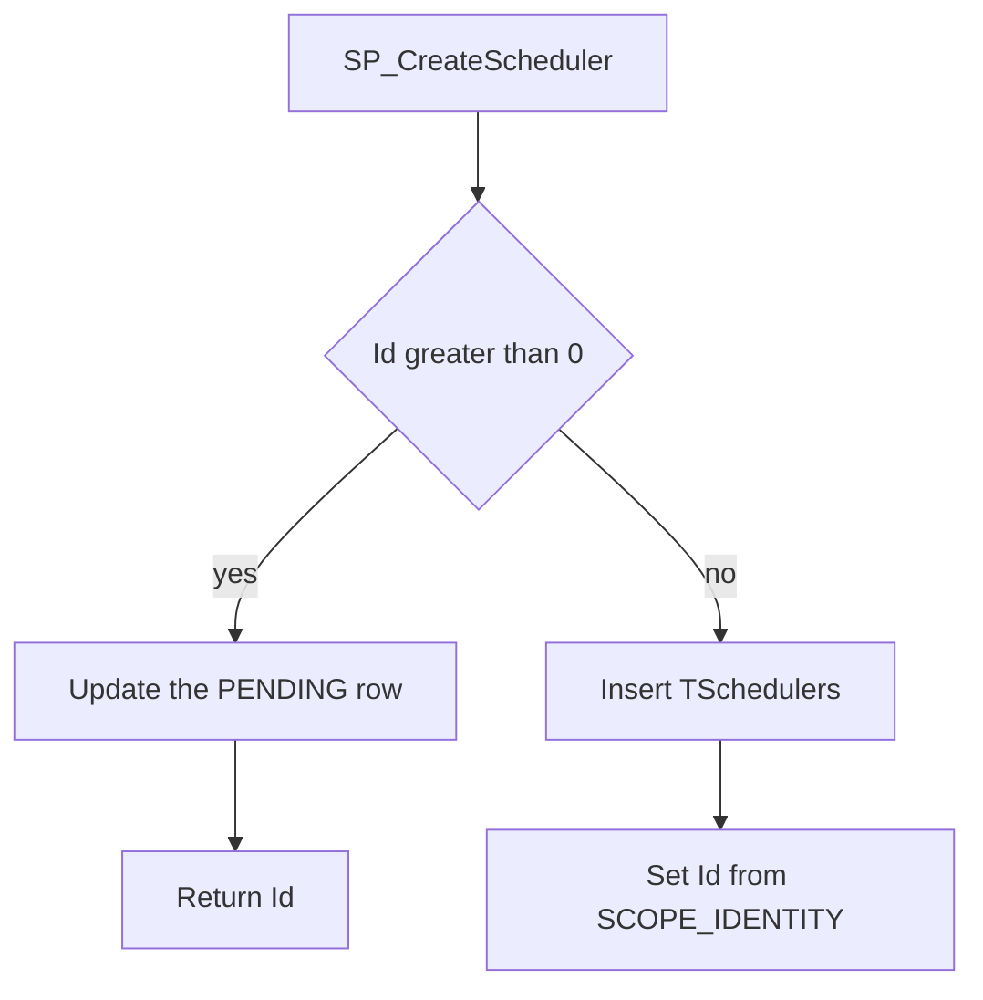

# SP_CreateScheduler

## What it does

Inserts one `TSchedulers` row, or updates an existing row that is still `PENDING`. Manage Scheduler calls it for Submit and for Run now. The constant `SP_SaveSchedulerDetails` in `DBConstant.cs` is this procedure name.

## Parameters

| Name | Direction | What it is for |
|---|---|---|
| `@Id` | in/out | Existing schedule id. Greater than 0 updates. Otherwise the new identity is returned |
| `@SchedulerMasterId` | in | Job from `TJobSchedulerMaster` |
| `@EmployerId` | in | Organisation |
| `@SchedulerDescription` | in | Description, up to 150 characters |
| `@StartDate` | in | Start date |
| `@EndDate` | in | End date |
| `@IsHourly` | in | Hourly frequency flag |
| `@IsDaily` | in | Daily frequency flag |
| `@IsWeekly` | in | Weekly frequency flag |
| `@IsMonthly` | in | Monthly frequency flag |
| `@IsYearly` | in | Yearly frequency flag |
| `@StartTime` | in | Start time |
| `@EndTime` | in | End time |
| `@CreatedBy` | in | Creating user. The page leaves this at 0 |
| `@TimeZoneID` | in | Time zone id |
| `@IsStopped` | in | Stopped flag. The page sends false |
| `@ParameterValue` | in | Extra parameter text. The page sends empty |
| `@Type` | in | `SCHEDULED` or `IMMEDIATE` |
| `@Status` | in | The page sends `PENDING` |
| `@IsEndOfMonth` | in | End-of-month flag |

## Call sequence

Calls no other procedures or functions.

## Callers

Procedures and functions that call this object.

No other procedure or function calls this object.

## Nested

Calls no other procedures or functions.

## Steps

1. In `HRMS-DATABASE/HRMS/STOREPROCEDURE/SP_CreateScheduler.sql`, when `@Id` is greater than 0, update `TSchedulers` for that id only while `Status` is `PENDING`. The update sets the master, employer, description, dates, frequency flags, end-of-month flag, times, time zone, parameter value, and type. It does not change `Status`. It then selects `@Id`.

2. Otherwise insert a row. `LastExecuted` and `NextExecutionDate` are null. `SkipNext` is 0. `CreateDate` is `GETUTCDATE()`. `Attempts` and `OccurrenceNumber` are 0. `Status` and `Type` come from the parameters. `@Id` becomes `SCOPE_IDENTITY()`.

## Tables

| Table | Read or write |
|---|---|
| `TSchedulers` | write |

## Flow

