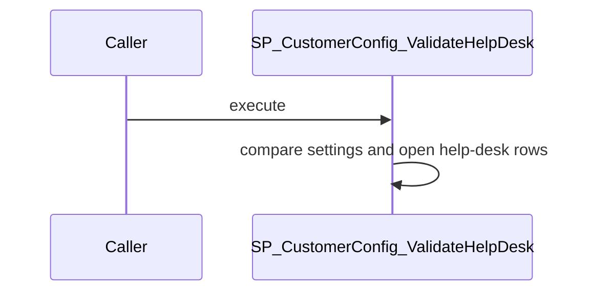
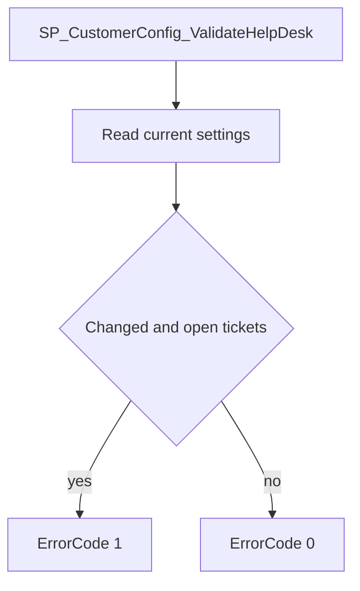

# SP_CustomerConfig_ValidateHelpDesk

## What it does

Checks whether an ESS help-desk assign setting can change for an employer. If the proposed values differ from `TCustomerSettings` and any non-closed `tHelpDesk` request exists, it returns an error message and `ErrorCode` 1. Otherwise it returns an empty message and `ErrorCode` 0.

## Parameters

| Name | Direction | What it is for |
|---|---|---|
| `@EmployerId` | in | Employer whose settings are compared |
| `@HelpDeskRequestAssign` | in | Proposed assign mode |
| `@MapHelpdeskActivityOwner` | in | Proposed activity-owner mapping |

## Call sequence

Calls no other procedures or functions.

## Callers

No other procedure or function calls this object. `dashBoardDAL.GetCustomerConfigValidateHelpdesk` executes it from Customer Config ESS fields.

## Nested

Calls no other procedures or functions.

## Steps

1. In `HRMS-DATABASE/HRMS/STOREPROCEDURE/SP_CustomerConfig_ValidateHelpDesk.sql`, read current help-desk settings from `tCustomerSettings` for `@EmployerId`.
2. When either proposed value differs and a non-closed `tHelpDesk` row exists for the employer, select the blocking message and `ErrorCode` 1.
3. Otherwise select an empty message and `ErrorCode` 0.

## Tables

| Table | Read or write |
|---|---|
| `dbo.tCustomerSettings` | read |
| `dbo.tHelpDesk` | read |

## Flow

