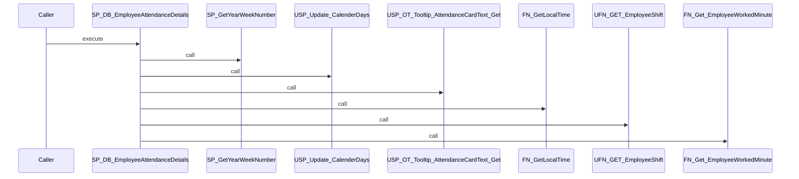
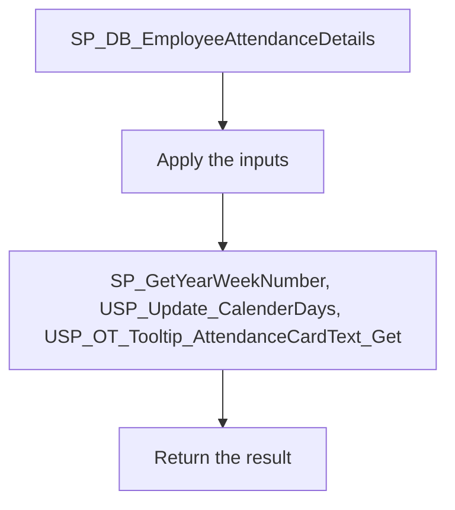

# SP_DB_EmployeeAttendanceDetails

## What it does

Returns the signed-in employee's attendance card for one month and year: each day, shift, leave, work-from-home, optional holiday, regularisation, and on-duty state, plus overtime tooltip text.

## Parameters

| Name | Direction | What it is for |
|---|---|---|
| `@Employeeid` | in | Employee the Home screen is loading or acting for (`INT`) |
| `@Month` | in | Month number for the attendance or timesheet card (`INT`) |
| `@Year` | in | Year for the attendance or timesheet card (`INT`) |
| `@ViewType` | in | Input used by this procedure (`VARCHAR(MAX)`) |

## Call sequence

## Callers

| Object | Kind | Page |
|---|---|---|
| `SP_LeaveAttendance_DashBoard` | procedure | No page yet |
| `USP_Get_MyRoasterDetails` | procedure | No page yet |

## Nested

| Object | Kind | When | Page |
|---|---|---|---|
| `SP_GetYearWeekNumber` | procedure | Called while this object runs | [SP_GetYearWeekNumber](/docs/database/hrms/SP_GetYearWeekNumber) |
| `USP_Update_CalenderDays` | procedure | Called while this object runs | [USP_Update_CalenderDays](/docs/database/hrms/USP_Update_CalenderDays) |
| `USP_OT_Tooltip_AttendanceCardText_Get` | procedure | Called while this object runs | [USP_OT_Tooltip_AttendanceCardText_Get](/docs/database/hrms/USP_OT_Tooltip_AttendanceCardText_Get) |
| `FN_GetLocalTime` | function | Called while this object runs | [FN_GetLocalTime](/docs/database/hrms/FN_GetLocalTime) |
| `UFN_GET_EmployeeShift` | function | Called while this object runs | [UFN_GET_EmployeeShift](/docs/database/hrms/UFN_GET_EmployeeShift) |
| `FN_Get_EmployeeWorkedMinute` | function | Called while this object runs | [FN_Get_EmployeeWorkedMinute](/docs/database/hrms/FN_Get_EmployeeWorkedMinute) |
| `FN_CM_GetLeaveChk` | function | Called while this object runs | [FN_CM_GetLeaveChk](/docs/database/hrms/FN_CM_GetLeaveChk) |
| `UFN_WO_Employee_Weekly_Off_Details` | function | Called while this object runs | [UFN_WO_Employee_Weekly_Off_Details](/docs/database/hrms/UFN_WO_Employee_Weekly_Off_Details) |
| `UFN_GetEmployeeDayDetails` | function | Called while this object runs | [UFN_GetEmployeeDayDetails](/docs/database/hrms/UFN_GetEmployeeDayDetails) |
| `UFN_FormatDateTimeStandard` | function | Called while this object runs | [UFN_FormatDateTimeStandard](/docs/database/hrms/UFN_FormatDateTimeStandard) |
| `FN_ConvertMinutesToHHMM` | function | Called while this object runs | [FN_ConvertMinutesToHHMM](/docs/database/hrms/FN_ConvertMinutesToHHMM) |
| `Fn_GetEmployeeName` | function | Called while this object runs | [Fn_GetEmployeeName](/docs/database/hrms/Fn_GetEmployeeName) |
| `UFN_MinutesToDuration` | function | Called while this object runs | [UFN_MinutesToDuration](/docs/database/hrms/UFN_MinutesToDuration) |

## Steps

In `HRMS-DATABASE/HRMS/STOREPROCEDURE/SP_DB_EmployeeAttendanceDetails.sql`:

1. Returns the signed-in employee's attendance card for one month and year: each day, shift, leave, work-from-home, optional holiday, regularisation, and on-duty state, plus overtime tooltip text.

## Tables

| Table | Read or write |
|---|---|
| `TEmployeeInfo` | read |
| `TCalendarMaster` | read |
| `TSHIFTMASTER` | read |
| `TCalenderDays` | read |
| `TShiftAttendanceConfig` | read |
| `TLeaveRequestDays` | read |
| `THolidayMaster` | read |
| `TDailyRegisterNew` | read |
| `TWorkfromHomeRequestDays` | read |
| `TWorkfromHomeRequest` | read |
| `TCustomerSettings` | read |
| `TEmployeeRoasterDetails` | read |
| `TShiftGroupMaster` | read |
| `TRequestWorkflows` | read |
| `TAttendanceRegularizationDays` | read |
| `TOptionalHolidayRequest` | read |
| `TAttendanceTransaction` | read |
| `TLeaveTypeMaster` | read |
| `TLeaveRequest` | read |
| `TEmployeeDayWiseAttendanceStatus` | read |
| `TAttendanceRegularization` | read |
| `TAttendanceRegularizeCategory` | read |
| `TOnDutyDaily` | read |
| `TEmployeeOnDuty` | read |
| `base` | read |

## Flow

