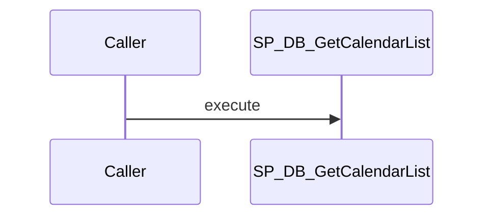
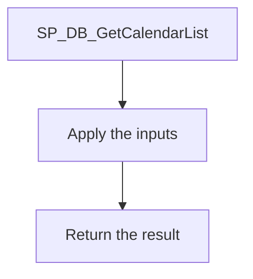

# SP_DB_GetCalendarList

## What it does

Lists active calendars for the employer that have at least one active holiday in the current year. The Holidays card uses this before it loads dates.

## Parameters

| Name | Direction | What it is for |
|---|---|---|
| `@EmployerId` | in | Employer that owns the data (`INT`) |

## Call sequence

## Callers

No other procedure or function under STOREPROCEDURE or FUNCTIONS executes this object.

## Nested

This object does not execute another procedure or user-defined function.

## Steps

In `HRMS-DATABASE/HRMS/STOREPROCEDURE/SP_DB_GetCalendarList.sql`:

1. Lists active calendars for the employer that have at least one active holiday in the current year.
2. The Holidays card uses this before it loads dates.

## Tables

| Table | Read or write |
|---|---|
| `TCalendarMaster` | read |
| `THolidayMaster` | read |

## Flow

