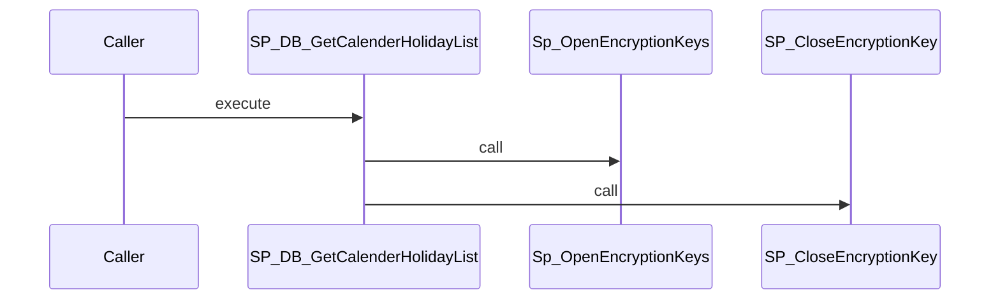
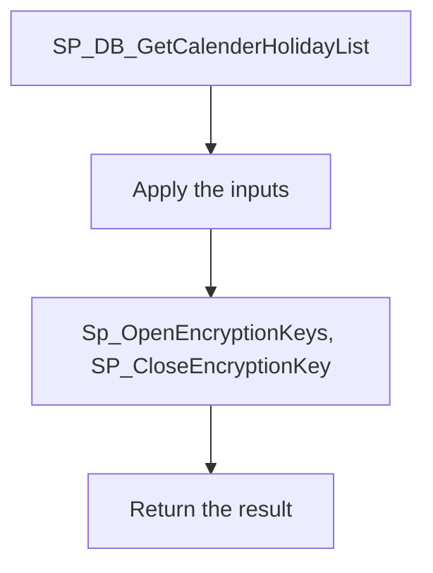

# SP_DB_GetCalenderHolidayList

## What it does

Returns this year's active holidays for one calendar, with half-day and optional-holiday wording and a tooltip when a minimum attendance duration is set.

## Parameters

| Name | Direction | What it is for |
|---|---|---|
| `@CalenderId` | in | Calendar whose holidays are listed (`Int`) |

## Call sequence

## Callers

No other procedure or function under STOREPROCEDURE or FUNCTIONS executes this object.

## Nested

| Object | Kind | When | Page |
|---|---|---|---|
| `Sp_OpenEncryptionKeys` | procedure | Called while this object runs | [Sp_OpenEncryptionKeys](/docs/database/hrms/Sp_OpenEncryptionKeys) |
| `SP_CloseEncryptionKey` | procedure | Called while this object runs | [SP_CloseEncryptionKey](/docs/database/hrms/SP_CloseEncryptionKey) |

## Steps

In `HRMS-DATABASE/HRMS/STOREPROCEDURE/SP_DB_GetCalenderHolidayList.sql`:

1. Returns this year's active holidays for one calendar, with half-day and optional-holiday wording and a tooltip when a minimum attendance duration is set.

## Tables

| Table | Read or write |
|---|---|
| `TCalendarMaster` | read |
| `THolidayMaster` | read |

## Flow

