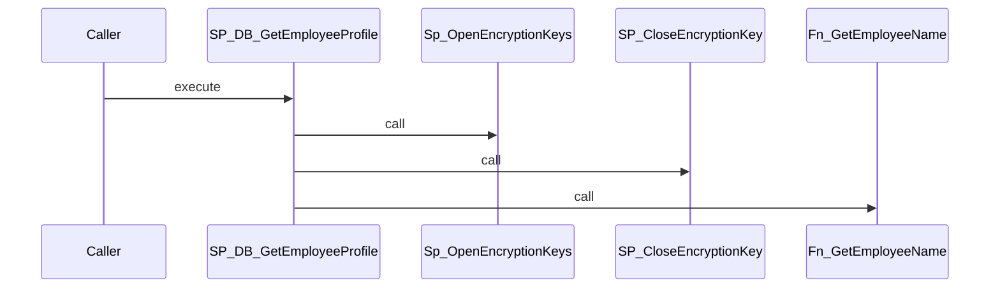
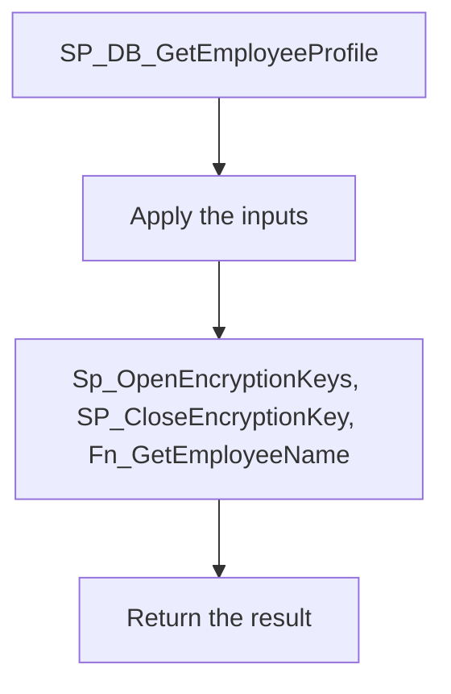

# SP_DB_GetEmployeeProfile

## What it does

Builds the Quick Links profile strip: employee name, employment number, date of joining, business unit, current-organisation experience, and the active contract end date. It opens the encryption keys before reading the name.

## Parameters

| Name | Direction | What it is for |
|---|---|---|
| `@Employeeid` | in | Employee the Home screen is loading or acting for (`INT`) |

## Call sequence

## Callers

No other procedure or function under STOREPROCEDURE or FUNCTIONS executes this object.

## Nested

| Object | Kind | When | Page |
|---|---|---|---|
| `Sp_OpenEncryptionKeys` | procedure | Called while this object runs | [Sp_OpenEncryptionKeys](/docs/database/hrms/Sp_OpenEncryptionKeys) |
| `SP_CloseEncryptionKey` | procedure | Called while this object runs | [SP_CloseEncryptionKey](/docs/database/hrms/SP_CloseEncryptionKey) |
| `Fn_GetEmployeeName` | function | Called while this object runs | [Fn_GetEmployeeName](/docs/database/hrms/Fn_GetEmployeeName) |

## Steps

In `HRMS-DATABASE/HRMS/STOREPROCEDURE/SP_DB_GetEmployeeProfile.sql`:

1. Builds the Quick Links profile strip: employee name, employment number, date of joining, business unit, current-organisation experience, and the active contract end date.
2. It opens the encryption keys before reading the name.

## Tables

| Table | Read or write |
|---|---|
| `TEmployeeEmploymentType` | read |
| `Temployee` | read |
| `TMEmploymentTypes` | read |
| `TEmployeeContactDetails` | read |
| `fn_directindirectreportee` | read |
| `TOrgChart` | read |
| `TGrade` | read |
| `TTitle` | read |
| `TLocation` | read |
| `Temployeeinfo` | read |
| `TEmployerDetails` | read |

## Flow

