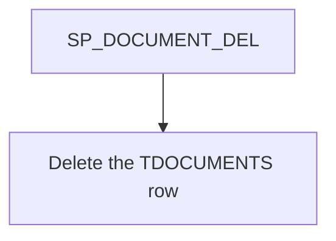

# SP_DOCUMENT_DEL

## What it does

Deletes one document metadata row by id. The budget panel calls it when an uploaded file is removed.

## Parameters

| Name | Direction | What it is for |
|---|---|---|
| `@pDocumentID` | in | Document to delete |

## Call sequence

Calls no other procedures or functions.

## Callers

No other procedure or function calls this object.

`documentDAL.DeleteDocumentInfo` calls it from the budget document delete.

## Nested

Calls no other procedures or functions.

## Steps

1. Delete `TDOCUMENTS` where `DocumentID` equals `@pDocumentID` (`SP_DOCUMENT_DEL.sql`).

## Tables

| Table | Read or write |
|---|---|
| `TDOCUMENTS` | write |

## Flow

