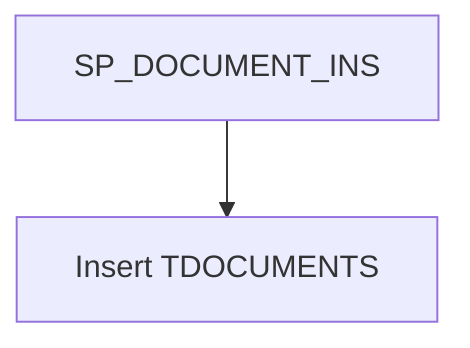

# SP_DOCUMENT_INS

## What it does

Inserts one document metadata row. Recruitment Management calls it after the budget file has been written to the document folder, with document URI `BudgetDetails`.

## Parameters

| Name | Direction | What it is for |
|---|---|---|
| `@pDocumentID` | in | 32-character id |
| `@pDocumentURI` | in | Storage folder key |
| `@pFileName` | in | Original file name |
| `@pFileExtension` | in | Extension |
| `@pCreatedBy` | in | Actor |

## Call sequence

Calls no other procedures or functions.

## Callers

No other procedure or function calls this object.

`documentDAL.SaveDocumentInfo` calls it. The budget panel uploads through `POST /document/upload`.

## Nested

Calls no other procedures or functions.

## Steps

1. Insert `DocumentID`, `DocumentURI`, `FileName`, `FileExtension`, `CreatedBy`, and `GETUTCDATE()` into `TDOCUMENTS` (`SP_DOCUMENT_INS.sql`).

## Tables

| Table | Read or write |
|---|---|
| `TDOCUMENTS` | write |

## Flow

