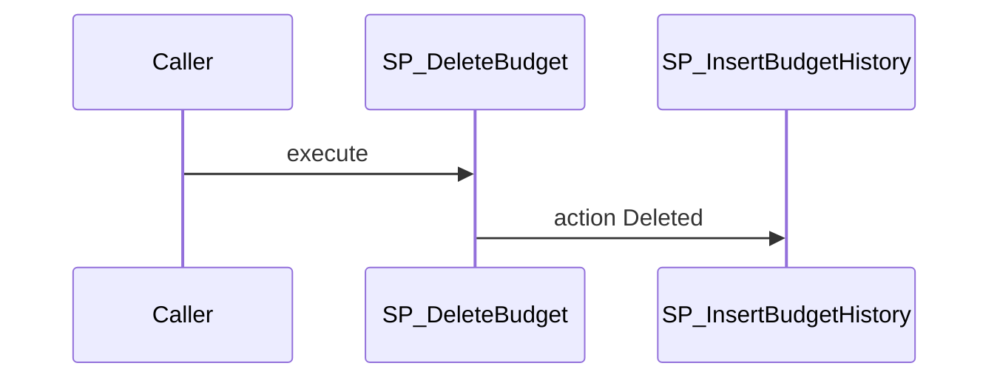
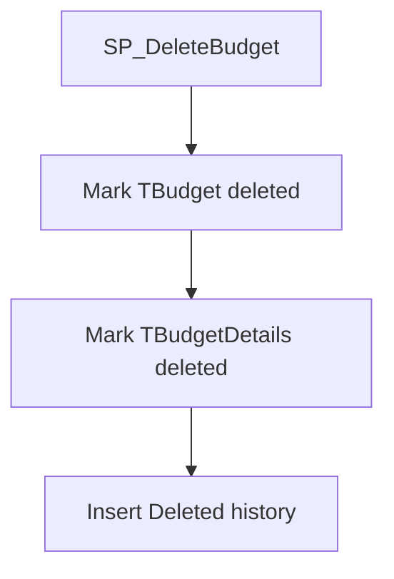

# SP_DeleteBudget

## What it does

Marks one budget and its detail rows deleted for an employer, then writes a history row whose action name is `Deleted`.

## Parameters

| Name | Direction | What it is for |
|---|---|---|
| `@EmployerId` | in | Organisation |
| `@EmployeeId` | in | Stored as `UpdatedBy` and as the history actor |
| `@BudgetId` | in | Budget to mark deleted |

## Call sequence

## Callers

No other procedure or function calls this object.

`recruitmentDAL.DeleteBudget` calls it from Recruitment Management.

## Nested

| Object | Kind | When | Page |
|---|---|---|---|
| `SP_InsertBudgetHistory` | procedure | after both updates, with action `Deleted` and an empty comment | [SP_InsertBudgetHistory](/docs/database/hrms/SP_InsertBudgetHistory) |

## Steps

1. Set `IsDeleted` to 1, `UpdatedBy`, and `UpdatedDate` on `TBudget` for the budget and employer (`SP_DeleteBudget.sql`).
2. Set the same columns on `TBudgetDetails` for that budget and employer.
3. `EXEC SP_InsertBudgetHistory` with action name `Deleted`.

## Tables

| Table | Read or write |
|---|---|
| `TBudget` | write |
| `TBudgetDetails` | write |

## Flow

