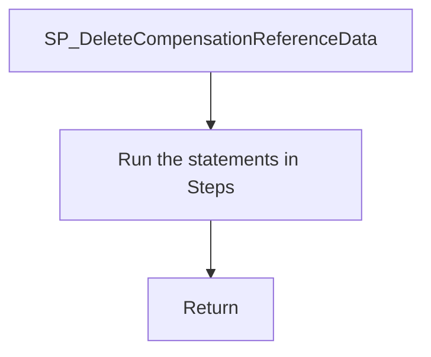

# SP_DeleteCompensationReferenceData

## What it does

Hard-deletes one TCompensationReferenceData row by ReferenceId.

## Parameters

| Name | Direction | What it is for |
|---|---|---|
| `@ReferenceId` | in | Row to delete |

## Call sequence

Calls no other procedures or functions.

## Callers

No other procedure or function calls this object.

## Nested

Calls no other procedures or functions.

## Steps

1. DELETE FROM TCompensationReferenceData WHERE ReferenceId = @ReferenceId.

## Tables

| Table | Read or write |
|---|---|
| `dbo.TCompensationReferenceData` | write |

## Flow

