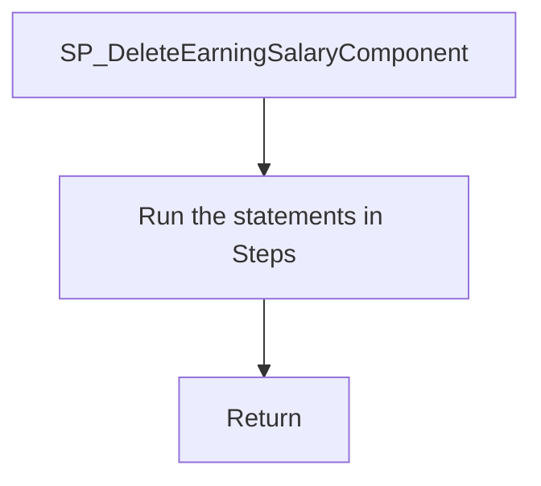

# SP_DeleteEarningSalaryComponent

## What it does

Hard-deletes one earning salary component for an employer.

## Parameters

| Name | Direction | What it is for |
|---|---|---|
| `@employerId` | in | Employer scope |
| `@ComponentId` | in | Component to delete |

## Call sequence

Calls no other procedures or functions.

## Callers

No other procedure or function calls this object.

## Nested

Calls no other procedures or functions.

## Steps

1. DELETE from TEarningSalaryComponents where Employerid and ComponentId match.

## Tables

| Table | Read or write |
|---|---|
| `dbo.TEarningSalaryComponents` | write |

## Flow

