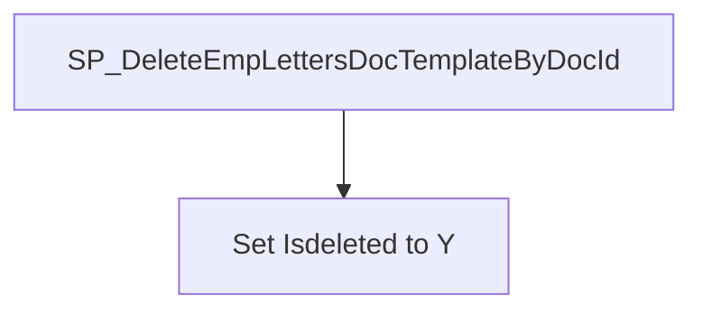

# SP_DeleteEmpLettersDocTemplateByDocId

## What it does

Soft-deletes one letter template by setting Isdeleted to Y on TEmpLetterDocumentTemplates.

## Parameters

| Name | Direction | What it is for |
|---|---|---|
| `@documentid` | in | Template id |

## Call sequence

Calls no other procedures or functions.

## Callers

No other procedure or function calls this object.

## Nested

Calls no other procedures or functions.

## Steps

1. Set `Isdeleted` to Y where `documentid` matches (`SP_DeleteEmpLettersDocTemplateByDocId.sql`).

## Tables

| Table | Read or write |
|---|---|
| `dbo.TEmpLetterDocumentTemplates` | write |

## Flow

