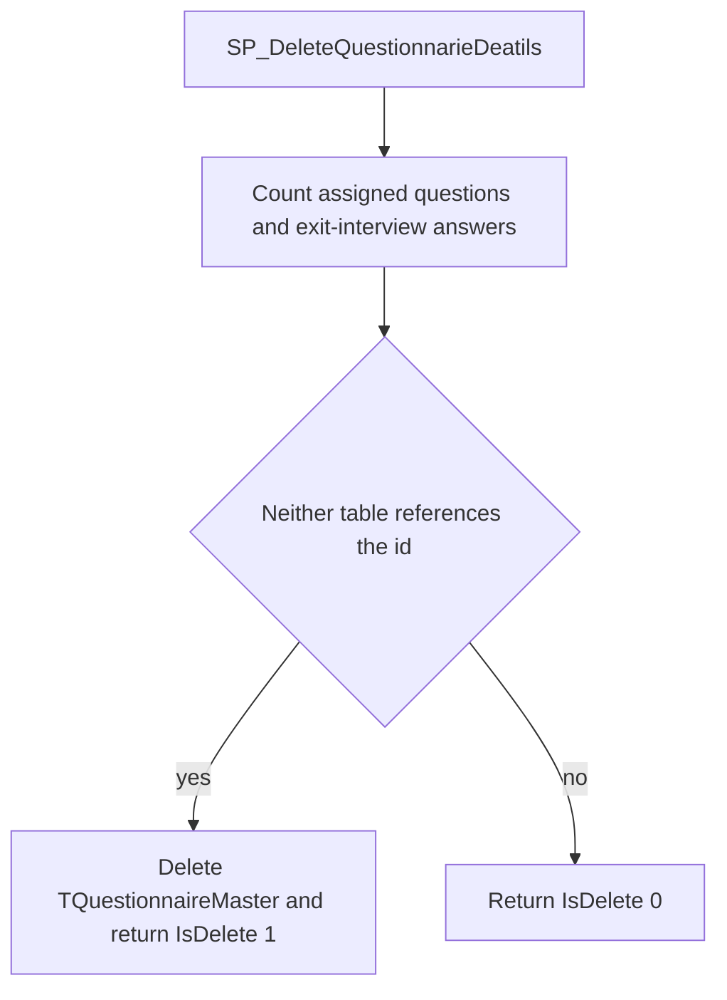

# SP_DeleteQuestionnarieDeatils

## What it does

Deletes one questionnaire when nothing still points at it. Add Questionnaire calls this after its own template-category check. The procedure refuses the delete when `TAssignedQuestions` has the question id or `TEmployeeExitInterviewDetails` has the questionnaire id, and it returns `IsDelete` 0. Otherwise it deletes the master row and returns `IsDelete` 1.

## Parameters

| Name | Direction | What it is for |
|---|---|---|
| `@QuestionnaireId` | in | Question to delete |

## Call sequence

Calls no other procedures or functions.

## Callers

No other procedure or function calls this object. `recruitmentDAL.DeleteQuestionnaireDetails` executes it for Add Questionnaire.

## Nested

Calls no other procedures or functions.

## Steps

1. Set a flag when `TAssignedQuestions.QuestionId` equals `@QuestionnaireId`.
2. Set a flag when `TEmployeeExitInterviewDetails.QuestionnaireId` equals `@QuestionnaireId`.
3. When both flags are 0, delete that `TQuestionnaireMaster` row and return `IsDelete` 1.
4. Otherwise leave the row and return `IsDelete` 0.

## Tables

| Table | Read or write |
|---|---|
| `TAssignedQuestions` | read |
| `TEmployeeExitInterviewDetails` | read |
| `TQuestionnaireMaster` | write |

## Flow

