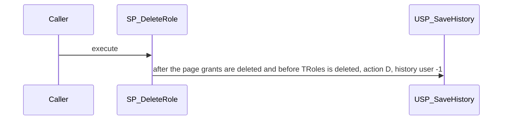
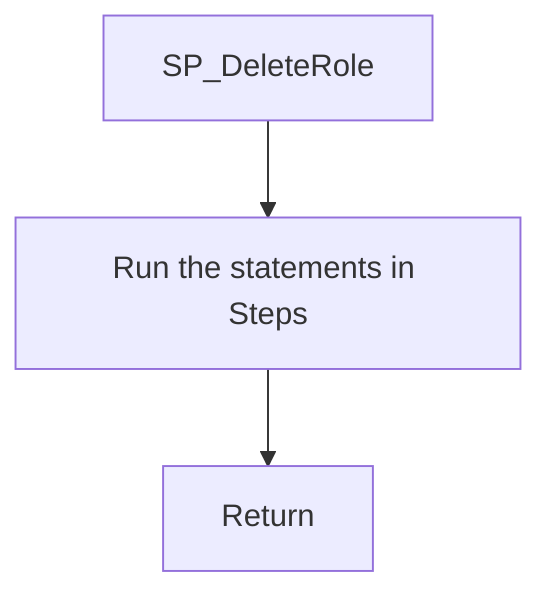

# SP_DeleteRole

## What it does

Deletes a role and its page grants when no TUsers row still points at that RoleID. Returns a one-column Message of 0 when users still hold the role, and 1 after the delete.

## Parameters

| Name | Direction | What it is for |
|---|---|---|
| `@RoleID` | in | Role to delete |
| `@Employerid` | in | Employer scope for the page-grant deletes |

## Call sequence

## Callers

No other procedure or function calls this object.

## Nested

| Object | Kind | When | Page |
|---|---|---|
| `USP_SaveHistory` | procedure | after the page grants are deleted and before TRoles is deleted, action D, history user -1 | Script not in inventory |

## Steps

1. Count TUsers rows with RoleID = @RoleID.
2. When the count is greater than 0, select 0 as Message and stop.
3. Delete TRollWisePageAccess and TRolePagesMapping for the role and employer.
4. Execute USP_SaveHistory for TRoles into TRoles_History with action D.
5. Delete the TRoles row for the role and employer and select 1 as Message.

## Tables

| Table | Read or write |
|---|---|
| `TUsers` | read |
| `TRollWisePageAccess` | write |
| `TRolePagesMapping` | write |
| `TRoles` | write |

## Flow

