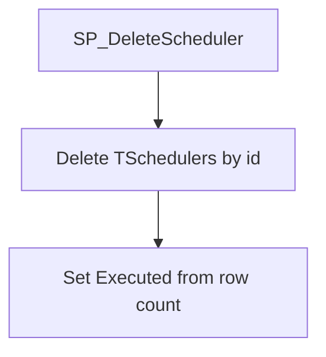

# SP_DeleteScheduler

## What it does

Deletes one `TSchedulers` row by id and returns how many rows were deleted. The header comment says it deletes a pending scheduler. The statement itself has no status predicate.

## Parameters

| Name | Direction | What it is for |
|---|---|---|
| `@Id` | in | Schedule id |
| `@Executed` | out | `@@ROWCOUNT` after the delete |

## Call sequence

Calls no other procedures or functions.

## Callers

Procedures and functions that call this object.

No other procedure or function calls this object.

## Nested

Calls no other procedures or functions.

## Steps

1. In `HRMS-DATABASE/HRMS/STOREPROCEDURE/SP_DeleteScheduler.sql`, delete `TSchedulers` where `Id` = `@Id`.

2. Set `@Executed` to `@@ROWCOUNT`.

## Tables

| Table | Read or write |
|---|---|
| `TSchedulers` | write |

## Flow

