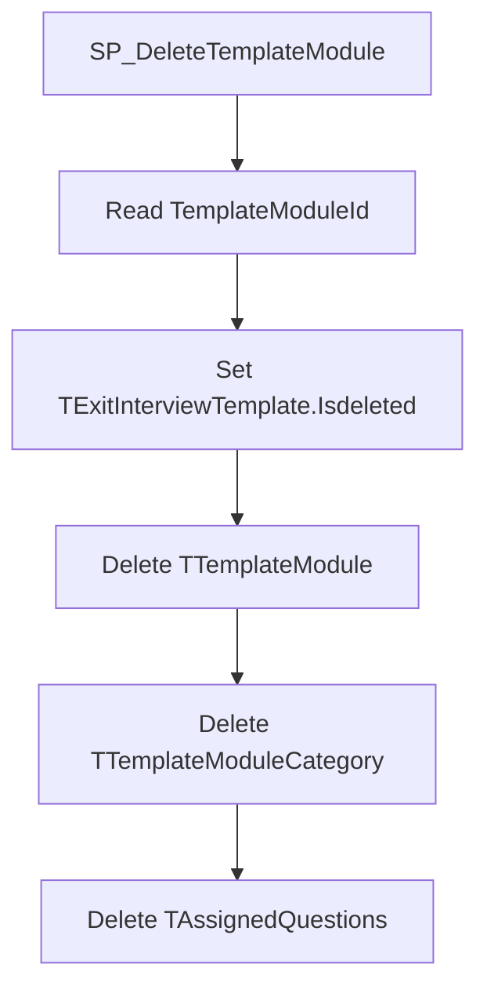

# SP_DeleteTemplateModule

## What it does

Marks one interview template deleted and removes its module map, the categories for the module id it read, and the questions assigned to that template. It does not check whether a resignation, termination, or candidate interview still points at the template.

## Parameters

| Name | Direction | What it is for |
|---|---|---|
| `@TemplateId` | in | Template header id to delete |
| `@EmployerId` | in | Declared on the procedure. The statements do not read it |

## Call sequence

Calls no other procedures or functions.

## Callers

No other procedure or function calls this object. `recruitmentDAL.DeleteQuestionBuilderTemplate` calls it inside a DAL transaction for `POST /api/recruitment/deleteQuestionBuilderTemplate`.

## Nested

Calls no other procedures or functions.

## Steps

1. Read `TemplateModuleId` from `TTemplateModule` where `TemplateId` equals `@TemplateId` (`SP_DeleteTemplateModule.sql`).
2. Set `TExitInterviewTemplate.Isdeleted` to 1 where `Transid` equals `@TemplateId`.
3. Delete `TTemplateModule` rows for that template id.
4. Delete `TTemplateModuleCategory` rows for the module id read in step 1.
5. Delete `TAssignedQuestions` rows for that template id.

## Tables

| Table | Read or write |
|---|---|
| `TTemplateModule` | read and write |
| `TExitInterviewTemplate` | write |
| `TTemplateModuleCategory` | write |
| `TAssignedQuestions` | write |

## Flow

