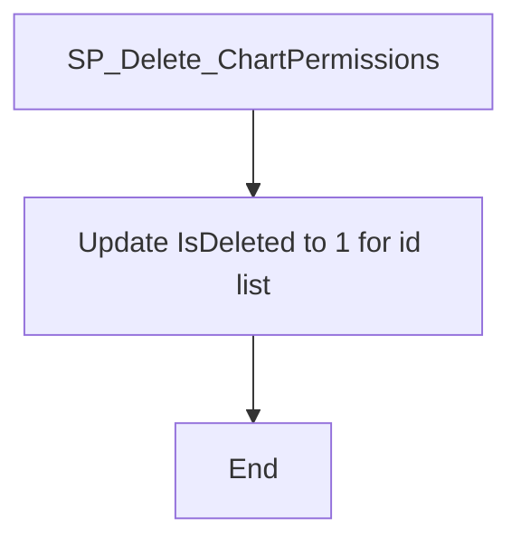

# SP_Delete_ChartPermissions

## What it does

Soft-deletes chart permission rows for one employer and module whose ids appear in a comma-separated list. Sets `IsDeleted = 1`, `UpdatedBy`, and `UpdatedDate`. It does not hard-delete rows.

## Parameters

| Name | Direction | What it is for |
|---|---|---|
| `@EmployerId` | in | Employer filter on the update |
| `@ModuleId` | in | Module filter on the update |
| `@UpdatedBy` | in | Employee id written to `UpdatedBy` |
| `@ChartPermissionsIds` | in | Comma-separated `ChartPermissionId` values to soft-delete |

## Call sequence

Calls no other procedures or functions. Uses built-in `STRING_SPLIT` only.

## Callers

No other procedure or function calls this object. App caller: `dashBoardDAL.DeleteChartPermissionRecord` from Charts Setup (`SetupCharts.aspx`).

## Nested

Calls no other procedures or functions.

## Steps

In `HRMS-DATABASE/HRMS/STOREPROCEDURE/SP_Delete_ChartPermissions.sql`:

1. Update `TChartPermissions` set `IsDeleted = 1`, `UpdatedBy = @UpdatedBy`, `UpdatedDate = GETDATE()` where `EmployerId` and `ModuleId` match and `ChartPermissionId` is in `STRING_SPLIT(@ChartPermissionsIds, ',')`.

## Tables

| Table | Read or write |
|---|---|
| `dbo.TChartPermissions` | write |

## Flow

