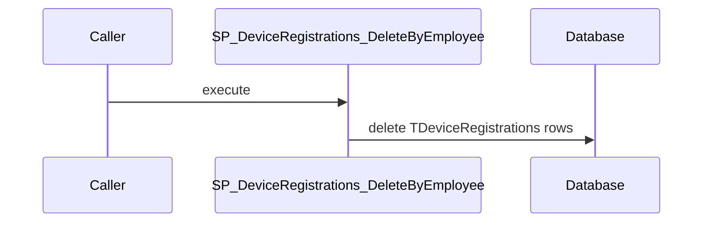
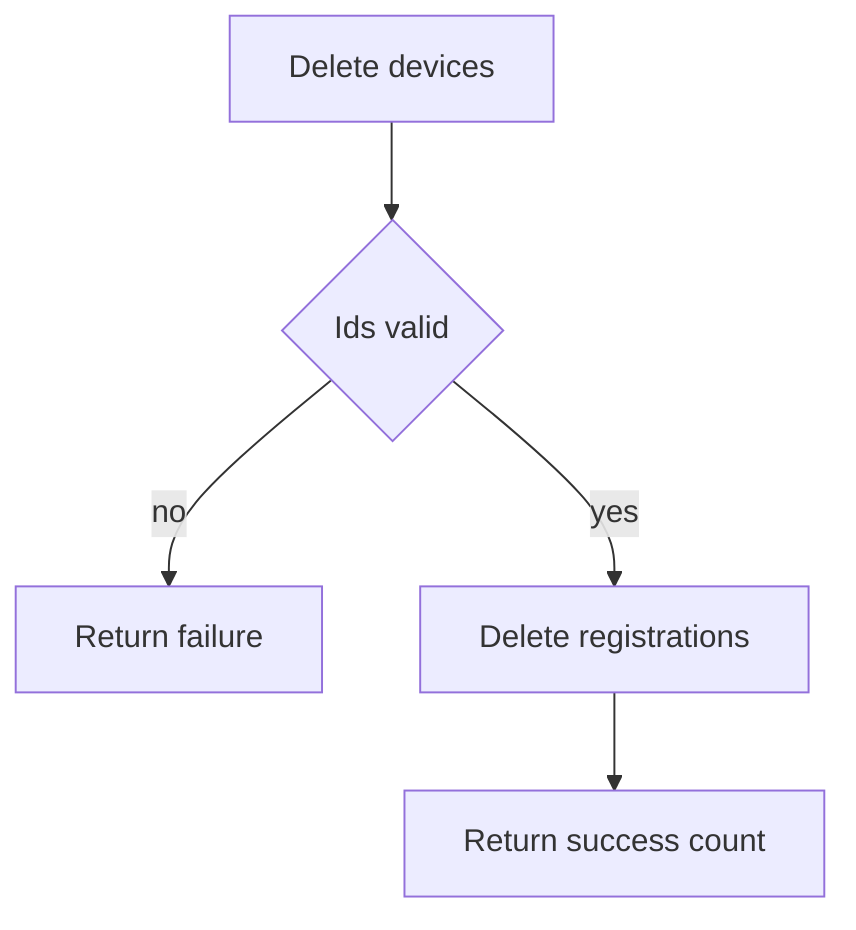

# SP_DeviceRegistrations_DeleteByEmployee

## What it does

Deletes mobile/device registration rows for one employer + employee pair. Used as cleanup when an employee is deactivated.

## Parameters

| Name | Direction | What it is for |
|---|---|---|
| `@EmployerId` | in | Employer (required, &gt; 0) |
| `@EmployeeId` | in | Employee (required, &gt; 0) |
| `@ReturnResult` | in | When 1, return success/message/count row |

## Call sequence

## Callers

Nested from `SP_SEP_DeActivateEmployee_BY_ID` after a successful deactivate.

## Nested

None.

## Steps

1. Script is `HRMS-DATABASE/HRMS/STOREPROCEDURE/SP_DeviceRegistrations_DeleteByEmployee.sql`.
2. Validate employer and employee ids.
3. `DELETE` from `TDeviceRegistrations` for that pair.
4. Optionally return deleted count.

## Tables

| Table | Read or write |
|---|---|
| `dbo.TDeviceRegistrations` | write (delete) |

## Flow

