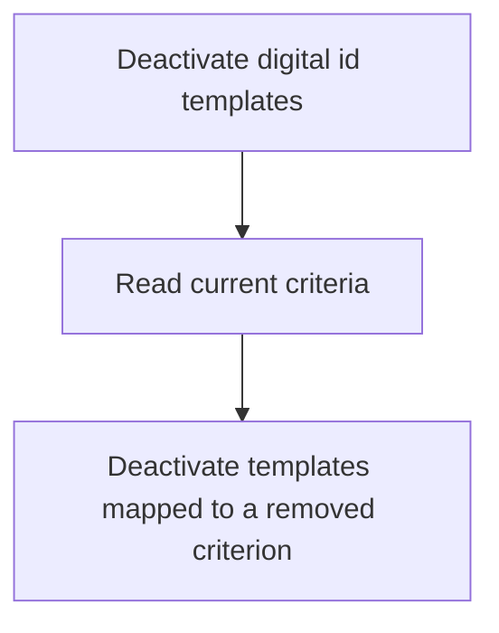

# SP_DigitalIdCard_DeactivateTemplatesForRemovedCriteria

## What it does

Deactivates active digital-id templates that still map a criterion no longer listed on the employer's DigitalIdCardBasedOn. Mapping rows are kept.

## Parameters

| Name | Direction | What it is for |
|---|---|---|
| `@EmployerId` | in | Employer whose templates are checked |

## Call sequence

Calls no other procedures or functions.

## Callers

Procedures and functions that call this object.

| Object | Kind | Page |
|---|---|---|
| `SP_AdminORG_UpdEmployerDetails` | procedure | [SP_AdminORG_UpdEmployerDetails](/docs/database/hrms/SP_AdminORG_UpdEmployerDetails) |

## Nested

Calls no other procedures or functions.

## Steps

1. Read DigitalIdCardBasedOn for the employer and split it on commas.

2. Set IsActive 0 and UpdatedDate to SYSUTCDATETIME on TDigitalIdCardTemplate rows that are active, not deleted, and have a TDigitalIdCardTemplateMapping criteria type outside that list.

## Tables

| Table | Read or write |
|---|---|
| `TEmployerDetails` | read |
| `TDigitalIdCardTemplate` | write |
| `TDigitalIdCardTemplateMapping` | read |

## Flow

