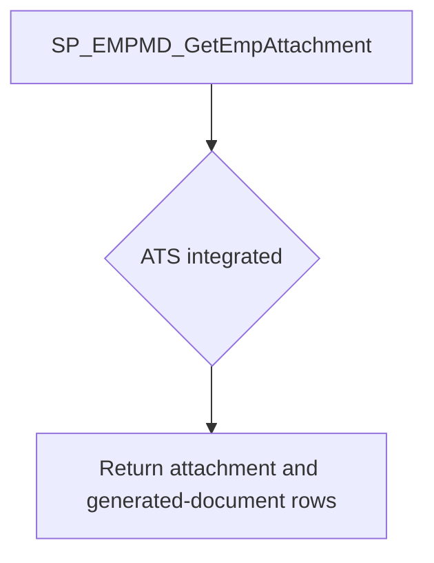

# SP_EMPMD_GetEmpAttachment

## What it does

Returns attachment rows for an employee. When ATS is integrated it includes candidate documents. It also returns employee attachments, POB candidate attachments, and generated-document templates the logged-in employee may see.

## Parameters

| Name | Direction | What it is for |
|---|---|---|
| `@employeeId` | in | Employee |
| `@LoginEmployeeId` | in | Optional logged-in employee used for the template role filter |

## Call sequence

Calls no other procedures or functions.

## Callers

No other procedure or function calls this object.

## Nested

Calls no other procedures or functions.

## Steps

1. Read whether `TCustomerSettings.IntegrateAtsIntoHrms` is on (`SP_EMPMD_GetEmpAttachment.sql`).
2. When it is on, include `TATSCandidateDocuments`.
3. Union `TEmployeeAttachment`, POB candidate attachments, and generated documents from `TDocumentTemplates` and `TEmployeeDocumentGeneratedDetails` filtered by the employee role.

## Tables

| Table | Read or write |
|---|---|
| `dbo.TEmployee` | read |
| `dbo.TCustomerSettings` | read |
| `dbo.TEmployeeAttachment` | read |
| `dbo.TAttachmentCategory` | read |
| `dbo.TDocumentTemplates` | read |
| `dbo.TEmployeeDocumentGeneratedDetails` | read |

## Flow

