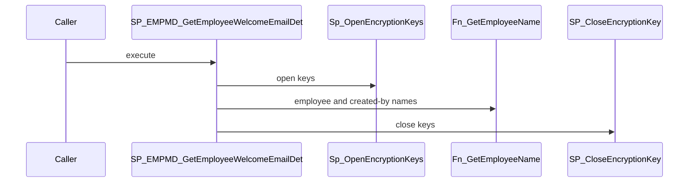
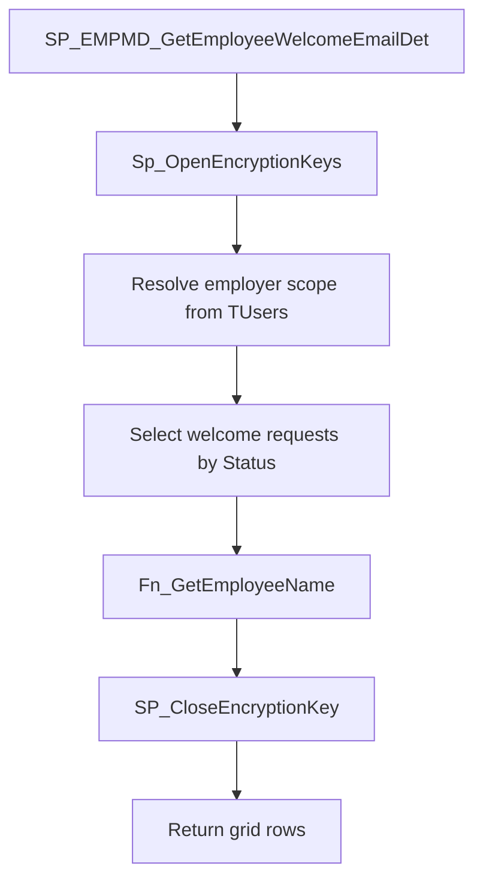

# SP_EMPMD_GetEmployeeWelcomeEmailDet

## What it does

Returns welcome-email request rows for active employees in the caller's employer scope, filtered by `@NotificationType` matching `TEmployeeWelcomeEmailRequest.Status`. The Removed Welcome Emails screen passes `Rejected`. Each row includes employment number, display names, email, business unit, joining date, designation, total experience, and highest qualification.

## Parameters

| Name | Direction | What it is for |
|---|---|---|
| `@EmployeeId` | in | Logged-in employee used to resolve employer scope via `TUserEmployee` / `TUsers` |
| `@NotificationType` | in | Status filter (for example `Rejected`, `Pending`) |

## Call sequence

## Callers

No other procedure or function calls this object. Application callers include Core API `NotificationDAL.GetRejectedWelcomeEmails` and shared `EmployeeDAL`.

## Nested

| Object | Kind | When | Page |
|---|---|---|---|
| `Sp_OpenEncryptionKeys` | procedure | start of body | [Sp_OpenEncryptionKeys](/docs/database/hrms/Sp_OpenEncryptionKeys) |
| `Fn_GetEmployeeName` | function | select list for employee and created-by | [Fn_GetEmployeeName](/docs/database/hrms/Fn_GetEmployeeName) |
| `SP_CloseEncryptionKey` | procedure | end of body | [SP_CloseEncryptionKey](/docs/database/hrms/SP_CloseEncryptionKey) |

## Steps

1. Execute `Sp_OpenEncryptionKeys`.
2. Resolve `@EmployerId` and optional global `EmployerIds` from `TUsers` for the user linked to `@EmployeeId`.
3. Build `@EmployerIds_Table` with the user's employer plus split global employer ids.
4. Select from `TEmployeeWelcomeEmailRequest` joined to `TEmployeeInfo` and active `TEmployee`, restricted to employers in `@EmployerIds_Table` and `Status = @NotificationType`.
5. Compute display columns (employment number, names via `Fn_GetEmployeeName`, business unit, designation, experience, qualification).
6. Order by `Id` descending.
7. Execute `SP_CloseEncryptionKey`.

## Tables

| Table | Read or write |
|---|---|
| `dbo.TUsers` | read |
| `dbo.TUserEmployee` | read |
| `dbo.TEmployeeWelcomeEmailRequest` | read |
| `dbo.TEmployeeInfo` | read |
| `dbo.TEmployee` | read |
| `dbo.TOrgHierarchyDetails` | read |
| `dbo.TTitle` | read |
| `dbo.TEducationDetails` | read |
| `dbo.TQualificationName` | read |

## Flow

