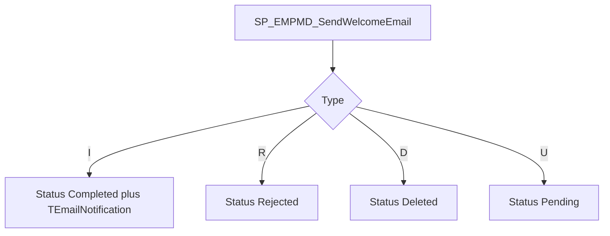

# SP_EMPMD_SendWelcomeEmail

## What it does

Updates one `TEmployeeWelcomeEmailRequest` row by `@Id` according to `@Type`. `I` marks the request `Completed`, stamps send audit columns, and inserts a pending `TEmailNotification` for template `EmployeeWelcomeMail`. `R` sets `Rejected`, `D` sets `Deleted`, and `U` sets `Pending`. The Removed Welcome Emails screen posts `U` (restore) and `D` (delete) only.

## Parameters

| Name | Direction | What it is for |
|---|---|---|
| `@Id` | in | `TEmployeeWelcomeEmailRequest.Id` |
| `@EmployeeId` | in | Employee id written to the notification queue when `@Type` is `I` |
| `@Type` | in | Action code `I`, `R`, `D`, or `U` |
| `@EmailSentBy` | in | Actor stamped on send/audit columns and notification created-by |
| `@EmployerId` | in | Employer id for the notification insert when `@Type` is `I` |

## Call sequence

Calls no other procedures or functions.

## Callers

No other procedure or function calls this object. Application callers include Core API `NotificationDAL.RejectDeleteWelcomeEmails` and shared `EmployeeDAL`.

## Nested

Calls no other procedures or functions.

## Steps

1. When `@Type = 'I'`, update the request to `Completed` with `EmailSentOn` / `EmailSentBy`, then insert `TEmailNotification` (`TemplateName` `EmployeeWelcomeMail`, `Status` `Pending`).
2. When `@Type = 'R'`, update status to `Rejected` and stamp send audit columns.
3. When `@Type = 'D'`, update status to `Deleted` and stamp send audit columns.
4. When `@Type = 'U'`, update status to `Pending` and stamp send audit columns.

## Tables

| Table | Read or write |
|---|---|
| `dbo.TEmployeeWelcomeEmailRequest` | write |
| `dbo.TEmailNotification` | write when `@Type = 'I'` |

## Flow

