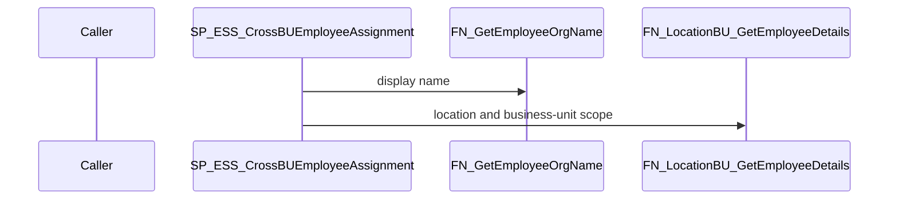
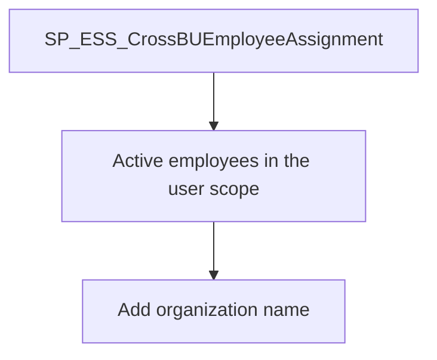

# SP_ESS_CrossBUEmployeeAssignment

## What it does

Returns active employees in the logged-in user's location and business-unit scope. The employer parameter is not used in the filter. The name includes the organization label.

## Parameters

| Name | Direction | What it is for |
|---|---|---|
| `@EmployerId` | in | Passed by the caller and not used in the where clause |
| `@LoginUserId` | in | User whose location and business-unit scope is applied |

## Call sequence

## Callers

No other procedure or function calls this object.

## Nested

| Object | Kind | When | Page |
|---|---|---|---|
| `FN_GetEmployeeOrgName` | function | display name | [FN_GetEmployeeOrgName](/docs/database/hrms/FN_GetEmployeeOrgName) |
| `FN_LocationBU_GetEmployeeDetails` | function | location and business-unit scope | [FN_LocationBU_GetEmployeeDetails](/docs/database/hrms/FN_LocationBU_GetEmployeeDetails) |

## Steps

1. Join active employees to employee info, employer, and title (`SP_ESS_CrossBUEmployeeAssignment.sql`).
2. Keep rows returned by `FN_LocationBU_GetEmployeeDetails` for `@LoginUserId`.
3. Build the name with `FN_GetEmployeeOrgName`.

## Tables

| Table | Read or write |
|---|---|
| `dbo.tEmployee` | read |
| `dbo.tEmployeeinfo` | read |
| `dbo.tEmployerDetails` | read |
| `dbo.TTitle` | read |

## Flow

