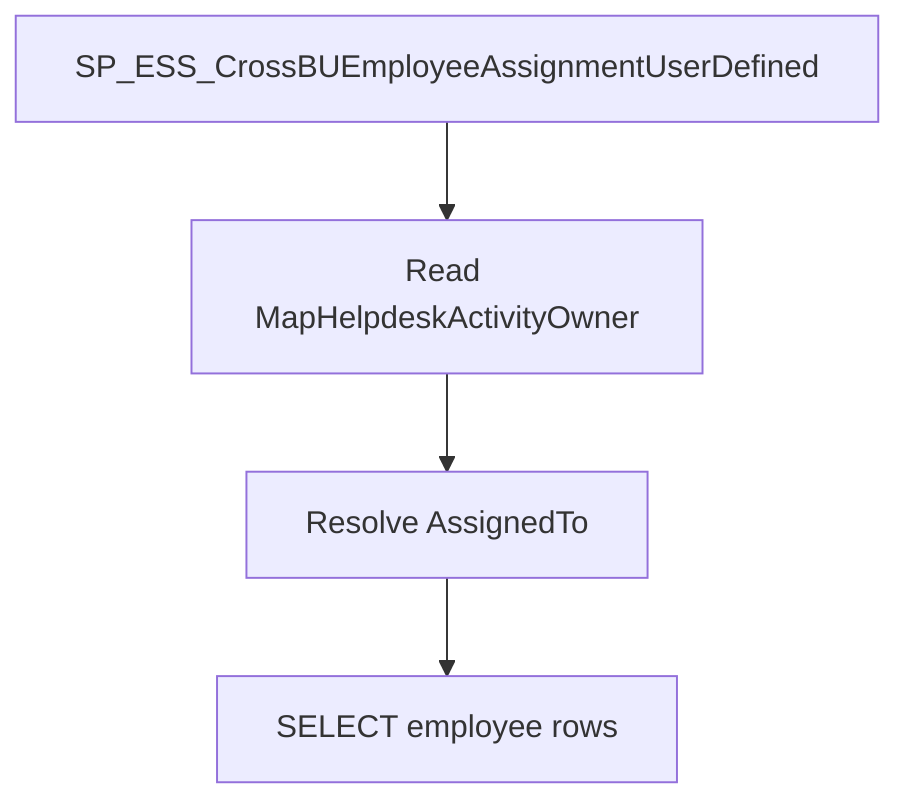

# SP_ESS_CrossBUEmployeeAssignmentUserDefined

## What it does

Returns employees available as help-desk activity owners based on customer MapHelpdeskActivityOwner setting for the Help Desk owner picker.

## Parameters

| Name | Direction | What it is for |
|---|---|---|
| `@EmployerId` | in | Employer |
| `@LoginUserId` | in | Logged-in user |
| `@GroupID` | in | Selected group |
| `@GroupCategoryID` | in | Optional category |
| `@GroupActivityID` | in | Optional activity |

## Call sequence

Calls nested procedures listed under Nested when present; otherwise runs inline SQL only.

## Callers

| Object | Kind |
|---|---|
| `EmployeeDal.GetAllEmployeeInfoForESS` | procedure |
| `ucHelpDeskRequest.ascx.cs` | application |

## Nested

Calls no other procedures or functions.

## Steps

1. Read MapHelpdeskActivityOwner from tCustomerSettings.
2. Resolve AssignedTo employee id list from group, category, or activity.
3. Return employee info for those ids.

## Tables

| Table | Read or write |
|---|---|
| `tCustomerSettings` | read |
| `THelpDeskGroup` | read |
| `THelpDeskGroup_Category` | read |
| `THelpDeskGroup_Category_Activity` | read |
| `TEmployee` | read |

## Unresolved calls

None noted for this feature pass.

## Flow

