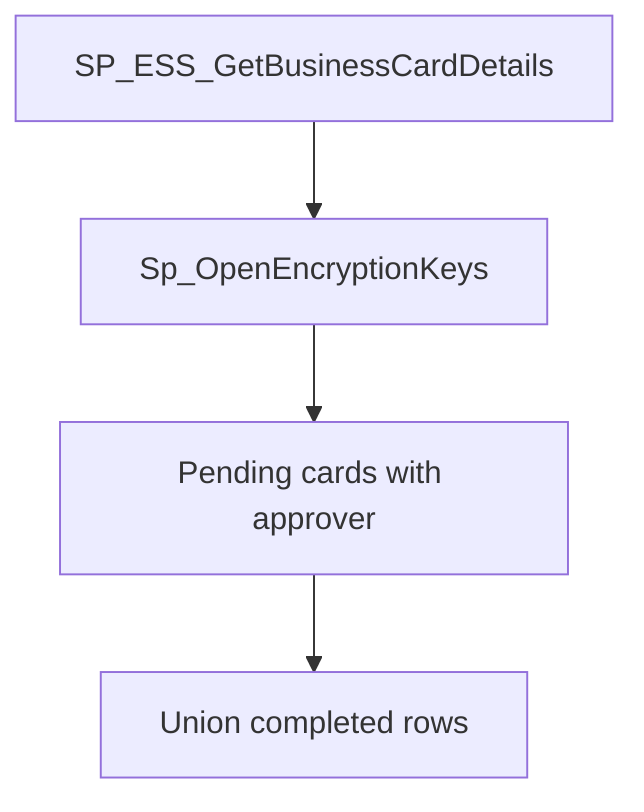

# SP_ESS_GetBusinessCardDetails

## What it does

Returns the employee business-card request status rows for the Business Card Request status grid.

## Parameters

| Name | Direction | What it is for |
|---|---|---|
| `@employeeId` | in | Employee whose requests to list |

## Call sequence

Calls nested procedures listed under Nested when present; otherwise runs inline SQL only.

## Callers

| Object | Kind |
|---|---|
| `BusinessCardDAL.GetBusinessCardDetails` | procedure |

## Nested

- [`Sp_OpenEncryptionKeys`](/docs/database/hrms/Sp_OpenEncryptionKeys)

## Steps

1. Open encryption keys.
2. SELECT pending TBusinessCards joined to pending TRequestWorkflows with Approver text.
3. UNION completed or non-pending card rows for the same employee.

## Tables

| Table | Read or write |
|---|---|
| `TBusinessCards` | read |
| `TRequestWorkflows` | read |

## Unresolved calls

None noted for this feature pass.

## Flow

