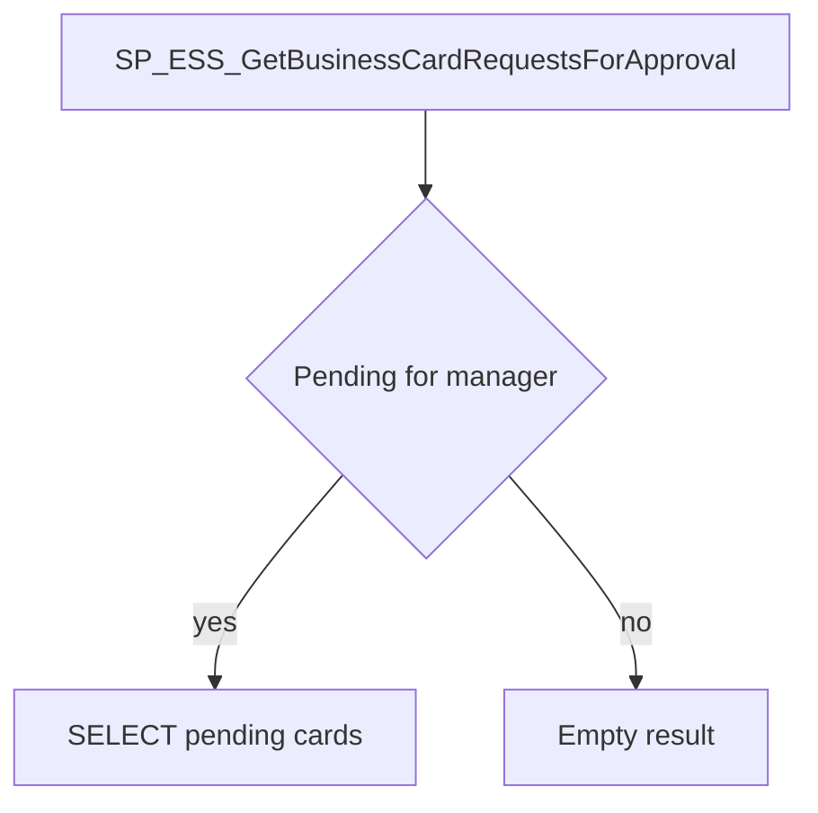

# SP_ESS_GetBusinessCardRequestsForApproval

## What it does

Lists pending business-card requests where the logged-in employee is the current workflow manager for the Notification For Me grid.

## Parameters

| Name | Direction | What it is for |
|---|---|---|
| `@EmployeeId` | in | Approver employee id |
| `@Employerid` | in | Employer scope |

## Call sequence

Calls nested procedures listed under Nested when present; otherwise runs inline SQL only.

## Callers

| Object | Kind |
|---|---|
| `BusinessCardDAL.GetBusinessCardsForApproval` | procedure |
| `ucPendingBusinessCardRequestForMe.ascx.cs` | application |

## Nested

- [`Sp_OpenEncryptionKeys`](/docs/database/hrms/Sp_OpenEncryptionKeys)

## Steps

1. Count pending BusinessCard workflow rows for this manager.
2. When count is greater than 0, SELECT distinct card fields joined to employment number and pending workflow level.

## Tables

| Table | Read or write |
|---|---|
| `TBusinessCards` | read |
| `TRequestWorkflows` | read |
| `TEmployee` | read |

## Unresolved calls

None noted for this feature pass.

## Flow

