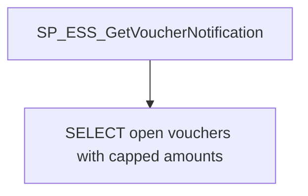

# SP_ESS_GetVoucherNotification

## What it does

Returns open vouchers the employee can still apply for with filtered VoucherAmounts honouring MaxAmount. Used by the Voucher Request picker and the Pending Vouchers notification panel.

## Parameters

| Name | Direction | What it is for |
|---|---|---|
| `@EmployerId` | in | Employer |
| `@EmployeeId` | in | Employee applying |

## Call sequence

Calls nested procedures listed under Nested when present; otherwise runs inline SQL only.

## Callers

| Object | Kind |
|---|---|
| `VoucherDAL.GetVoucherNotification` | procedure |
| `ucPendingVoucherRequestForMe.ascx.cs` | application |

## Nested

Calls no other procedures or functions.

## Steps

1. SELECT active vouchers for the employer with type name, year-month, and amount list filtered by remaining MaxAmount.

## Tables

| Table | Read or write |
|---|---|
| `TVoucher` | read |
| `TvoucherTypeMaster` | read |
| `TVoucherAmount` | read |
| `TEmployeeBenefitVoucher` | read |

## Unresolved calls

None noted for this feature pass.

## Flow

