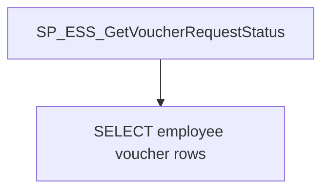

# SP_ESS_GetVoucherRequestStatus

## What it does

Lists the employee voucher applications with type name, amounts still available for edit, and request status for the Voucher Request status grid.

## Parameters

| Name | Direction | What it is for |
|---|---|---|
| `@EmployeeId` | in | Employee |

## Call sequence

Calls nested procedures listed under Nested when present; otherwise runs inline SQL only.

## Callers

| Object | Kind |
|---|---|
| `VoucherDAL.GetVoucherRequestStatus` | procedure |

## Nested

Calls no other procedures or functions.

## Steps

1. SELECT TEmployeeBenefitVoucher joined to TVoucher with remaining amount options.

## Tables

| Table | Read or write |
|---|---|
| `TEmployeeBenefitVoucher` | read |
| `TVoucher` | read |
| `TvoucherTypeMaster` | read |
| `TVoucherAmount` | read |

## Unresolved calls

None noted for this feature pass.

## Flow

